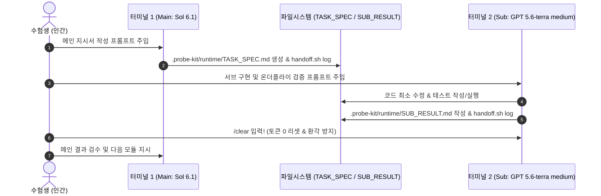

# 🧭 Cofa Probe 실전 당일 라이브 런북 (Chronological Exam-Day Runbook)

**UI,유지보수,HTML**
> **수험생 전용 안내:**  
> 이 문서는 시험 당일 분초 단위로 따라 하는 **원클릭 실전 라이브 런북**입니다.  
> **대회 진행 일정:** 3.5시간 단기형(10:00~13:30) 및 6.5시간 표준형(09:30~16:00) 일정을 완벽히 지원하며 타임라인을 병기합니다.  
> 각 단계별로 **⏱ 권장 시각**, **👉 수행 행동**, **📋 복붙용 명령어/프롬프트**, 그리고 **✅ 완료 시그널**을 엄격히 갖추고 있습니다.  
> 화면 한쪽에 이 문서를 켜두고 순서대로 복사하여 터미널과 에이전트에 입력하세요.

---

## 📑 타임라인 요약 (Timeline Overview)

> ⏱ **대회 일정 병기 안내:** 본 표는 **3.5시간 단기형(10:00~13:30)**과 **6.5시간 표준형(09:30~16:00)** 일정을 나란히 제공합니다. 6.5시간 대회 시 **[2.5단계]**에서 백그라운드 Sol 6.1 에이전트(터미널 4)를 가동하면 최대 5시간(09:40~14:40) 동안 자율 학습 트랙을 가동할 수 있습니다.

| 시각 (3.5h) | 시각 (6.5h) | 단계 | 핵심 수행 내용 | 주요 도구 / 명령어 |
| :--- | :--- | :--- | :--- | :--- |
| **10:00** | **09:30** | **[1단계]** 원클릭 하네스 설치 | 외부 Git 차단 및 하네스 자동 장착 | `git clone ... && bash init.sh` |
| **10:02** | **09:35** | **[2단계]** 환경 검증 & 듀얼 터미널 | 무토큰 EDA 확인 및 Sol/GPT 5.6-terra 분리 기동 | `git status` / `EDA_SUMMARY` / `codex` |
| **10:04** | **09:40** | **[2.5단계]** 초반 5분 (09:40) | 🧪 경량 ML 해결 가능성 10초 판별 & 백그라운드 Sol 6.1 (터미널 4) 5시간 자율 학습 가동 | `python3 .probe-kit/scripts/ml_feasibility_check.py` |
| **10:05** | **09:45** | **[3단계]** 문제 탐색 & Case 식별 | 과제 README·[CASE_SIGNAL] 분석 및 Case 1~7 식별 (및 복합 Case 9 / 신규 Case 0 분기) | 메인 프롬프트 (`NOTES_TEMP.md` 기록) |
| **10:10** | **09:55** | **[4단계]** DM 실무자 만능 질의 | 목표, 입출력, 결측/중복, 인터페이스 질의 | 우측 DM 창 (범용 템플릿) |
| **10:20** | **10:10** | **[5단계]** 케이스별 DM 질문 질의 | Case 0~7·복합 9 / #6~#15 전용 DM 질문 및 스킬 온디맨드 로드 | `.probe-kit/dm_question.md` |
| **10:25** | **10:25** | **[6단계]** 솔루션 브레인스토밍 | N단계 분할 ➔ 트레이드오프 ➔ 주도적 결정 | 3-Part 메인 프롬프트 & 결정 로깅 |
| **10:35** | **10:45** | **[6.5단계]** 구현 & 온더플라이 검증 | `TASK_SPEC` 발행 ➔ 서브 구현 ➔ `/clear` | 터미널 1 ↔ 터미널 2 핑퐁 반복 |
| **상시** | **상시** | **[7단계]** 다음 단계 전환 시그널 | ALL PASS / FAIL / Drift 상황별 액션 | 전환 시그널 판정표 |
| **12:20** | **14:40** | **[8단계]** 마무리 검증 & 사전 감사 | 🏆 알고리즘 vs 백그라운드 ML 챔피언 비교·채택 + 표본 검증 + 8대 사전 감사(requirements.txt AST 자동 검사 포함) | `python3 .probe-kit/scripts/ml_feasibility_check.py --compare <내_알고리즘_출력파일> .probe-kit/ml_track/ml_submission_ready.csv` / `sample_check_*.py` / `pre_submit_audit.py` |
| **12:45** | **15:30** | **[9단계]** 실무자 DM 최종 완료 보고 | 검증 결과 보고 및 만족도 확인 요청 | 메인 초안 작성 ➔ 우측 DM 전송 |
| **12:47** | **15:35** | **[10단계]** 제출 보고서 3대 요소 점검 | [판단·근거]-[검증]-[남은 한계] 점검 | 메인 보고서 검토 프롬프트 |
| **12:50** | **15:45** | **[11단계]** 보안 취약점 전수 점검 | API 키, 0.0.0.0 바인딩, 로그 누출 점검 | 메인 보안 감사 프롬프트 |
| **12:52** | **15:50** | **[12단계]** 오버엔지니어링 점검 & 제출 | 불필요 라이브러리 배제 ➔ 마감 5분 전 칼제출 | 메인 점검 ➔ 최종 제출 |
| **상시** | **상시** | **[13]** 비상 상황 트러블슈팅 | 막히면 3분 우회, 핑퐁·환경 장애 즉각 해결 | 13. 트러블슈팅 표 / 플레이북 |

---

## 1단계: ⏱ 10:00 (시험 시작 0초) | 👉 원클릭 하네스 클론 및 초기화

시험 시작 버튼을 누르고 안경/신분증 확인을 마친 즉시, 워크스페이스 터미널을 열고 아래 1줄 명령어를 복사하여 실행합니다.

```bash
git clone https://github.com/chichochoi/sk.git /tmp/probe-kit && bash /tmp/probe-kit/init.sh
```

> ⚠️ **웹 터미널 붙여넣기 주의:** 웹 터미널에서 붙여넣기는 반드시 `Ctrl+Shift+V`(또는 마우스 우클릭 > 붙여넣기)를 쓰고 `Ctrl+V`는 절대 쓰지 마세요. `Ctrl+V`를 누르면 `^[[200~`, `\026` 같은 제어 문자가 명령어 앞에 붙어 `command not found` 오류가 발생합니다.

### 🔍 스크립트 자동 실행 내역 (총 6단계 순서)
1. **[1/6] 외부 git push 원천 차단 (보안 안전장치):** 하네스를 클론한 직후(기본 `/tmp/probe-kit` 또는 `<workspace>/.probe-kit` 직접 클론 모두 지원), 원본의 **`.git` 디렉토리를 즉시 삭제**하여 시험 중 외부 GitHub으로의 `git push` 사고를 원천 차단합니다.
2. **[2/6] probe-kit 하네스 파일을 워크스페이스(.probe-kit)로 배포:** 하네스 파일들을 워크스페이스 내부(`.probe-kit`)로 안전하게 배치하고 실행 권한(`chmod +x`)을 부여합니다.
3. **[3/6] 워크스페이스 Git 오염 방지 (.git/info/exclude) 등록:** `.git/info/exclude`에 `/.probe-kit`, `/runtime/`, `/NOTES_TEMP.md`, `/TASK_SPEC.md`, `/SUB_RESULT.md`, `/EDA_SUMMARY.txt`, `/HANDOFF.md` 등을 등록하여, **과제 저장소의 Git 형상(`.gitignore` 포함)을 전혀 더럽히지 않고 100% 격리**합니다. (워크스페이스가 비-Git 디렉토리인 경우 경고와 함께 안전하게 건너뜁니다)
4. **[4/6] 런타임 버퍼 보장 및 실시간 메모장/인수인계서 준비:** `templates/NOTES.md`를 워크스페이스 루트의 `NOTES_TEMP.md`로, `templates/HANDOFF.md`를 `.probe-kit/runtime/HANDOFF.md`로 안전하게 복사합니다. (기존 파일이 있으면 덮어쓰지 않고 보존)
5. **[5/6] 워크스페이스 구조 및 데이터 무토큰 초기 스캔:** `eda_scan.py`를 무토큰(0 Token)으로 실행하여 데이터 및 테스트 파일 현황을 `.probe-kit/runtime/EDA_SUMMARY.txt`에 자동 생성합니다.
6. **[6/6] Codex 글로벌 하네스(~/.codex) 및 모델 프리셋 설정 (마지막 / 선택적 Non-fatal):** 글로벌 설정 디렉토리(`~/.codex`)에 `AGENTS.md`(메인 헌법), `SUB_AGENTS.md`(서브 헌법), `config.toml`을 설치합니다. 이 단계는 **선택적(Non-fatal)**으로 동작하여, 환경에 따라 권한 오류(`Permission denied`)가 발생해도 경고만 출력하고 정상 통과합니다. (이 경우 에이전트 프롬프트 첫 줄에서 `.probe-kit/AGENTS.md` / `SUB_AGENTS.md`를 명시적으로 읽도록 안내합니다)

✅ **완료 시그널:**
터미널에 다음 메시지가 출력되면 정상 완료입니다:
```text
=== [6/6] Codex 글로벌 하네스(~/.codex) 및 모델 프리셋 설정 ===
...
🎉 [probe-kit] 메인(Sol 6.1 xhigh) × 서브(GPT 5.6-terra medium) 하네스 설치 완료!
```

---

## 2단계: ⏱ 10:02 ~ 10:05 | 👉 환경 검증 및 듀얼 터미널 분리 기동

하네스 설치 직후 워크스페이스 격리 상태와 무토큰 EDA 요약을 확인하고, 메인과 서브 터미널을 분리합니다.

```bash
# 1. Git 격리 검증 (Untracked files에 .probe-kit, NOTES_TEMP.md 등이 나타나지 않아야 함)
git status

# 2. 무토큰 데이터/코드 구조 요약 및 [CASE_SIGNAL] 확인
cat .probe-kit/runtime/EDA_SUMMARY.txt

# 3. Handoff 로깅 동작 검증 (에이전트가 실행되는 터미널과 같은 셸에서 확인)
bash .probe-kit/scripts/handoff.sh log "검증" "하네스 환경 검증" || python3 .probe-kit/scripts/handoff.py log "검증" "하네스 환경 검증"

# 4. 기존 프로젝트 베이스라인 테스트 1회 사전 실행 (초기 건강 상태 확인)
pytest || npm test || python3 -m unittest discover || echo "기존 단위 테스트 스위트 없음 (확인 완료)"
```

> ⚠️ **웹 터미널 붙여넣기:** 터미널 명령어 입력 시 `Ctrl+V` 대신 반드시 `Ctrl+Shift+V`(또는 우클릭 > 붙여넣기)를 사용하세요.  
> 💡 **비-Git 워크스페이스 안내:** 워크스페이스가 Git 저장소가 아닌 일반 디렉토리(예: `/home/user`)인 경우, `init.sh`에서 `.git/info/exclude` 등록 단계가 경고와 함께 안전하게 건너뛰어집니다(정상 동작). 이 경우 `git status` 격리 확인은 생략하고 바로 `cat .probe-kit/runtime/EDA_SUMMARY.txt`부터 확인하세요.  
> 💡 **[CASE_SIGNAL] 단서 포착:** `EDA_SUMMARY.txt` 상단과 데이터 요약에서 파일명, 컬럼 목록, 결측치 센티널(`-999`, `< DL`), 좌표 컬럼(`x`, `y`, `dx`, `dy`) 등의 시그널을 확인하여 이번 과제가 Case 1~7 중 어느 방향인지 1차 감을 잡습니다.
> 💡 **Handoff 실행 규칙:** handoff 로그는 에이전트가 실행되는 터미널과 같은 셸에서 실행. bash가 실패하면(WSL E_ACCESSDENIED 등) `python3 .probe-kit/scripts/handoff.py log "<step>" "<msg>"` 사용. 그래도 안 되면 runtime/HANDOFF.md 표에 직접 한 줄 추가.

### 🖥️ 듀얼 터미널 기동 및 모델 선택

단일 터미널에서 대화를 지속하면 컨텍스트 오염과 토큰 폭발로 후반부에 치명적인 환각이 발생합니다. 반드시 **터미널을 2개로 분리**하세요.

```bash
# [터미널 1 - 메인 아키텍트 전담]
codex
# Codex 진입 후 명령어 실행:
/status
/model
# 모델 목록에서 [Sol 6.1 (xhigh)] 선택 (sol-6.1, reasoning xhigh)
```
> **절대 원칙 (메인):** 메인에게는 비즈니스 소스 코드를 직접 짜게 하지 않습니다. 오직 아키텍처 진단, 요구사항 구조화, 작업 명세서(`.probe-kit/runtime/TASK_SPEC.md`) 작성, 서브 결과 검수만 시킵니다.

```bash
# [터미널 2 - 서브 워커 전담] (터미널 우측 상단 '+' 버튼으로 새 탭 열기)
codex
# Codex 진입 후 명령어 실행:
/status
/model
# 모델 목록에서 [GPT 5.6-terra medium] 선택 (gpt-5.6-terra, reasoning medium)
```
> **절대 원칙 (서브):** 서브는 `TASK_SPEC.md`에 지정된 파일만 최소 수정하고, 온더플라이 테스트를 실행하여 `SUB_RESULT.md`를 작성한 뒤 **반드시 `/clear`로 초기화**합니다.
> 
> ⚠️ **주의:** `Astra` 모델이나 자동 화면 조작(`Computer Use`)은 규정상 금지되어 있으며 사용 시 실격 처리됩니다.

✅ **완료 시그널:**
`git status` 출력 시 하네스 파일이 노출되지 않고, `EDA_SUMMARY.txt`에서 컬럼/테스트 파일 목록 및 `[CASE_SIGNAL]` 단서를 확인했으며, 터미널 1(`Sol 6.1 xhigh`)과 터미널 2(`GPT 5.6-terra medium`)가 대기 상태인 것. (진행 중 문제가 발생하면 [13. 비상 상황 트러블슈팅](#13-비상-상황-트러블슈팅-if-something-breaks) 참조)

---

## 2.5단계: ⏱ 10:04 (6.5h 기준 09:40) | 🧪 (초반 3분 컷) Sol 6.1 LLM 주도 ML 해결 가능성 직접 판단 & 5시간 백그라운드 자율 학습 가동

시험 시작 직후(09:40 또는 10:04), 이번 과제를 머신러닝(ML)으로도 해결할 수 있는지 **스크립트가 아니라 터미널 4의 `Sol 6.1` LLM이 30초 만에 직접 판단**하고, 적합 판정 시 백그라운드에서 5시간 무인 자율 학습을 수행하도록 가동합니다.

### 1) 2초 하드웨어·환경·데이터 팩트 프로파일 생성 (터미널 3 — Bash 전용 창)

터미널 3(Bash)에서 아래 1줄 명령어를 복사하여 실행합니다:

```bash
python3 .probe-kit/scripts/ml_feasibility_check.py
```

이 명령어는 2초 만에 다음 작업을 **100% 안전한 Read-Only(3중 try-except 에러 방어)**로 완료합니다:
- 하드웨어 스펙(CPU 코어수, RAM 용량, GPU 유무) 및 파이썬 ML 패키지 설치 현황 진단
- 과제 워크스페이스 내 데이터 파일 목록, 총 행수, 용량, 타깃 후보군 스캔
- 데이터 파일별 컬럼 상세 프로파일 표(컬럼명, 추정 타입, 결측률%, 고유값 수, 센티널 감지 여부, 실제 샘플 값 3~5개)를 `.probe-kit/ml_track/FEASIBILITY_SUMMARY.txt`에 풍부하게 생성
- **⚠️ 중요:** 스크립트는 객관적 팩트 수집기(Profiler)일 뿐이며, **실제 경량 ML 적용 가능 여부(최종 GO/SKIP 판정, 예상 학습 시간, 데이터 경량화 전략)는 터미널 4의 `Sol 6.1` LLM이 README.md(문제 요구사항/평가지표)와 이 프로파일을 함께 읽고 직접 판단**합니다!

---

### 2) Sol 6.1 LLM이 직접 심사하는 8대 진입 조건 (Phase 0 심층 심사표)

터미널 4의 `Sol 6.1` LLM이 기동 직후 아래 8대 조건을 직접 심사하여 스스로 GO / SKIP을 결정합니다:

| 조건 번호 | 조건명 | 상세 판별 기준 (Sol 6.1 LLM 심사 기준) |
| :--- | :--- | :--- |
| **조건 1** | **문제의 경량 ML 해결 가능성** | 단순 규칙/UI 구현 문제가 아니라 경량 ML(GBDT, RF, Ridge)로 풀 수 있는 문제이며, 학습 가능한 타깃(`y`) 또는 목적함수가 존재하는가? |
| **조건 2** | **학습 시간 견적 (6.5h 기준)** | 현재 하드웨어/데이터 규모에서 1회 학습이 몇 초(또는 몇 분, 최대 3분 이내) 걸릴지 추산하고, 5시간 내에 경량화·피처 탐색·CV·앙상블 완주가 가능한가? |
| **조건 3** | **데이터셋 크기·형식·표본 수** | 학습 표본 수 $N \ge 50$행 이상이며, 데이터 크기가 메모리 용량 내에 안전하게 적재되는가? |
| **조건 4** | **데이터셋 자체 경량화 가능성** | FEASIBILITY_SUMMARY.txt를 읽고 핵심 변수(Keep) 보존 및 노이즈(Drop) 제거, 다운캐스팅, 대규모 시 20% 코어셋 경량화가 가능한가? |
| **조건 5** | **추론 시간 SLA & 모델 용량** | 전체 테스트셋 추론이 5초 내에 끝나고(`추론 SLA < 5초`), 제출 용량 제한을 넘지 않는가(`용량 < 10MB`)? |
| **조건 6** | **하드 제약조건 후처리 결합성** | 버스 정원, 예산, 비음수, 규격 상하한 등 하드 제약을 **"ML 예측 + 결정론적 클램핑 후처리"**로 100% 방어할 수 있는가? |
| **조건 7** | **파일·CPU 완전 격리** | 메인 트랙과 충돌하지 않게 **`.probe-kit/ml_track/` 내부에만** 파일을 쓰고, CPU 스레드 제한(`OMP_NUM_THREADS=2`, `n_jobs=2`)을 준수하는가? |
| **조건 8** | **동일 지표 챔피언 비교 가능성** | 후반(8단계)에 `--compare` 한 줄로 메인 알고리즘 결과와 1:1 비교 및 앙상블 블렌딩 채택이 가능한가? |

---

### 3) 터미널 4 가동 및 30초 자율 판정 흐름 (가장 명쾌한 3단계 진행법)

1. **터미널 4 (`Sol 6.1 xhigh`) 열기:**  
   터미널 창 우측 상단 `+` 버튼을 눌러 새 탭을 열고 `codex`를 실행한 뒤 모델을 **`Sol 6.1 (xhigh)`**로 설정합니다:
   ```bash
   codex
   /status
   /model
   # 모델 목록에서 [Sol 6.1 (xhigh)] 선택 (sol-6.1, reasoning xhigh)
   ```
2. **아래 `[AutoML 프롬프트 1]` 복사 & 붙여넣기:**  
   아래 코드블록을 복사해 터미널 4에 주입하고 엔터를 칩니다.
3. **Sol 6.1 LLM의 30초 자율 판단 및 자동 분기:**  
   터미널 4의 `Sol 6.1` LLM이 `README.md`와 `FEASIBILITY_SUMMARY.txt`를 읽고 **30초 만에 스스로 판단**합니다:
   - ❌ **`[LLM 최종 판정: SKIP (ML 부적합)]` 판단 시:** 스스로 사유를 브리핑하고 **즉시 세션을 종료하고 멈추므로**, 터미널 4를 닫고 평소대로 [3단계: 문제 탐색 및 Case 식별](#3단계-⏱-1005--1010-65h-기준-0945--0955--과제-지시서readmemd-탐색-및-case스킬-식별)로 가면 됩니다.
   - ✅ **`[LLM 최종 판정: GO (ML 해결 가능)]` 판단 시:** 예상 학습 시간과 계획을 출력한 뒤 **인간 사용자의 추가 승인 없이 곧바로 백그라운드에서 데이터 경량화 ➔ 학습 ➔ 검증 ➔ 최종 예측 파일 생성까지 최대 5시간 동안 알아서 진행**합니다. 창을 최소화해 두고 [3단계](#3단계-⏱-1005--1010-65h-기준-0945--0955--과제-지시서readmemd-탐색-및-case스킬-식별)로 가서 메인 알고리즘 루트를 진행하세요!

#### 📋 [AutoML 프롬프트 1 — 터미널 4 (Sol 6.1 xhigh)] LLM 적격성 직접 판단 & 5시간 자율 학습 통합 지시
> **용도:** 시험 시작 직후(09:40 또는 10:04) 또는 `FEASIBILITY_SUMMARY.txt` 생성 직후, 독립된 터미널 4 탭을 열고 `codex` 기동 후 주입하여 Phase 0(자율 심층 판정)부터 Phase 4(최종 패키징)까지 가동합니다.
> **질문을 다 하고 쓰자.**

```text
[AUTOML_SHADOW_TRACK]
너는 메인 트랙과 완전히 격리된 독립 백그라운드 머신러닝 및 경량 회귀모델(OLS·다항회귀·Ridge·Huber 등) 탐색 에이전트(Sol 6.1 xhigh)야.
스크립트의 단순 추정에 의존하지 않고, 네가 직접 과제 지시서(README.md)와 환경/데이터 프로파일(.probe-kit/ml_track/FEASIBILITY_SUMMARY.txt)을 읽고 ML 및 간단한 회귀모델 적격성(GO/SKIP)을 직접 판단해야 해. 거창한 트리 기반 ML뿐만 아니라, 간단한 선형/다항 회귀식 피팅이나 이상치 강건 회귀(Robust Regression), 또는 메인 수식의 잔차(Residual) 회귀 보정만으로도 유효한 해법이 될 수 있는지까지 반드시 살펴보고, 적합할 경우 인간 사용자의 추가 개입 없이 최대 5시간 동안 데이터 경량화, 피처/수식 항 생성, 회귀/ML 모델 튜닝, 앙상블 블렌딩, 하드 제약 후처리, 최종 패키징까지 자율 완수해야 해.

먼저 다음 파일들을 정독해:
1. .probe-kit/skills/case8_lightweight_automl_track.md (절대 헌법 및 5-Phase 자율 루프)
2. .probe-kit/ml_track/FEASIBILITY_SUMMARY.txt (하드웨어/환경 스펙 및 데이터 컬럼 상세 프로파일)
3. 워크스페이스 루트의 README.md (과제 목표 및 채점 지표)
4. NOTES_TEMP.md(DM과의 질의응답 내용)

반드시 다음 [절대 격리 & 리소스 보호 헌법]을 준수해:
- [Strict Read-Only]: 워크스페이스 루트의 기존 파일(src/, main.py, app/, tests/, README.md, TASK_SPEC.md 등)과 원본 데이터셋은 절대 수정/삭제하지 마.
- [완전 격리 샌드박스]: 모든 중간 전처리 데이터, 실험 코드, 모델 체크포인트, 최종 산출물은 반드시 .probe-kit/ml_track/ 내부에만 생성해.
- [CPU/RAM Throttling]: 메인 터미널의 응답성을 위해 모든 파이썬 스크립트 최상단에 OMP_NUM_THREADS="2", MKL_NUM_THREADS="2"를 강제 설정하고, 모든 모델 파라미터에 n_jobs=2를 고정해. 쉘 명령 실행 시 nice -n 10을 붙여 실행해.

[자율 수행 시퀀스 (Phase 0 ~ Phase 4)]:
0. Phase 0 (0~2분, Sol 6.1 LLM 주도 8대 조건 적격성 심층 판정 및 GO/SKIP 자율 분기):
   - README.md와 FEASIBILITY_SUMMARY.txt, NOTES_TEMP.md를 바탕으로 아래 8대 조건을 직접 심사해:
     ① 문제의 경량 ML 또는 간단한 회귀모델(OLS/다항회귀/Ridge/Lasso/Huber 강건회귀/잔차 보정) 해결 가능성 (타깃 y, 연속형 수치 추정, 물리/공정 파라미터 피팅, 또는 메인 알고리즘 오차 보정 가능 여부 — ※ 복잡한 트리 ML이 안 맞아도 간단한 선형/다항 회귀나 통계 피팅이 유의미하면 무조건 충족으로 판정!),
     ② 학습 시간 견적(1회 3분 이내 & 5시간 완주 가능 여부),
     ③ 데이터 크기/표본 수 적합성 (대용량은 트리/앙상블 ML로, 소표본·물리 수식 데이터는 과적합 없는 단순 선형/다항/정규화 회귀모델로 대응 가능 여부),
     ④ 데이터 자체 경량화 가능성, ⑤ 추론 SLA(<5초) 및 아티팩트 용량(<10MB), ⑥ 하드 제약 후처리 클램핑 결합 가능성, ⑦ .probe-kit/ml_track/ 완전 격리 및 CPU 스레드 제한(2코어) 준수, ⑧ 동일 평가지표 1:1 비교 가능성.
   - [분기 행동]:
     ❌ 조건 미충족 시 (SKIP): 간단한 회귀식 피팅조차 전혀 쓸 수 없는 문제일 때만 콘솔 및 .probe-kit/ml_track/CHAMPION_REPORT.md에 [LLM 최종 판정: ❌ SKIP (ML/회귀 모두 부적합) — 사유: ...]를 명확히 기록하고 즉시 세션을 종료해 리소스/토큰 낭비를 차단해.
     ✅ 조건 통과 시 (GO): 콘솔에 [LLM 최종 판정: ✅ GO — 예상 1회 학습 시간: 약 X초(분), 채택 모델 계열: (단순 회귀 피팅 / 경량 트리 ML / 하이브리드), 경량화 전략: Z]를 출력하고, 사용자 승인 대기 없이 즉시 Phase 1으로 진입해!
1. Phase 1 (통과 시 LLM 주도 도메인 맞춤형 데이터 경량화 & 자기디버깅): 무작정 기계적 규칙으로 컬럼을 버리지 마. 먼저 README.md(문제 요구사항)와 .probe-kit/ml_track/FEASIBILITY_SUMMARY.txt(컬럼별 결측률·고유값·샘플값) 및 원본 데이터 샘플을 직접 읽고, 도메인 관점에서 ① 예측 타깃(y), ② 테이블 조인/그룹 키(Key), ③ 결측이 많아도 반드시 살려야 할 핵심/희소 도메인 변수(Keep), ④ 단순 일련번호/해시/데이터 누수 변수(Drop)를 직접 판단해. 그 후 이 데이터셋 구조와 인코딩에 딱 맞는 경량화 스크립트(.probe-kit/ml_track/compact_data.py)를 작성해서 실행하고, 만약 파싱/타입/메모리 에러가 발생하면 즉시 에러 로그를 보고 코드를 수정(Self-Healing)하여 .probe-kit/ml_track/data_compact/ 안에 고속 포맷(.pkl/.parquet/float32 또는 정제된 CSV, 대용량일 경우 고속 탐색용 20% 층화 코어셋 포함)으로 안전하게 저장해. 그런 다음 타깃 특성에 맞는 누수 없는 K-Fold(Stratified/TimeSeries/Group)를 구축해 가장 단순한 회귀/베이스라인 점수를 .probe-kit/ml_track/leaderboard.json 에 기록해.
2. Phase 2 (20~120분): N > 30,000일 경우 20% Coreset을 활용하고, 소표본일 경우 전체 데이터를 활용해 도메인 수식 기반 회귀 항(다항식 거듭제곱/교호작용항 x*y, 로그 변환) 및 파생 피처(비율/차이/그룹통계량/Lag/OOF Target Encoding)를 생성하고, CV 점수가 상승한 피처만 영구 채택(Forward Selection)해.
3. Phase 3 (120~240분):
   - [간단한 회귀모델 탐색]: 먼저 해석 가능하고 외삽(Extrapolation)에 강한 전통 회귀모델(OLS 선형/다항회귀, Ridge, Lasso, ElasticNet, 이상치에 강건한 HuberRegressor)을 정밀 피팅해 살펴봐.
   - [경량 ML 탐색]: HistGradientBoosting, RandomForest 등 비선형 트리 모델을 튜닝해.
   - Out-of-Fold(OOF) 예측값을 비교하여 간단한 회귀모델만으로 충분하면 과적합 없는 회귀식을 채택하고, 결합 시 성능이 오르면 최적 가중치 블렌딩(회귀 + 트리 ML) 앙상블을 구축해 단일 모델 대비 성능 개선을 확인해. (20% Coreset으로 최적화한 상위 모델은 100% Full 데이터셋으로 최종 재학습)
4. Phase 4 (240~300분):
   - 예측값이 문제의 물리적/비즈니스 제약(비음수, 상하한 규격, 정수 제약)을 100% 만족하도록 post_process_constraints() 후처리를 강제 적용해.
   - 전체 테스트셋 추론 시간 < 3초 및 아티팩트 용량 < 10MB를 확인해.
   - 최종 4대 산출물을 .probe-kit/ml_track/ 에 생성하고 대기 상태로 들어가:
     1) ml_submission_ready.<csv|json> (즉시 제출 가능한 최종 예측 결과)
     2) ml_solution.py (메인 파이프라인 1분 교체용 predict_solution(df) 함수 모듈 — 회귀식 계수 또는 경량 모델 내장)
     3) leaderboard.json (전체 실험 히스토리 및 CV 점수 변천사)
     4) CHAMPION_REPORT.md (베이스라인 대비 오차 감소율, 회귀식/상위 피처 Top 5, 하드 제약 통과 여부, 1줄 채택 쉘 명령어, 사후 질의용 [결정]-[근거]-[검증]-[한계] 4문장 요약)

지금 즉시 Phase 0 심사에 착수해.
```

✅ **완료 시그널:**  
- **SKIP 판정 시:** 터미널 4의 Sol 6.1이 ML 부적합 사유를 기록하고 즉시 멈춤 ➔ 터미널 4 닫고 즉시 3단계 착수 완료  
- **GO 판정 시:** 터미널 4에서 예상 학습 시간 브리핑 후 Phase 1~4 백그라운드 5시간 자율 트랙이 돌기 시작하고, 터미널 1·2·3은 평소대로 3단계 착수 완료.

---

## 3단계: ⏱ 10:05 ~ 10:10 (6.5h 기준 09:45 ~ 09:55) | 👉 과제 지시서(README.md) 탐색 및 Case·스킬 식별

과제 루트의 문제 지시서(`README.md`)와 `.probe-kit/runtime/EDA_SUMMARY.txt` 상단의 `[CASE_SIGNAL]`을 메인 에이전트가 읽고 어떤 Case에 해당하는지 판별하도록 지시합니다.  
*(⚠️ 주의: 키트의 README가 아니라 **시험장 과제 루트의 문제 README.md**를 읽게 해야 합니다.)*

### 📋 [메인 프롬프트 1 — Sol 6.1 xhigh] 초기 탐색, Case 분류(단일/혼합/신규) 및 아키텍처 구조화

터미널 1 (`Sol 6.1 xhigh`)에 아래 프롬프트를 복사하여 입력합니다:

```text
[MAIN] 먼저 .probe-kit/AGENTS.md를 읽고 그 규칙을 따라줘.
아직 비즈니스 코드는 절대 작성하거나 수정하지 마.
현재 워크스페이스 루트에 있는 과제 지시서(README.md)와 .probe-kit/runtime/EDA_SUMMARY.txt 상단의 [CASE_SIGNAL] 및 주요 설정/인터페이스 파일 구조만 최소한의 토큰으로 확인해서 다음 사항을 핵심 위주로 간결하고 명확하게 브리핑하고 워크스페이스 루트의 NOTES_TEMP.md 에 기록해줘: (키트 내부 README가 아닌 과제 문제 지시서여야 함)
1. EDA_SUMMARY.txt 상단의 [CASE_SIGNAL] 및 과제 지시서(README.md)를 분석하여 이번 과제를 아래 3가지 중 하나로 분류해줘:
   - [단일형 (Case 1~7)]: 가장 일치하는 Case 1개와 SK하이닉스 도메인 아키타입(#6~#15 직무) 매칭
   - [혼합형 (Case 9, 예: 알고리즘/데이터 파이프라인 + 웹 UI/RAG 등)]: 주력(Primary) Case 1개 + 보조(Secondary) Case 1개를 결합 매칭하고, 반드시 "Step 1: 백엔드 코어 엔진/데이터 출력 완성 및 단독 검증 ➔ Step 2: 프론트엔드 UI/API 결합" 순서의 Core-First 아키텍처로 설계
   - [완전 신규 유형 (Novel Case 0 — 기존 Case 1~7에 없는 새로운 문제)]: 억지로 기존 스킬에 끼워 맞추지 말고 전용 스킬(.probe-kit/skills/case0_novel_first_principles.md)을 바탕으로 [제1원칙 분해(First-Principles Decomposition)]를 가동하여 ① 채점기 입출력 계약(I/O Contract), ② 위반 시 0점 되는 Hard 제약 vs 점수 극대화 Soft 목적함수, ③ 15분 내 동작하는 최소 베이스라인(Tier 1) ➔ 핵심 알고리즘 고도화(Tier 2) ➔ 엣지케이스 방어(Tier 3)의 3-Tier 계획으로 직접 구조화
2. 스킬 및 DM 질문 선택:
   - [단일형 (Case 1~7) / 혼합형 (Case 9)]: 매칭된 전용 스킬 파일(.probe-kit/skills/case1~7_*.md) 최대 1~2개만(혼합형의 경우 최대 4개) 온디맨드로 읽고, .probe-kit/dm_question.md에서 복사할 정확한 섹션/카드 명칭을 출력해줘.
   - [완전 신규 유형 (Novel Case 0)]: 억지로 기존 스킬을 읽지 말고 .probe-kit/skills/case0_novel_first_principles.md 스킬 1개만 온디맨드로 읽은 뒤, .probe-kit/dm_question.md의 "## Case 0. 완전 신규 미출제 유형" 섹션 안내와 함께 과제 README.md의 모호한 정책/제약/예외처리를 파고드는 [실무자 전송용 맞춤형 DM 질문 10개] 및 [자체 표본 검증 스크립트(tests/custom_sample_check.py) 설계안]을 이 브리핑에 즉시 출력해줘.
3. 과제 요구사항 요약 (필수 제출 파일명, 입출력 포맷, 대상 파일 범위)
4. 절대 변경하면 안 되는 기존 시스템의 불변 제약 조건 (인증 방식, API 규격, 함수 시그니처, 파일 경로 등)
5. 불필요한 오버엔지니어링을 배제하고, 서브 에이전트(GPT 5.6-terra xhigh)에게 단계별로 위임할 최소 핵심 기능(MVP) 모듈 분할 계획 (Step 1, Step 2, Step 3)
6. 기존 단위 테스트 스위트가 존재한다면 사전 베이스라인 실행 결과(PASS/FAIL 및 실패 내역)도 NOTES_TEMP.md에 함께 기록해줘.
7. [ML 트랙 적합성 교차 의견]: 과제 요구사항(README.md)과 데이터 구조로 볼 때 백그라운드 경량 ML/하이브리드 모델(터미널 4) 적용이 유의미한지(GO/SKIP) 한 줄 의견
브리핑과 NOTES_TEMP.md 기록이 끝나면 터미널에서 다음 명령어를 실행해줘:
bash .probe-kit/scripts/handoff.sh log "탐색" "Case 식별 및 초기 분석 완료"
(실패 시 `python3 .probe-kit/scripts/handoff.py log "탐색" "Case 식별 및 초기 분석 완료"` 사용. 그래도 안 되면 runtime/HANDOFF.md 표에 직접 한 줄 추가)
```

> [!TIP]
> **💡 [참고] 만약 과제가 혼합형(Case 9)이거나 아예 처음 보는 신규 유형(Case 0)이라면?**  
> 1. **혼합형 (Case 9):** 백엔드 코어 연산/데이터 정합성(Step 1)을 먼저 완성 및 표본 검증한 뒤, 프론트엔드 UI/API(Step 2)를 결합하는 Core-First 순서로 진행합니다.  
> 2. **완전 신규 유형 (Novel Case 0):** 억지로 기존 케이스에 맞추지 말고 제1원칙(입출력 계약 ➔ 0점 방지 Hard 제약 ➔ 3-Tier 점수 최적화)으로 분해합니다.  
> 3. **맞춤형 DM 질문:** 기존 카드가 안 맞을 경우 메인이 생성해 준 3개 DM 질문으로 실무자의 예외 처리 정책을 캐내어 공략합니다.

### 🗺️ 1-Page Quick Router (Case 0~7, 복합 Case 9 및 백그라운드 Case 8 즉시 매핑표)

`EDA_SUMMARY.txt` 상단의 `[CASE_SIGNAL]` 및 과제 지시서의 키워드를 대조하여, 로드할 스킬과 DM 질문, 검증 도구를 즉시 결정합니다:

| 키워드 / 데이터 특징 | 추정 과제 / 페르소나 | 로드할 스킬 (`.probe-kit/skills/...`) | DM 질문 섹션 (`.probe-kit/dm_question.md`) | 검증 스크립트 |
| :--- | :--- | :--- | :--- | :--- |
| **Case 0**<br>기존 Case 1~7과 50% 이상 불일치하는 신규 미출제 유형 (커스텀 시뮬레이터, 게임/상태머신 규칙 엔진, 신규 그래프/파서 등) | 완전 신규 도메인 과제 (제1원칙 분해 모드) | `case0_novel_first_principles.md` | `dm_question.md`<br>▶ **Case 0 섹션** + 터미널 1이 즉석 생성한 **맞춤 DM 질문 3개** | `python3 tests/custom_sample_check.py`<br>+ `python3 .probe-kit/scripts/sample_check_template.py <산출물경로>` |
| **Case 1**<br>CSV/JSON, wafer_id, lot_id, 센티널(-999), 결측치·중복행, 수율(Yield), 배치 집계·정제 | 범용 제조 데이터 정제, 수율 판정, 배치 집계 파이프라인 | `case1_data_pipeline.md` | `dm_question.md`<br>▶ **Case 1 섹션** (행 정의, 결측/중복, 경계값, 집계 단위) | `python3 .probe-kit/scripts/sample_check_template.py`<br>(또는 `--demo`) |
| **Case 2**<br>Web/HTML, REST API, 대시보드, 등록/수정 폼, 단일 유저 동선 MVP, 0.0.0.0 바인딩 | 사내 운영 웹 서비스, 현황 모니터링 대시보드 구축 | `case2_web_service.md` | `dm_question.md`<br>▶ **Case 2 섹션** (핵심 유저 동선, 권한/인증, API 불변, 영속성) | `0.0.0.0:포트` 바인딩 + `curl` / 플랫폼 내장 Browser 직접 클릭·조작 |
| **Case 3**<br>기존 `tests/`, 레거시 코드베이스, API 엔드포인트 유지, 하위 호환성, Zero Regression | 기존 레거시 시스템 버그 픽스, 신규 파라미터/기능 확장 | `case3_legacy_debug.md` | `dm_question.md`<br>▶ **Case 3 섹션** (인터페이스 불변, 기존 실패 테스트 분별, 회귀 방지) | `pytest` / `npm test`<br>(베이스라인 100% PASS 유지) |
| **Case 4**<br>규정집/매뉴얼(PDF/TXT/MD), RAG, 업무 자동화, 수동 검토 큐, Strict Grounding, 환각 거절 | 사내 복지/인사 규정 판정기, 정책 대안 비교 보고서 | `case4_policy_rag_doc.md` | `dm_question.md`<br>▶ **Case 4 섹션** (업무 자동화 경계, 수동 검토 큐, 규정 충돌 우선순위) | 테스트 쿼리 15건 근거 조항 라인 대조 + 환각 거절 문구 검증 |
| **Case 5**<br>배차/배치/편성/스케줄링, VRP, ILP, CSP, Hard vs Soft 제약, Makespan, 28초 타임아웃 | **[기출 3종 + 미출제 4종]**<br>• **#8 이천 HR운영팀 책임** (통근버스 VRP/CSP)<br>• **#9 이천 식단운영 영양사** (월간 식단 CSP/ILP)<br>• **#10 안전 모니터링팀 TL & #11 Safety Monitoring TL** (CCTV Set Cover)<br>• **#13-A 이천 포토기술팀 TL** (노광기 배정 & PM 스케줄링)<br>• **#7-A 소재품질팀 책임매니저** (원자재 공급사 쿼터 LP)<br>• **#6-B 시장전략팀 책임매니저** (HBM/DDR5 Product Mix LP)<br>• **#15-B 반도체 산업교육 TL** (선수지식 DAG 커리큘럼) | `case5_optimization_csp.md` | `dm_question.md`<br>▶ **Case 5 섹션**<br>(또는 페르소나별 특화 질문 카드) | `python3 .probe-kit/scripts/sample_check_opt.py --demo`<br>(타깃 함수 연동: `TARGET_MODULE=... TARGET_FUNC=...`) |
| **Case 6**<br>화학 단위(ppm/ppb/ppt), `< DL`, Cpk, Nelson Rules, PCN, 좌표 $(x, y)$, $\Delta x, \Delta y$, 6-Param OLS, ADI/AEI, FY/CY 보간, Bit*ASP, DOI | **[반도체 특화 3종]**<br>• **#7-B 소재품질팀 책임매니저** (원소재 CoA 성적서, Cpk, PCN 3단 인터락)<br>• **#13-B 이천 포토기술팀 TL** (웨이퍼 Overlay 6-Param OLS, ADI REWORK vs AEI SCRAP)<br>• **#6-A 시장전략팀 책임매니저** (경쟁사 실적 CY 보간, 환율 분리, Waterfall, DOI) | `case6_semicon_data_spc.md` | `dm_question.md`<br>▶ **Case 6 섹션**<br>(또는 반도체 도메인 특화 질문 카드) | `python3 .probe-kit/scripts/sample_check_spc.py --demo`<br>(타깃 함수 연동: `TARGET_MODULE=... TARGET_FUNC=...`) |
| **Case 7**<br>밸류체인 DAG 수급 충격, HBM/CoWoS 후공정 병목 클리핑, 오개념 진단 튜터, `FAIL_INTERLOCK`, Role Switcher, `0.0.0.0` | **[FDE / Full-Stack 웹앱]**<br>• **#14 경영전략팀 시장분석 TL** (밸류체인 수급 충격 전파 What-If 시뮬레이터)<br>• **#15 반도체 산업교육 TL** (반도체 지식그래프 오개념 진단 AI 튜터)<br>• **#14+#15 듀얼 모드** (전략 분석가 ↔ 산업 교육자 통합 웹앱)<br>• **#6-C / #7-C / #13-C / #12** (FDE 인터랙티브 대시보드 확장) | `case7_fde_valuechain_app.md`<br>(보조: `case2_web_service.md`, `case4_policy_rag_doc.md`) | `dm_question.md`<br>▶ **Case 7 섹션**<br>(또는 FDE 밸류체인 특화 질문 카드) | `0.0.0.0:8000` 백그라운드 바인딩<br>+ `curl /api/simulate`<br>+ 내장 Browser `Role Switcher`·슬라이더·`FAIL_INTERLOCK` 직접 점검 |
| **Case 9 (복합형)**<br>알고리즘/데이터 파이프라인 + 웹 대시보드/RAG 등 2개 이상 결합 과제 | 복합 엔지니어링 과제 (Core-First 순차 구현) | 주력 1개 + 보조 1개 조합<br>(최대 2개 스킬 로드) | `dm_question.md`<br>▶ **Case 판별이 안 될 때(Case 9)** + 주력 Case 질문 | 백엔드 표본 검증(`sample_check_*.py`) 선행 완결 후<br>`0.0.0.0:8000` 웹/브라우저 검증 |
| **[터미널 4 전용] Case 8**<br>정형 테이블(Tabular), 센서/장비 시계열 로그, 수율/불량 예측, 웨이퍼 잔차 회귀, 리드타임/수요 예측, `GO — DIRECT_ML`, `GO — HYBRID_ML` | 경량 머신러닝 자율 트랙 & 챔피언 솔루션 패키징 | `case8_lightweight_automl_track.md` | (독립 백그라운드 트랙 — 실무자 DM 불필요 / 5단계 생략) | `python3 .probe-kit/scripts/ml_feasibility_check.py`<br>`python3 .probe-kit/scripts/ml_feasibility_check.py --compare <내_알고리즘_출력파일> .probe-kit/ml_track/ml_submission_ready.csv` |

✅ **완료 시그널:**
메인 에이전트가 과제 유형(Case 0~7, 복합 Case 9 및 매핑 페르소나 #6~#15)과 로드할 스킬 파일명을 보고하고, `NOTES_TEMP.md`에 문제 개요가 기록되며, `HANDOFF.md`에 탐색 로그가 추가됨.

---

## 4단계: ⏱ 10:10 ~ 10:20 | 👉 우측 DM '업무 담당자(실무자)' 만능 질문 질의

과제 지시서에는 출제자가 숨겨둔 예외 조건(Edge Case)이 20~30% 존재합니다.  
화면 우측 메신저에서 **`업무 담당자(실무자 에이전트)`**를 선택하고, 아래 **어떤 Case/단계에서도 즉시 통용되는 만능 질문 템플릿**을 복사하여 순차적으로 질문합니다.

### 📋 DM 만능 질문 복붙 템플릿 (Universal Templates)

#### 1) [목표, 주 사용자 및 기존 업무 문제점]
```text
안녕하세요 담당자님, 본격적인 착수 전 핵심 맥락을 확인하고자 합니다. 이 결과물을 실제로 활용하는 주 타겟 사용자는 누구이며, 기존 업무 방식에서 가장 불편해하던 핵심 문제점(Pain Point)이나 실수가 자주 발생하는 지점은 어디인가요?
```

#### 2) [입력 데이터 스펙 및 결측/이상치 처리]
```text
입력 데이터의 정확한 스펙과 예외 처리 기준을 여쭙고자 합니다. 취소·반려된 데이터나 중복 유입된 데이터는 집계 및 연산에서 어떻게 처리해야 하나요? (예: 취소 건 분모 제외 여부, 중복 시 최신/최초 기준) 결측치(null, 빈 값, -999)나 비정상 입력값에 대한 기본 처리 기준이 정의되어 있나요?
```

#### 3) [산출물 스펙 및 완료 조건 (Definition of Done)]
```text
최종 결과물은 어떤 파일 및 포맷이어야 하며, 반드시 포함되어야 할 필수 컬럼/필드나 정렬 순서, 소수점 반올림, 단위 기준이 있나요? 이번 과제가 성공적으로 끝났다고 판단하는 '완료 조건(Definition of Done)'은 무엇인가요?
```

#### 4) [불변 규칙 및 절대 금지 사항 (Hard Constraints)]
```text
기존 시스템의 인터페이스(함수 시그니처, API 엔드포인트 URL, HTTP 메서드, 응답 JSON 스키마, 인증 방식)는 그대로 유지해야 하나요? 시스템 운영상 절대로 건드리거나 변경해서는 안 되는 금지 사항이 있다면 말씀해 주세요.
```

#### 5) [상충 시 우선순위 (Priority)]
```text
요구조건 간에 상충이 발생할 경우(예: 데이터 정합성 vs 처리 속도, 화려한 UI 기능 vs 핵심 유저 동선의 안정성), 실무에서는 어떤 가치를 최우선 순위로 두어야 하나요?
```

#### 6) [표본 검증 및 신뢰성 확인 기준]
```text
최종 제출 전 결과의 신뢰성을 확인하기 위해, 현업에서 교차 대조해볼 수 있는 기준 표본 데이터나 수동 검증 기준(기댓값)이 마련되어 있나요?
```

#### 7) [비상 힌트 유도 질문 (과제 파악이 막혔을 때)]
```text
과제 맥락을 정확히 파악하고 싶습니다. 현업 관점에서 제가 무엇을 먼저 물어봐야 할까요? 어떤 영역이나 숨은 예외 조건에 대해 확인하면 좋을지 힌트를 주실 수 있나요?
```

#### 8) [미인지 단서 조항 및 현업 특수 규칙 발굴]
```text
제가 아직 미처 파악하지 못했거나 여쭤보지 않은 내용 중에, 현업에서 이 업무를 처리할 때 반드시 알아야 할 특수 예외 규칙이나 단서 조항이 또 있을까요?
```


> [!WARNING]
> **❌ 절대 금지 질문 (감점 및 답변 거부):**
> - *"제가 지금 뭐부터 해야 하나요? 1, 2, 3단계로 정리해주세요."*
> - *"어떻게 코딩하면 되나요?"*  
> 구조화와 아키텍처 판단은 본인이 직접 내려야 하며, 실무자에게는 도메인 규칙, 데이터 스펙, 예외 조건만 캐내야 합니다.

✅ **완료 시그널:**
실무자 DM으로부터 목표, 입출력 포맷, 결측/중복 처리, 불변 인터페이스에 대한 구체적 답변을 수신함.

---

## 5단계: ⏱ 10:20 ~ 10:25 | 👉 케이스별 맞춤형 DM 질문 추출 및 답변 기록 (`dm_question.md`)

범용 질문 외에 각 Case별로 특화된 심층 질문은 `.probe-kit/dm_question.md`에서 확인하여 추가 질의합니다.

### 📋 실전 복사용 원클릭 프롬프트 2종 (터미널 1 메인 에이전트 주입용)
수험생이 수십 페이지의 질문 뱅크를 일일이 찾지 않고, 메인 에이전트에게 맞춤 질문을 도출하여 `dm_question.md` 최상단에 바로 기록하게 할 때 아래 문구를 그대로 복사해 터미널 1에 입력합니다:

1. **과제 착수 시 (도메인 맞춤 질문 탐색 및 상단 배치):**
```text
dm_question.md를 읽고, 주어진 과제에 쓸만한 질문을 찾아서 dm_question.md의 맨 위에 적어줘.
```

2. **1차 질의 진행 후 (미확인 예외 규칙/추가 질의 도출 및 상단 배치):**
```text
NOTES_TEMP.md를 읽고 지금까지 질문한거 외에 추가로 담당자에게 질문해야하는 내용을 dm_question.md 맨 위에 적어줘.
```

### 👉 수행 행동:
1. 에디터에서 `.probe-kit/dm_question.md` 파일을 엽니다.
2. 3단계에서 식별한 유형에 따라 아래 **3초 직행 색인표**의 해당 섹션으로 이동합니다:
   - **Case 1~7 또는 페르소나(#6~#15):** 해당 Case 섹션 또는 `[카드 #6~#15]` 질문을 복사해 우측 실무자 DM에 전송하고, 매칭된 스킬 파일 1개를 로드합니다.
   - **복합형 (Case 9):** `## Case 판별이 안 될 때 (복합형 및 모호한 상황 긴급 대응)` 질문으로 1순위 채점 산출물과 인터페이스 규격을 먼저 확인하고, 주력+보조 스킬(최대 2개)을 로드합니다.
   - **완전 신규 유형 (Case 0):** ① `.probe-kit/dm_question.md`의 **`## Case 0. 완전 신규 미출제 유형 (제1원칙 First-Principles 심층 질의문)`**에서 입출력 계약·Hard 제약·Tie-breaking 질문을 복사해 전송하고, ② 3단계에서 터미널 1(`Sol 6.1`)이 브리핑에 생성해 준 **`[맞춤형 DM 질문 3개]`**를 추가로 전송하며, ③ 전용 스킬은 **`.probe-kit/skills/case0_novel_first_principles.md` 단 1개**만 로드합니다.
   - *(참고: 2.5단계의 터미널 4 **Case 8 AutoML 트랙**은 백그라운드 자율 학습 트랙이므로 실무자 DM 질의를 수행하지 않습니다.)*
   > ⚠️ **토큰 절약 및 환각 방지 필수 규칙:** 모든 스킬을 한꺼번에 컨텍스트에 쏟아붓지 마세요. 식별된 단 1개(복합형은 최대 2개)의 전용 스킬만 온디맨드로 참조시켜야 에이전트의 컨텍스트 오염을 원천 차단할 수 있습니다.

#### 📇 `.probe-kit/dm_question.md` 3초 직행 색인표 (Exact Section & Card Headers)

| 구분 | dm_question.md 파일 내 정확한 헤더명 | 주요 대상 및 도메인 |
| :--- | :--- | :--- |
| **Case 0** | `## Case 0. 완전 신규 미출제 유형 (제1원칙 First-Principles 심층 질의문)` | 신규 미출제 과제 입출력 계약, Hard/Soft 경계, Tie-breaking, 3단계 생성 맞춤 질문 3개 병행 |
| **Case 1** | `## Case 1. 데이터 파이프라인 정제·집계 및 반도체/제조 판정` | 제조 데이터 정제, 수율 판정, 배치 집계 파이프라인 |
| **Case 2** | `## Case 2. 실무형 웹 서비스 / 웹앱 구축` | 실무 웹 대시보드, 등록/조회 단일 동선 MVP |
| **Case 3** | `## Case 3. 레거시 코드베이스 디버깅 및 신규 기능 확장` | 기존 테스트 보존, 무회귀 버그 픽스/파라미터 확장 |
| **Case 4** | `## Case 4. 사내 업무 자동화, 규정 색인·판정, RAG·분류기, 전략 대안 비교` | 규정집/매뉴얼 색인, 수동 검토 큐, Strict Grounding |
| **Case 5** | `## Case 5. 수리·조합 최적화 / CSP (배차·식단·CCTV·스케줄링·Product Mix·쿼터)` | VRP 배차, 식단 ILP, CCTV Set Cover, 30초 타임아웃 |
| **Case 6** | `## Case 6. 반도체 CoA/SPC·2D Overlay·재무 정규화` | CoA 정량한계(< DL), Overlay 6-Param OLS, 재무 CY보간 |
| **Case 7** | `## Case 7. 밸류체인 DAG·듀얼 페르소나·교육 AI/시뮬레이터` | 수급 충격 DAG, CoWoS 병목, AI 튜터, FAIL_INTERLOCK |
| **Case 9** | `## Case 판별이 안 될 때 (복합형 및 모호한 상황 긴급 대응)` | 복합형(파이프라인 + 웹 UI) 우선순위 및 인터페이스 질의 |
| **카드 #6** | `### 💳 [카드 #6] 시장전략팀 책임매니저 (메모리 시장·경쟁사 실적 분석)` | ASP, bit_growth, WSPM, Micron CY, Waterfall |
| **카드 #7** | `### 💳 [카드 #7] 소재품질팀 책임매니저 (신규 소재·공급사 변경 검토)` | CoA < DL 대치, Cpk 기준, Nelson Rules, PCN 3단 인터락 |
| **카드 #8** | `### 💳 [카드 #8] 이천 HR운영팀 책임 (통근버스 노선 배차 및 정류장 최적화)` | 통근버스 VRP, 입석 금지(Hard), 목적지 마감 시각 |
| **카드 #9/#12** | `### 💳 [카드 #9 & #12] 이천 식단운영 영양사 & Dietitian (월간 식단 편성 / 오늘의 메뉴 추천)` | 월간 식단 CSP/ILP, 3일 연속 금지, 개인화 메뉴 추천 |
| **카드 #10/#11** | `### 💳 [카드 #10 & #11] 안전 모니터링팀 TL & Safety Monitoring TL (CCTV 설치안 검토)` | CCTV 2D 도면 Set Cover, 가시성 극대화, 사각지대 |
| **카드 #13** | `### 💳 [카드 #13] 이천 포토기술팀 TL (Overlay 품질·장비 운영 & 팹 엔지니어링)` | 노광 스케줄링(A), 2D Overlay OLS(B), 관제 대시보드(C) |
| **카드 #14/#15** | `### 💳 [카드 #14 & #15] 경영전략팀 시장분석 TL & 반도체 산업교육 TL (skhynix-value-chain-*)` | 밸류체인 DAG 충격 시뮬레이터 + AI 튜터 통합 웹앱 |

4. 실무자 답변을 받는 즉시 워크스페이스 루트의 `NOTES_TEMP.md`를 열고 `## 3. 실무자 DM Q&A 기록` 섹션에 아래 표(Table) 형식으로 기록합니다:

```markdown
## 3. 실무자 DM Q&A 기록

| 시각 | 질문 내용 | 답변 요약 | 코드/설계 반영 위치 |
| :---: | :--- | :--- | :--- |
| 10:22 | 취소/반려 건 및 결측치 처리 기준 | status='cancelled'는 분모에서 완전 제외, 결측치는 경고 로그 남김 | `src/processor.py` line 45 |
| 10:24 | 중복 레코드 및 산출물 포맷 | 동일 ID는 최신 timestamp 1건 유지, result.json(소수점 둘째자리 반올림) | `src/pipeline.py` |
| 10:26 | 기존 인터페이스 및 우선순위 | 기존 run_pipeline() 시그니처 절대 불변, 화려한 기능보다 데이터 정합성 최우선 | `src/main.py` |
```

#### 💡 추가 심층 DM 질문 추천 요청 프롬프트 (터미널 1 - 메인 `Sol 6.1 xhigh`)
현업 담당자가 한 번에 알려주지 않은 숨은 예외 규칙이나 경계값을 캐내기 위해 터미널 1에 입력합니다:

```text
[MAIN] NOTES_TEMP.md와 현재까지의 DM 답변을 읽고, 현업 담당자가 한 번에 알려주지 않은 숨은 예외 규칙·경계값을 찔러볼 추가 DM 질문 3~5개를 추천해줘. (읽기 전용인 dm_question.md는 수정하지 말고 터미널에 출력 및 NOTES_TEMP.md에 메모해줘)
```

✅ **완료 시그널:**
`NOTES_TEMP.md`의 `## 3. 실무자 DM Q&A 기록`에 실무자 확인 조건이 구체적 수치 및 예외 규칙과 함께 표로 정리되어 저장됨.

---

## 6단계: ⏱ 10:25 ~ 10:35 | 👉 솔루션 브레인스토밍 3-Part 프롬프트 (인간 주도성 가점)

메인 에이전트와 트레이드오프를 논의하고 수험생이 직접 방향을 결정하는 과정을 남겨 **의도(Intent)·인지(Cognition) 축 만점**을 공략합니다.  
터미널 1 (`Sol 6.1 xhigh`)에 순서대로 주입합니다. (코드는 아직 작성하지 않습니다.)

### 📋 Part (a) & (b): [N단계 분할 및 대안별 장단점 분석 요구]
```text
[MAIN] 아직 비즈니스 코드는 절대 작성하거나 수정하지 마.
과제 README.md와 실무자 DM 확인 결과(NOTES_TEMP.md)를 바탕으로 다음 2가지를 분석해줘:
1. 전체 문제를 시험 시간 내에 안정적으로 해결할 수 있는 N개의 주요 개발 단계(Step 1, Step 2, Step 3 등)로 분할해줘.
2. 각 단계별로 채택 가능한 2~3가지 구현 대안(예: 표준 라이브러리 기반 경량 스트림 방식 vs 외부 프레임워크 일괄 적재 방식 등)을 제시하고, 각각의 장단점(구현 복잡도, 시간 내 완성 가능성, 실무자 예외 조건 충족 신뢰성, 오버엔지니어링 위험)을 명확한 트레이드오프 표로 정리해줘.
어떤 방식이 오버엔지니어링 없이 최소 구현(MVP)을 달성하는 데 최적인지 요약해줘.
3. 담당자나 나에게 물어볼게 있으면 언제든 나에게 말해.

```

### 📋 Part (c): [수험생의 주도적 결정 및 로깅 지시 템플릿]
*(수험생이 분석 결과를 확인한 후, 아래 템플릿의 대괄호 내용을 채워 터미널 1에 입력합니다)*

```text
[MAIN] 네 분석을 검토했어. 
[Step 1]는 []때문에  []를 쓰자.
가능해?
가능하다면 내가 결정한 [채택한 방식]과 [배제한 대안 및 이유]를 NOTES_TEMP.md에 기록하고, 터미널에서 다음 명령어를 실행해줘:
bash .probe-kit/scripts/handoff.sh log "결정" "[선택한 해결법] 채택 확정 (이유: [장점 명시])"
(실패 시 `python3 .probe-kit/scripts/handoff.py log "결정" "[선택한 해결법] 채택 확정 (이유: [장점 명시])"` 사용. 그래도 안 되면 runtime/HANDOFF.md 표에 직접 한 줄 추가)
기록이 끝나면 코드는 짜지 말고 Step 1을 위한 준비 완료를 보고해줘.
```

#### [6단계 마무리] 우측 실무자 DM에 가설 제시 및 구현 범위 최종 합의 전송 (의도 축 가산점)
브레인스토밍과 주도적 결정이 끝난 직후(10:35경), 본격적인 코딩 착수 전 우측 DM의 실무자에게 가설을 제시하여 요구사항 일치 여부를 최종 확인하고 **의도(Intent) 축 가산점**을 확정합니다.

터미널 1 (`Sol 6.1 xhigh`)에 입력하여 가설 확인 메시지를 생성합니다:
```text
[MAIN] 우리가 확정한 구현 방향(NOTES_TEMP.md)을 바탕으로, 우측 DM의 '업무 담당자'에게 보낼 가설 제시 및 구현 범위 최종 합의 메시지를 3~4줄로 작성해줘.
형식: "말씀해주신 내용을 바탕으로 요구사항을 [A, B, C]로 구조화하여, [X 기준]으로 예외를 처리하고 [Y 구조]로 우선 구현하려 합니다. 현업의 의도와 부합할까요?"
내가 우측 DM에 그대로 복사해서 보낼 수 있도록 메시지 본문만 깔끔하게 출력해줘.
```
👉 **행동:** 메인이 출력한 메시지를 복사하여 우측 DM 창에 전송하고, 실무자의 확인/동의를 받습니다.

✅ **완료 시그널:**
메인이 수험생의 결정을 확인하고 `NOTES_TEMP.md`와 `HANDOFF.md`에 의사결정 근거가 기록됨.

---

## 6.5단계: ⏱ 10:35 ~ 12:20 | 👉 범용 `TASK_SPEC.md` 발행 및 서브 위임 사이클

이 단계가 시험의 70%를 차지하는 메인-서브 핑퐁 구간입니다.  
터미널 1(메인 지시) ➔ 터미널 2(서브 구현 & `/clear`) 사이클을 각 단계(Step 1, 2, 3)마다 반복합니다.



### 1) 📋 [메인 프롬프트 2] 터미널 1 (메인 Sol 6.1 xhigh) — 서브 작업 지시서(TASK_SPEC.md) 발행
```text
[MAIN] 비즈니스 코드는 절대 직접 작성하거나 수정하지 마.
우리가 확정한 의사결정과 실무자 DM 조건을 반영하여, 서브 에이전트(GPT 5.6-terra xhigh)가 수행할 이번 단계(Step 1, 이후 반복 시 Step 2, Step 3...) [Step N: X 모듈] 작업 명세서를 .probe-kit/runtime/TASK_SPEC.md 파일에 작성해줘.
TASK_SPEC.md 에는 [시작 · 정의 · 기준 · 종료] 4대 핵심 축을 바탕으로 다음 7대 표준 섹션을 누락 없이 포함해야 해:
1. [시작 / Start]: 이번 단계 단일 목표(MVP), 직전 단계 선행 완료 상태 확인, 착수 전 기존 베이스라인 테스트 100% PASS 확인
2. [통제 / Scope]: 변경 허용 파일 및 절대 수정 금지 파일 범위, 5대 금지 사항(오버엔지니어링 금지, API 키 하드코딩 금지, 웹 서버 0.0.0.0 바인딩, .gitignore 수정 금지, git add/commit/reset/clean 금지)
3. [정의 / Definition]: 도메인 핵심 용어 정의, 상태 코드(Status/State) 의미, 입·출력 데이터 스키마 및 계약(반환 타입, 정렬, 반올림 등)
4. [기준 / Criteria]: 실무자 DM 확인 비즈니스 판정 규칙(예: 취소 건 분모 제외, 중복 최신화 등), 수치 경계값/부등호(>= vs >) 판정 기준, 결측치·이상치 격리 기준, 기준 충돌 시 우선순위(데이터 정합성 최우선)
   - [도메인 핵심 규칙 알림]
     * Case 0 (완전 신규 유형): 입출력 불변 계약 검증기(validate_output_contract) 최우선 분리, 15분 내 동작하는 Tier 1 최소 베이스라인 우선 확보, 자체 표본 검증 스크립트(tests/custom_sample_check.py) 즉석 작성 및 검증
     * Case 5 (최적화/CSP): 하드 제약과 소프트 목적함수 물리적 분리, is_valid(candidate, constraints) -> tuple[bool, list[str]] 독립 불리언 검증 필수, 실행가능 베이스라인 우선 확보, 30초 타임아웃 페일세이프 가드
     * Case 6 (반도체/SPC/오버레이): < DL/ND 보수적 대치, 치명 불순물 초과 즉시 REJECT, Edge Exclusion(147mm) 마진 필터링, 6-Param OLS 잔차 및 제조공장 변경 PCN HOLD 인터락
     * Case 7 (FDE/밸류체인 앱): 백엔드 수리 연산(DAG 충격전파/수율곱/병목클리핑)과 프론트 UI 분리, HTTP 500 방어(400/422 Bad Request), 웹 서버 0.0.0.0 바인딩 필수
5. [검증 / Verification]: 베이스라인 회귀 검증 명령 + 매 태스크별 DM 맞춤 온더플라이 ad-hoc 테스트 코드(tests/test_*.py 등) 즉석 작성 및 실행(고정 템플릿 사용 금지, git commit 없이 untracked 유지) + 정상 경로 및 예외/경계값 검증 명령어 (표본 수동 대조 스크립트 활용: Case 1 sample_check_template.py, Case 5 sample_check_opt.py, Case 6 sample_check_spc.py)
6. [DoD]: 완료 정의 체크리스트 (베이스라인 100% 통과, 스키마 계약 일치, 비즈니스 규칙 및 경계값 검증 통과, git diff 범위 준수)
7. [종료 / End]: 멈춤 조건(범위 밖 수정 불가피·스키마 모호성·베이스라인 원인불명 실패 시 즉시 구현 중단 후 보고) 및 서브 완료 후 조치(SUB_RESULT.md 요약 보고서 작성 -> bash .probe-kit/scripts/handoff.sh log "서브 구현 완료" "Step N 구현 및 자체 검증 완료" 실행 (실패 시 python3 .probe-kit/scripts/handoff.py log "서브 구현 완료" "Step N 구현 및 자체 검증 완료") -> 서브 터미널 /clear 실행 대기)
- 참고할 스킬 파일: .probe-kit/skills/[case0_novel_first_principles.md ~ case7_fde_valuechain_app.md 중 매칭 파일 1~2개]
TASK_SPEC.md 작성이 끝나면 터미널에서 다음 명령어를 실행해줘:
bash .probe-kit/scripts/handoff.sh log "TASK_SPEC 발행" "Step N 작업 지시서 발행 완료"
(실패 시 `python3 .probe-kit/scripts/handoff.py log "TASK_SPEC 발행" "Step N 작업 지시서 발행 완료"` 사용. 그래도 안 되면 runtime/HANDOFF.md 표에 직접 한 줄 추가)
담당자나 나에게 물어볼게 있으면 언제든 나에게 말해.
UI를 만들때는 매우 가독성이 좋아야하고, 사용자가 유지보수가 직접 쉽게 가능한 형태로 만들어야해.
```

### 2) 📋 [서브 프롬프트 3] 터미널 2 (서브 GPT 5.6-terra medium) — 코드 구현 및 테스트 실행
터미널 2 창으로 전환하여 아래 프롬프트를 입력합니다:

```text
[SUB] 먼저 .probe-kit/SUB_AGENTS.md를 읽고 그 규칙을 따라줘.
.probe-kit/runtime/TASK_SPEC.md 와 지정된 스킬 파일을 읽고 [시작 · 정의 · 기준 · 종료] 4대 축 순서에 맞춰 실행해줘:
1. [시작 / Start]: 코드 수정 전 기존 베이스라인 테스트 100% PASS 여부와 진입 조건을 먼저 확인해. (사전 베이스라인 실패 시 착수 금지, 즉시 원인 보고)
2. [정의 & 기준]: 명시된 도메인 용어/상태 정의, 입·출력 스키마 계약, 실무자 DM 판정 규칙 및 경계값 기준을 숙지하고, 허용 파일 범위 내에서 MVP 최소 구현을 수행해. (범위 밖 수정 불가피하거나 스키마/기준 모호 시 임의 추측 구현 즉시 중단 및 보고)
3. [검증 / Verification]: 베이스라인 회귀 테스트 + 매 태스크 DM 요구사항 맞춤 전용 테스트 코드(tests/test_*.py 등)를 온더플라이로 즉석 작성하여 정상 경로 및 예외/경계값(결측치, 경계 수치, 중복 등)을 직접 검증해. (고정 템플릿 금지, git add/commit/reset/clean 금지 및 untracked 유지. 실패 시 덮어쓰지 말고 원인 진단)
4. [종료 / End]: DoD 완료 정의 점검 후 .probe-kit/runtime/SUB_RESULT.md 에 요약 보고서를 작성하고, 다음 명령어를 터미널에서 실행해줘:
bash .probe-kit/scripts/handoff.sh log "서브 구현 완료" "Step N 구현 및 자체 검증 완료"
(실패 시 `python3 .probe-kit/scripts/handoff.py log "서브 구현 완료" "Step N 구현 및 자체 검증 완료"` 사용. 그래도 안 되면 runtime/HANDOFF.md 표에 직접 한 줄 추가)
```

#### 🚀 `subagent.sh` 스크립트 연동 명령어 3종 (단일 터미널 또는 CLI 자동화 환경 시)
터미널 창을 분리하지 못했거나 스크립트로 상태를 확인하고 싶을 때 아래 명령어를 터미널에서 활용합니다:
```bash
# 1. 비대화형 환경에서 서브 에이전트 자동 호출 실행 (TASK_SPEC.md 읽고 구현 및 SUB_RESULT.md 생성):
bash .probe-kit/scripts/subagent.sh run

# 2. TASK_SPEC.md 및 SUB_RESULT.md 발행 상태 및 결과 확인:
bash .probe-kit/scripts/subagent.sh status

# 3. 터미널 2에 수동으로 복사-붙여넣기할 프롬프트 및 가이드 확인:
bash .probe-kit/scripts/subagent.sh guide
```

> [!IMPORTANT]
> **서브 작업 완료 즉시 필수 조치:**
> 서브가 `SUB_RESULT.md` 작성을 마치면, **터미널 2에 반드시 `/clear`를 입력**하세요!  
> 서브 세션의 이전 코드 잔재와 에러 로그를 비워 토큰을 0으로 리셋하고, 다음 모듈 구현 시 이전 기억과 혼동하여 발생하는 환각(Hallucination)을 원천 차단합니다.

### 3) 📋 [메인 프롬프트 4] 터미널 1 (메인 Sol 6.1 xhigh) — 서브 결과 검수 & 다음 단계 반복
터미널 1 창으로 돌아와 아래 프롬프트를 입력합니다:

```text
[MAIN] .probe-kit/runtime/SUB_RESULT.md 와 git diff --stat 만 확인해서 Step N이 실무자 DM 조건에 맞게 검증되었는지 엣지 케이스 관점에서 비판적으로 검토해줘.
검토가 완료되면 다음 모듈인 [Step N+1]에 대한 .probe-kit/runtime/TASK_SPEC.md 를 작성해줘.
검수 및 다음 지시서 작성이 끝나면 터미널에서 다음 명령어를 실행해줘:
bash .probe-kit/scripts/handoff.sh log "검수 완료" "Step N 메인 검수 및 의사결정 기록 완료"
(실패 시 `python3 .probe-kit/scripts/handoff.py log "검수 완료" "Step N 메인 검수 및 의사결정 기록 완료"` 사용. 그래도 안 되면 runtime/HANDOFF.md 표에 직접 한 줄 추가)
담당자나 나에게 물어볼게 있으면 언제든 나에게 말해.
```

---

### 🔍 케이스별 특화 추가 지침 (Case-Specific Extra Instructions)

| 케이스 구분 | 연동 스킬 | 서브 지시 시 반드시 포함해야 할 특화 지침 |
| :--- | :--- | :--- |
| **Case 0**<br>(완전 신규 유형 / 제1원칙) | `case0_novel_first_principles.md` | - **입출력 계약 검증 함수(`validate_output_contract`) 최우선 격리 구현 및 100% 검증**<br>- **0점 방지용 Tier 1 최소 베이스라인(탐욕/결정론) 15분 내 우선 구현** 후 점진적 고도화<br>- 정상 5 + 경계 3 + 예외 4 + 계약 1개 총 13건 자체 표본 스크립트(`tests/custom_sample_check.py`) 실행 검증 |
| **Case 1**<br>(데이터 파이프라인 / 반도체 판정) | `case1_data_pipeline.md` | - 대용량 데이터를 프롬프트에 덤프하지 말고 `EDA_SUMMARY.txt` 참조<br>- 전처리 단계별(중복 제거 건수, 취소 건수, 유효 행 수) 필터링 로그 출력<br>- 15건 표본 수동 대조(`sample_check_template.py`)로 기댓값과 100% 일치 증명 |
| **Case 2**<br>(실무형 웹 서비스) | `case2_web_service.md` | - 서버 기동 시 반드시 **`0.0.0.0` 호스트 바인딩** (`127.0.0.1` 금지)<br>- 서버 터미널 탭 유지, 플랫폼 내장 Browser에서 직접 클릭·입력 동작 수행 (클릭 로그가 채점됨)<br>- 회원가입 등 부가기능 제외, 핵심 유저 동선 1개(입력->처리->화면) 수직 완성 |
| **Case 3**<br>(레거시 코드 디버깅) | `case3_legacy_debug.md` | - 코드 수정 전 기존 테스트 스위트 1회 먼저 실행하여 **베이스라인 로그 보존**<br>- 기존 API URL 엔드포인트, 응답 JSON 스키마, 함수 시그니처 100% 불변 유지<br>- `git diff`로 합의된 최소 범위(1~3개 파일) 외 무단 변경 절대 차단 |
| **Case 4**<br>(규정 색인 / 자동화 / RAG) | `case4_policy_rag_doc.md` | - 문서를 통째 요약하지 말고 관련 조항/페이지 위치를 먼저 색인화<br>- 모호한 케이스는 임의 추측하지 않고 `'수동 검토 필요'` 또는 `'확인 불가'` 플래그 분리<br>- 단순 O/X가 아닌 판단 근거 조항(출처)을 결과물에 함께 출력 |
| **Case 5**<br>(최적화 / CSP 스케줄링) | `case5_optimization_csp.md` | - **하드 제약(`is_valid`)과 소프트 목적함수 물리적 분리** (하드 제약 1개라도 위반 시 즉시 0점)<br>- 가장 단순한 결정론적/탐욕적 **실행가능 베이스라인(`generate_feasible_baseline`) 5분 내 우선 확보**<br>- **30초 채점 타임아웃 페일세이프**: `time.perf_counter()` 감시 25~28초 도달 시 Best Feasible 즉시 반환 |
| **Case 6**<br>(반도체 SPC / Overlay / 재무) | `case6_semicon_data_spc.md` | - **전처리 5단계 건수 로깅(`[PIPELINE_STEP_1_LOAD]` ~ `[PIPELINE_STEP_5_FINAL]`) 콘솔 출력 필수**<br>- `< DL` 보수적 대치, Cpk 공식, Nelson Rules 1~4 및 PCN 3단 인터락(PASS/HOLD/REJECT) 분기<br>- 웨이퍼 에지 제외($r > 147\text{mm}$), 6-Param OLS 잔차 $3\sigma$, ADI(REWORK) vs AEI(SCRAP) 분기 |
| **Case 7**<br>(밸류체인 / FDE 웹앱) | `case7_fde_valuechain_app.md` | - 서버 기동 시 반드시 **`0.0.0.0` 호스트 바인딩** (`uvicorn --host 0.0.0.0 --port 8000`)<br>- 순수 Python 백엔드 연산 엔진(`engine/`)과 FastAPI 엔드포인트/UI 관심사 철저 분리<br>- 상단 `Role Switcher` 토글, What-If 슬라이더, `FAIL_INTERLOCK` 경고 모달, 내장 Browser 직접 조작 |
| **Case 9**<br>(복합형: 파이프라인 + 웹앱) | 주력 1개 + 보조 1개<br>(최대 2개 스킬 로드) | - **Core-First 원칙**: Step 1 백엔드 코어 연산 엔진/데이터 정합성 완성 및 표본 15건 검증 선행<br>- Step 2 웹 UI/API 바인딩 시 반드시 **`0.0.0.0`** 호스트로 바인딩 및 내장 Browser 실조작<br>- 백엔드-프론트엔드 간 JSON 인터페이스 불변 계약 엄수 |

✅ **완료 시그널:**
`TASK_SPEC.md` 작성 ➔ 서브 구현 및 온더플라이 테스트 통과 ➔ `SUB_RESULT.md` 기록 ➔ 터미널 2 `/clear` 실행 완료.

---

## 7단계: ⏱ 상시 참조 | 👉 다음 단계 전환 시그널 및 상황별 액션 테이블

구현 중 발생하는 다양한 상황에 맞춰 아래 표의 대응 행동을 즉각 취하세요.

| 시그널 (Signal) | 현재 상황 | 즉시 실행할 조치 (Action) |
| :--- | :--- | :--- |
| **`SUB_RESULT.md` ALL PASS** | 서브 구현 및 온더플라이 테스트 정상 통과 | 1) 터미널 2에 `/clear` 입력 (토큰 리셋)<br>2) 터미널 1에 메인 검수 프롬프트 입력<br>3) `bash .probe-kit/scripts/handoff.sh log "검증 완료" "<모듈 요약>"` 실행 (실패 시: `python3 .probe-kit/scripts/handoff.py log "검증 완료" "<모듈 요약>"` 또는 runtime/HANDOFF.md 직접 추가) |
| **서브 에이전트 [차단(블로커)] 보고** | 허용 범위 밖 수정 불가피 / 요구사항·스키마 모호성 / 베이스라인 원인 불명 실패로 서브가 멈춤 조건을 발동하여 구현을 중단함 | 1) `SUB_RESULT.md`의 차단 사유 확인 ➔ 2) 터미널 1(메인)에 아래 `[차단 대응 메인 프롬프트]` 주입 ➔ 3) 필요 시 우측 DM 질의 후 재발행된 `TASK_SPEC.md`로 터미널 2 `/clear` 후 재착수 |
| **온더플라이 / 단위 테스트 FAIL** | 서브 구현 결함 또는 엣지 케이스 충돌 | 무작정 코드를 덮어쓰지 말고, 터미널 2에서 에러 트레이스백과 원인 후보 2가지를 먼저 진단한 뒤 대상 파일만 최소 범위로 수정 (2회 이상 실패 시 단순 로직으로 전환) |
| **기존 베이스라인 테스트 FAIL** | 회귀(Regression) 발생 (기존 기능 파손) | 즉시 `git diff`로 변경된 코드 확인. 기존 함수 시그니처나 반환 형식이 깨졌는지 확인 후 원래 규격에 맞게 롤백 (`git reset --hard` 절대 금지, 에디터에서 직접 수정) |
| **메인 에이전트 제약 망각 (Drift)** | 메인이 DM 조건 누락하거나 불필요한 라이브러리 임의 제안 | **Handoff 골든 타이밍 발동!**<br>구 세션에서 `bash .probe-kit/scripts/handoff.sh` 실행 ➔ 7단계 '세션 교체 (Handoff) 원클릭 SOP'의 `[메인 프롬프트 5 → 6]` 실행으로 무손실 세션 전환 및 복창/승인 |
| **DM 실무자 요구사항 변경/추가** | 실무자가 새로운 조건이나 우선순위 변경 알림 | `NOTES_TEMP.md`에 즉시 반영하고, 메인 에이전트에게 변경 사항을 브리핑하여 다음 `TASK_SPEC.md`에 수정 반영 |
| **⏱ 12:20 (6.5h: 14:40) 데드라인 도달** | 시험 종료 70~80분 전 (코드 동결) | **신규 기능 추가 전면 중단 (Code Freeze)!** 백그라운드 ML 결과와 비교(8단계 0번) 후 미완성 기능은 과감히 배제하고, 핵심 기능 정합성 검증 및 보고서 작성(8단계)으로 즉시 전환 |

### 🛑 [MAIN] 서브 에이전트 [차단(블로커)] 대응 프롬프트 (터미널 1 - 메인 `Sol 6.1 xhigh`)
> **용도:** 서브 에이전트가 허용 범위 밖 수정 필요, 스키마/요구사항 모호성, 또는 베이스라인 실패로 멈춤 조건을 발동하여 `SUB_RESULT.md`에 `[차단]`을 보고했을 때 메인 터미널에 주입하여 명세를 재정비합니다.

```text
[MAIN] 비즈니스 코드는 절대 직접 작성하거나 수정하지 마.
서브 에이전트(GPT 5.6-terra xhigh)가 멈춤 조건을 발동하여 [차단(블로커)]을 보고하고 구현을 중단했어.
.probe-kit/runtime/SUB_RESULT.md 의 차단 사유와 관련 파일/에러 로그를 분석해줘:
1. 차단 원인 분석 (허용 파일 범위 확장 필요 여부, 스키마/요구사항 모호성, 베이스라인 충돌 원인 등)
2. 실무자 DM 확인이 필요한 사항이 있다면 구체적인 질문 1~2개 제시
3. 서브가 안전하게 구현을 재개할 수 있도록 수정·보완된 .probe-kit/runtime/TASK_SPEC.md 재발행
분석 및 TASK_SPEC.md 재발행이 끝나면 보고해줘.
```

#### 🔄 세션 교체 (Handoff) 원클릭 SOP

메인 에이전트의 컨텍스트가 비대해지거나 4대 골든 타이밍(Step 1 MVP 완료 직후 / 실무자 제약 망각 Drift 감지 / 대규모 방향 전환 / 12:20 최종 검증 진입 직전) 도달 시, 단순 `/clear` 대신 아래 4단계 무손실 인수인계 절차를 수행합니다:

1. **1단계 (기계 초안 조립):** 터미널에서 `bash .probe-kit/scripts/handoff.sh` 실행 (초안 조립 및 단계별 로그 보존; 실패 시 `python3 .probe-kit/scripts/handoff.py` 무인자 실행 시 동일하게 `HANDOFF.md` 기계 초안 자동 조립)
2. **2단계 (인수인계서 최종 확정):** 구(Old) 메인 터미널(`Sol 6.1 xhigh`)에 아래 `[메인 프롬프트 5]` 복붙 실행 (`HANDOFF.md` 결정 로그·불변 제약·Next Actions 최종 확정)
3. **3단계 (새 세션 기동):** 새(New) 터미널 탭 열고 `codex` 실행 (`Sol 6.1 xhigh` 모델 선택)
4. **4단계 (인수 및 복창/승인):** 새(New) 메인 터미널에 아래 `[메인 프롬프트 6]` 복붙 실행 (인수 및 복창 확인 ➔ 인간 아키텍트의 `[승인(Approved)]`을 거쳐 다음 단계 착수)

##### 📋 [메인 프롬프트 5 — 구 세션 `Sol 6.1 xhigh`] Handoff 문서 최종 확정 (Old Session)
> **용도:** 골든 타이밍(Step 1 MVP 직후 / 제약 망각 Drift 감지 / 대규모 방향 전환 / 12:20 최종 검증 진입 직전) 도달 시 터미널 1에 입력하여, 신규 세션에 인계할 핵심 결정과 제약을 `HANDOFF.md`에 구조화해 기록하게 합니다.

```text
[MAIN] 우리는 현재 세션의 컨텍스트를 리셋하고 깨끗한 새 세션으로 전환할 거야.
방금 bash .probe-kit/scripts/handoff.sh 로 생성된 HANDOFF.md 파일을 열고, 비즈니스 코드는 절대 수정하지 않은 채 아래 내용을 완벽히 보강하여 저장해줘:
1. [아키텍처 결정 로그]: 지금까지 확정한 핵심 구조를 [결정] - [근거] - [포기한 대안] 3요소 중심으로 명확히 정리
2. [실무자 불변 제약 체크리스트]: 실무자 DM에서 확정한 절대 위반하면 안 되는 비즈니스 규칙 및 불변 인터페이스 목록 작성
3. [Next Actions 1~3]: 신규 세션이 즉시 이어받아 수행해야 할 모듈 작업 목표 3가지 명시
작업이 완료되면 HANDOFF.md 저장 상태를 보고해줘.
```

##### 📋 [메인 프롬프트 6 — 신규 세션 `Sol 6.1 xhigh`] Handoff 인수 및 복창 (New Session)
> **용도:** 신규 터미널 탭을 열고 `codex` 기동 후 첫 번째로 입력하여, 이전 세션의 의사결정과 제약을 완벽히 숙지했음을 복창하고 인간 승인을 대기하게 합니다.

```text
[MAIN] 너는 새로 투입된 메인 아키텍트(Sol 6.1 xhigh)야. 비즈니스 코드는 절대 직접 작성하지 마.
먼저 워크스페이스의 HANDOFF.md 와 .probe-kit/runtime/TASK_SPEC.md 를 읽고 다음 사항을 간결하게 복창해줘:
1. 이전 세션에서 확정한 현재 시스템 상태 및 핵심 구현 방식
2. 실무자 DM에서 확정한 절대 위반하면 안 되는 불변 제약 사항들
3. 네가 지금 즉시 서브 에이전트(GPT 5.6-terra xhigh)를 위해 작성할 Next Actions 1~3
복창이 끝나면 코드를 작성하지 말고 인간 아키텍트의 [승인(Approved)]을 대기해.
```

---

## 8단계: ⏱ 12:20 ~ 12:45 (6.5h 기준 14:40 ~ 15:30) | 👉 🏆 알고리즘 vs 백그라운드 ML 챔피언 비교·채택 + 표본 검증 + 사전 감사

> [!WARNING]
> **코드 동결 (Code Freeze — 3.5h: 12:20 / 6.5h: 14:40):**
> 코드 동결 시점 이후로는 단 한 줄의 새로운 기능도 추가하지 않습니다. 불완전한 5개 기능보다 **완벽하게 검증되고 한계가 명시된 2~3개 핵심 기능(MVP)**이 훨씬 높은 점수를 받습니다.

### 0) 🏆 [Champion Selection] 내 메인 알고리즘 vs 백그라운드 ML 모델(터미널 4) 비교 및 최종 채택

2.5단계에서 터미널 4(백그라운드 Sol 6.1 AutoML 트랙)를 켜두었을 경우, 코드 동결 시점(09:30~16:00 대회 기준 **14:30~15:00**, 3.5시간 기준 **12:20**)에 **터미널 3(Bash)**에서 아래 명령어로 두 결과를 10초 만에 비교합니다:

```bash
# 1. 백그라운드 Sol 6.1이 작성한 5시간 자율 학습 최종 성적표 확인
cat .probe-kit/ml_track/CHAMPION_REPORT.md

# 2. 내 메인 알고리즘 결과 파일 vs 백그라운드 ML 예측 파일 1:1 정밀 비교 (통계치, 일치도, 상관계수)
python3 .probe-kit/scripts/ml_feasibility_check.py --compare <내_알고리즘_출력파일> .probe-kit/ml_track/ml_submission_ready.csv
```

#### 📊 비교 결과에 따른 3가지 최종 채택 시나리오

| 채택 시나리오 | 상황 및 지표 상태 | 즉시 실행할 결정 및 조치 (Action) |
| :--- | :--- | :--- |
| **시나리오 A**<br>**(알고리즘 단독 유지)** | 내 메인 알고리즘이 점수 우위이거나 동률인 경우, 혹은 ML 모델이 하드 제약을 아슬아슬하게 만족할 때 | **기존 메인 알고리즘 코드를 100% 그대로 유지합니다.**<br>단, 제출 보고서(`SUBMISSION_REPORT.md`) 및 사후 질의(Post-Q&A)에 *"경량 ML 앙상블 모델도 별도 트랙으로 5시간 학습·검증(CV 점수 X)하여 비교했으나, 하드 제약 충족 안정성과 엣지케이스 방어력에서 자체 알고리즘이 우위여서 최종 채택했다"*는 비교 근거를 추가하여 **검증(Verification) 및 의도(Intent) 평가 축 만점**을 확보합니다. |
| **시나리오 B**<br>**(ML 솔루션 전격 교체)** | 백그라운드 ML 모델이 압도적 우위이고, 비즈니스 하드 제약을 100% 안전하게 통과한 경우 | **터미널 1(메인 Sol 6.1)**에 아래 `[메인 프롬프트 7]`을 복붙하여 `.probe-kit/ml_track/ml_solution.py`를 메인 파이프라인으로 안전하게 이식(또는 `ml_submission_ready.*`로 제출 파일 교체)한 뒤, 아래 `1) 표본 검증`과 `2) 사전 감사`를 통과시킵니다. |
| **시나리오 C**<br>**(하이브리드 앙상블 결합)** | ML 예측 점수(수요/수율/위험도)를 내 알고리즘의 입력 우선순위/가중치로 결합할 때 최고 점수가 기대되는 경우 | ML이 예측한 수요/수율/위험도 점수를 내 알고리즘의 입력 가중치로 결합하는 하이브리드 파이프라인으로 통합합니다. |

#### 📋 [메인 프롬프트 7 — 터미널 1 (Sol 6.1 xhigh)] 알고리즘 vs ML 챔피언 비교 및 최종 채택/결합 지시
> **용도:** 시험 후반(12:20 또는 14:40), 메인 아키텍트가 터미널 4의 백그라운드 학습 성과를 검토하고 최종 의사결정을 내릴 때 사용합니다.

```text
[MAIN]
우리는 메인 파이프라인의 완성도를 점검하고, 백그라운드(터미널 4)에서 자율 학습된 ML 챔피언 솔루션을 최종 채택하거나 결합할지 결정해야 해.

먼저 다음 파일들을 확인해:
1. bash 터미널에서 python3 .probe-kit/scripts/ml_feasibility_check.py --compare <내_알고리즘_출력파일> .probe-kit/ml_track/ml_submission_ready.csv 실행 결과 (메인 휴리스틱 vs 백그라운드 ML 챔피언의 점수 및 추론 속도 비교 출력)
2. .probe-kit/ml_track/CHAMPION_REPORT.md (ML 챔피언 성능 향상폭, 상위 피처, 하드 제약 통과 여부)
3. 메인 트랙의 현재 검증 점수 및 안정성

위 3가지 근거를 바탕으로 아래 3가지 경로 중 가장 점수가 높고 안전한 최적의 경로를 1개 선택하여 브리핑해줘:
- [경로 1: 메인 알고리즘 단독 유지]: ML 챔피언이 하드 제약을 불안정하게 만족하거나 점수 향상이 미미한 경우, 현재의 안정적인 규칙/최적화 알고리즘을 100% 유지하고, 보고서에 "ML 탐색 대비 규칙 기반 알고리즘의 우위 및 안정성"을 비교 검증 근거로 서술.
- [경로 2: 백그라운드 ML 솔루션으로 전격 교체]: ML 챔피언이 하드 제약을 100% 통과하면서 예측 오차를 대폭 줄인 경우, cp .probe-kit/ml_track/ml_submission_ready.* 제출 파일로 1분 만에 교체하거나 main.py에서 ml_solution.py를 호출하도록 서브 에이전트(터미널 2)용 TASK_SPEC.md 발행.
- [경로 3: 알고리즘 + ML 하이브리드 결합]: 메인 알고리즘으로 하드 제약과 기본 배치를 먼저 잡고, 세부 수치/잔차/스코어링 우선순위에 ML 모델 예측값을 피처로 주입하는 하이브리드 결합 TASK_SPEC.md 발행.

의사결정 완료 후, 선택한 결정과 근거를 NOTES_TEMP.md 및 제출용 SUBMISSION_REPORT.md에 [결정]-[근거]-[검증]-[한계] 형식으로 반영해줘.
```

---

### 1) 케이스별 표본 수동 대조 교차 검증 (Case-Specific Verification)

과제 유형(Case 0~7, 복합 Case 9)에 맞춰 해당하는 표본 대조 검증 스크립트 또는 브라우저 조작을 실행합니다:

#### [완전 신규 유형: Case 0] 제1원칙 입출력 계약 및 맞춤형 표본 대조 검증
```bash
# 1) 6.5단계에서 과제 규칙(정상 5 + 경계 3 + 예외 4 + 불변 계약)에 맞춰 작성한 자체 표본 검증 스크립트 실행:
python3 tests/custom_sample_check.py

# 2) 최종 산출물 파일(CSV/JSON/JSONL/TSV)의 0바이트 여부 및 미정제 결측/센티널(-999, NaN, null) 누출 0건 검증:
python3 .probe-kit/scripts/sample_check_template.py <최종_산출물_파일경로>
```

#### [Case 1] 데이터 파이프라인 / 반도체 품질 판정
```bash
# 1) 내장 reference_impl 자체 데모 15건 기준 동작 확인:
python3 .probe-kit/scripts/sample_check_template.py --demo

# 2) [input_path] 실제 산출 파일 인자 전달 대조 실행 (예: cleaned_data.csv 또는 result.json):
python3 .probe-kit/scripts/sample_check_template.py output/cleaned_data.csv

# 3) 실제 구현 함수 직접 연동 대조 실행 (예: src.pipeline 모듈의 process_orders 함수):
TARGET_MODULE="src.pipeline" TARGET_FUNC="process_orders" python3 .probe-kit/scripts/sample_check_template.py
```

#### [Case 5] 수리·조합 최적화 및 CSP 스케줄링 (#8, #9, #10, #13-A, #7-A, #6-B, #15-B)
```bash
# 1) 최적화 표본 15건(정상/경계/하드제약 위반 탈락) 제약 검증 데모 실행:
python3 .probe-kit/scripts/sample_check_opt.py --demo

# 2) [input_path] 실제 생성된 해법(JSON) 파일 검증 실행:
python3 .probe-kit/scripts/sample_check_opt.py output/solution.json

# 3) 실제 구현 함수 직접 연동 대조 실행 (예: src.scheduler 모듈의 validate_and_schedule 함수):
TARGET_MODULE="src.scheduler" TARGET_FUNC="validate_and_schedule" python3 .probe-kit/scripts/sample_check_opt.py
```

#### [Case 6] 반도체 원소재 CoA · SPC 통계 · 2D Overlay · 재무 정규화 (#7-B, #13-B, #6-A)
```bash
# 1) 반도체 도메인 표본 15건(CoA/Cpk/Nelson, Overlay 6-Param/ADI/AEI, 재무 CY보간/환율/DOI) 데모 검증:
python3 .probe-kit/scripts/sample_check_spc.py --demo

# 2) [input_path] 실제 계측 데이터 파일 인자 전달 검증 실행:
python3 .probe-kit/scripts/sample_check_spc.py data/overlay_raw.csv

# 3) 실제 구현 함수 직접 연동 대조 실행 (예: src.spc_pipeline 모듈의 evaluate_spc 함수):
TARGET_MODULE="src.spc_pipeline" TARGET_FUNC="evaluate_spc" python3 .probe-kit/scripts/sample_check_spc.py
```

#### [Case 7 & Case 2] 밸류체인 수급 시뮬레이터 / FDE 대시보드 / 실무형 웹앱 (#14, #15, #14+#15)
```bash
# 1. 반드시 0.0.0.0 호스트로 서버 백그라운드 구동 (127.0.0.1 바인딩 금지)
python3 -m uvicorn main:app --host 0.0.0.0 --port 8000 &
# 또는 프레임워크 환경에 맞춤 구동: PORT=8000 HOST=0.0.0.0 npm start &

# 2. curl로 핵심 엔드포인트 헬스체크 및 시뮬레이션 응답 검증
curl -s -o /dev/null -w "%{http_code}\n" http://0.0.0.0:8000/api/health
curl -s -X POST http://0.0.0.0:8000/api/simulate -H "Content-Type: application/json" -d '{"node_id":"OSAT_01","shock_ratio":0.3}'

# 3. 플랫폼 우측 내장 Browser에서 접속 및 인터랙션 직접 점검:
#    - [Role Switcher] 토글 클릭 (전략 분석가 ↔ 산업 교육자 전환)
#    - What-If 슬라이더 조작 시 Top 3~4 KPI 요약 카드 수치 실시간 갱신 확인
#    - 비정상/치명 입력 시 서버 500 크래시 없이 FAIL_INTERLOCK 경고 모달 정상 표출 확인
#    *(내장 Browser의 마우스 클릭/입력 동작이 채점 로그에 자동 기록됨)*
```

#### [Case 3 & Case 4] 레거시 디버깅 및 규정 색인/RAG
```bash
# Case 3 & Case 4: 기존 베이스라인 테스트 및 6.5단계에서 온더플라이로 즉석 작성한 ad-hoc 테스트(tests/test_*.py) 일괄 무회귀(Zero Regression) 실행
pytest || python3 -m unittest discover -s tests -v

# (Case 4의 경우 6.5단계에서 즉석 작성한 규정 근거 조항 라인 대조 및 환각 거절 문구 ad-hoc 테스트가 tests/ 내에 존재하며 위 명령으로 함께 전수 검증됨)
```

#### [복합형: Case 9] 알고리즘/파이프라인 + 웹 대시보드 (2-Step 순차 검증)
```bash
# [Step A. 백엔드 데이터/최적화 정합성 표본 15건 검증 (최우선 배점)]
# 앞단 데이터/최적화 엔진이 틀리면 뒷단 웹 화면이 아무리 화려해도 0점 처리되므로, 반드시 백엔드 표본 검증을 먼저 완결합니다:
python3 .probe-kit/scripts/sample_check_template.py --demo
# (최적화/CSP 기반인 경우: python3 .probe-kit/scripts/sample_check_opt.py --demo)
# (반도체 SPC 기반인 경우: python3 .probe-kit/scripts/sample_check_spc.py --demo)

# [Step B. 0.0.0.0 웹 서버 기동 및 엔드포인트/내장 브라우저 조작 검증]
# 백엔드 정합성이 확보된 후, 서버를 0.0.0.0으로 띄우고 브라우저 핵심 동선을 검증합니다:
python3 -m uvicorn main:app --host 0.0.0.0 --port 8000 &
curl -s http://0.0.0.0:8000/api/health
# 플랫폼 우측 내장 Browser를 열어 http://0.0.0.0:8000 접속 -> 데이터 조회/양식 제출 등 핵심 인터랙션 1회 이상 직접 클릭·조작!
```

#### [Case 8] 경량 머신러닝 트랙 및 하이브리드 솔루션 검증
```bash
# 1) 백그라운드 Sol 6.1이 생성한 최종 아티팩트 및 챔피언 리포트 완비 확인:
ls -lh .probe-kit/ml_track/ml_submission_ready.* .probe-kit/ml_track/ml_solution.py .probe-kit/ml_track/CHAMPION_REPORT.md

# 2) ML 솔루션 아티팩트 및 추론 SLA (< 5초) 확인:
python3 -c "import os; print('ML 아티팩트 존재 여부:', os.path.exists('.probe-kit/ml_track/ml_submission_ready.csv'))"
```

### 2) 무감점 사전 감사 스크립트 실행 (환경에 맞추어 선택)
```bash
# Linux / WSL / Git Bash 환경:
bash .probe-kit/scripts/pre_submit_audit.sh

# 범용 Python 3 버전 직접 실행 (WSL/Linux/Windows 공통):
python3 .probe-kit/scripts/pre_submit_audit.py
```
* **8대 PASS 확인 항목:**
  1. `git diff --stat`: 과제 범위 외 불필요한 파일이 수정되지 않았는가?
  2. 민감정보 노출: API 키, 패스워드, 개인정보가 하드코딩되지 않았는가?
  3. 네트워크 바인딩: 웹 서버가 `0.0.0.0`으로 바인딩되어 있는가? (localhost / 127.0.0.1 경고)
  4. 시스템 리소스: 메모리(RAM) 및 CPU가 정상 상태인가?
  5. 하네스 격리: `.git/info/exclude`로 하네스 및 런타임 파일이 안전 격리되었는가?
  6. **하네스 디스크 영구 보존:** `.probe-kit` 및 `HANDOFF.md`가 디스크에 보존되어 있는가? (의도/인지 가점)
  7. **도메인 산출물 센티널 잔존 및 무결성 점검:** 센티널(-999 등) 잔존 및 결측치 누수 방지 확인
  8. **[8/8] requirements.txt 누락 패키지 AST 자동 검사:** 코드에 `import`된 외부 패키지가 `requirements.txt`에 빠졌는지 자동 검출하여 `ModuleNotFoundError` 0점 방지

### 3) Git 상태 읽기 전용 최종 확인
```bash
git status
```
> [!CAUTION]
> **시험 중 Git 절대 규칙 (위반 시 감점):**
> - `git add`, `git commit`, `git reset`, `git clean` **일체 금지!** 시험 중에는 커밋하지 않습니다.
> - 태스크별 온더플라이 테스트 코드는 untracked 상태로 유지되는 것이 정상입니다.
> - `.probe-kit`과 `HANDOFF.md`, `NOTES_TEMP.md`는 `.git/info/exclude`로 격리되어 Git status에 노출되지 않으며, **평가관 및 평가 AI의 가점 자산이므로 디스크에서 절대 삭제(`rm -rf`)하지 마세요!**

### 4) 최종 제출 보고서 초안 생성 지시 (터미널 1 - 메인 `Sol 6.1 xhigh`)
```text
[MAIN] 이제 신규 코드 작성은 중단하고 제출 보고서를 작성하자.
과제 README.md에서 요구하는 제출 보고서 파일명(예: SUBMISSION_REPORT.md 또는 REPORT.md)으로, .probe-kit/templates/SUBMISSION_REPORT.md 양식에 맞춰 최종 보고서를 작성해줘.
우리가 실무자 DM으로 확인한 내용, NOTES_TEMP.md, 그리고 SUB_RESULT.md의 검증 기록을 바탕으로 [결정] - [근거] - [검증] - [한계] 구조를 명확히 포함해줘. 우리가 택한 구조와 왜 그 구조를 택했는지를 적어.
특히 어떤 방식으로 AI 오버엔지니어링을 통제했는지, 현재 구현의 실패 가능 조건(한계점)을 구체적으로 적어줘.
API명세서도 함께 적어줘.
동시에 발표용 HTML도 함께 만들어. 핵심 내용을 담되, 가독성 있게.
```

### 5) 최종 인수인계서 동기화 및 모든 에디터 탭 저장
```bash
# 최종 인수인계서 동기화
bash .probe-kit/scripts/handoff.sh
```
* **모든 열린 탭 `Ctrl+S` 저장:** 에디터 상단 탭에 하얀 동그라미(미저장 상태)가 단 하나도 없도록 모든 탭을 확인하며 `Ctrl+S`를 누릅니다.

✅ **완료 시그널:**
사전 감사 8대 PASS (requirements.txt AST 정합성 포함), `git status` 클린(테스트 코드 외 불필요 파일 없음), 제출 보고서 생성 완료, 모든 파일 저장 완료.

---

## 9단계: ⏱ 12:45 | 👉 실무자 DM 최종 완료 보고 및 확인 요청 프롬프트

실무자 DM에 최종 작업 완료를 알리고 확인을 구하는 정중하고 전문적인 메시지를 메인 에이전트에게 작성하도록 지시합니다.

터미널 1 (`Sol 6.1 xhigh`)에 아래 프롬프트를 입력합니다:

```text
[MAIN] 비즈니스 코드는 절대 수정하지 마.
우리가 지금까지 구현하고 검증한 전체 결과를 바탕으로, 우측 DM의 '업무 담당자'에게 보낼 최종 완료 보고 메시지를 작성해줘.
메시지에는 다음 내용이 공학적이고 정중하게 포함되어야 해:
1. 담당자님이 지시하신 핵심 요구사항 및 예외 조건(취소 건 제외, 중복 최신 유지, 기존 인터페이스 100% 보존 등)을 어떻게 정확히 반영했는지 요약
2. 수행한 검증 결과 (베이스라인 회귀 테스트 통과, 태스크별 온더플라이 테스트 통과, 15건 표본 수동 대조 일치 등)
3. "지시해주신 방향에 맞추어 구현과 검증을 완결하였는데, 혹시 추가로 확인이 필요하시거나 보완할 부분이 있으신지 검토 부탁드립니다."라는 확인 요청 문구
답변이 나오면 내가 우측 DM에 그대로 복사해서 보낼 수 있도록 메시지 본문만 깔끔하게 출력해줘.
```

👉 **행동:** 메인이 출력한 메시지를 복사하여 우측 DM 창에 전송합니다.

✅ **완료 시그널:**
실무자 DM에 완료 보고 메시지가 전달되고 확인 응답을 수신함.

---

## 10단계: ⏱ 12:47 | 👉 제출 보고서 3대 필수 요소 (판단/검증/한계) 점검 프롬프트

제출 문서가 평가관의 채점 기준을 100% 충족하는지 메인 에이전트와 교차 점검합니다.

터미널 1 (`Sol 6.1 xhigh`)에 아래 프롬프트를 입력합니다:

```text
[MAIN] 현재 작성된 제출 보고서(SUBMISSION_REPORT.md 또는 지정된 보고서 파일)를 읽고, 아래 3대 필수 요소가 빠짐없이 구체적으로 작성되었는지 검토해줘:
① 선택한 판단과 근거: [결정] 왜 이 아키텍처/자료구조/로직을 선택했는지, 그리고 초기 제안된 복잡한 대안(오버엔지니어링)을 왜 거절하고 단순한 구조를 채택했는지 명시되었는가?
② 검증 결과: 베이스라인 테스트, 실무자 조건 맞춤 온더플라이 테스트, 그리고 표본 수동 대조(또는 브라우저 직접 조작) 결과가 구체적 수치/로그와 함께 명시되었는가?
③ 남은 한계: 이 시스템이 실패할 수 있는 구체적인 한계 조건(예: 초대용량 데이터 유입 시 메모리 한계, 미정의 비정형 포맷 등)과 향후 프로덕션 보완 방안이 솔직하게 명시되었는가?
부족한 부분이 있다면 해당 섹션만 즉시 보강하여 보고서를 업데이트해줘.
```

✅ **완료 시그널:**
제출 보고서에 ① 선택한 판단과 근거, ② 검증 결과, ③ 남은 한계 3대 축이 모두 완비됨.

---

## 11단계: ⏱ 12:50 | 👉 보안 취약점·민감정보 및 의존성 전수 점검 프롬프트

제출 전 코드와 설정 파일에 보안 취약점이 없는지, 그리고 의존성(`requirements.txt`) 누락이 없는지 최종 점검합니다.

터미널 1 (`Sol 6.1 xhigh`)에 아래 프롬프트를 입력합니다:

```text
[MAIN] 워크스페이스 내 수정된 모든 소스 코드와 설정 파일, 테스트 코드에 대해 보안 및 제출 안정성 감사를 수행해줘. 다음 5대 점검 항목 여부를 확인하고 결과를 보고해줘:
1. 민감정보 하드코딩: API 키, 패스워드, 시크릿 토큰, 사내 개인정보(주민등록번호 등)가 평문으로 남아있는가?
2. 네트워크 바인딩: 웹 서버 호스트가 localhost/127.0.0.1 로 닫혀있지 않고 반드시 0.0.0.0 으로 바인딩되어 있는가?
3. 로그 민감정보 유출: 콘솔 로그나 파일 로그에 비밀번호, 개인정보, 불필요한 대용량 원본 데이터가 출력되고 있는가?
4. 취약한 호출: eval(), 미검증 셸 실행, 임의 파일 경로 조작(Directory Traversal) 위험이 있는가?
5. 의존성 누락 (requirements.txt AST 점검): 코드에 import된 외부 패키지가 requirements.txt에 빠져 채점 환경에서 ModuleNotFoundError로 0점 탈락할 위험이 없는가?
문제 발견 시 수정할 파일과 수정 코드를 제시하고 즉시 조치해줘.
```

✅ **완료 시그널:**
보안 취약점 0건(PASS), 민감정보 평문 노출 없음, requirements.txt 의존성 정합성(ModuleNotFoundError 방지) 확인.

---

## 12단계: ⏱ 12:52 ~ 12:55 | 👉 오버엔지니어링 배제 & 최종 점검 및 제출 안내

오버엔지니어링 배제와 형상 위생을 점검하고 과제를 최종 제출합니다.

### 📋 오버엔지니어링 & 최종 형상 점검 프롬프트 (터미널 1 - 메인 `Sol 6.1 xhigh`)
```text
[MAIN] 최종 제출 전 마지막 아키텍처 및 위생 점검을 수행해줘:
1. 오버엔지니어링 점검: 실무자가 요구하지 않은 불필요한 외부 라이브러리 추가, 과도한 디자인 패턴/추상화 계층, 불필요한 캐싱이나 회원 관리 기능이 포함되어 있지 않은가?
2. 인터페이스 불변: 기존 함수의 시그니처, API URL 엔드포인트, JSON 응답 키 이름이 원래 스펙과 100% 일치하는가?
3. 형상 위생: __pycache__, *.pyc, 임시 백업(*.bak) 파일이 저장소 변경 파일에 포함되지 않았는가?
4. 디버그 잔재: 개발 중 삽입했던 불필요한 print/console.log 나 주석 처리된 대규모 코드 블록이 남아있는가?
5. 재현 가능성: 심사관이 README에 기재된 단 1줄의 실행 명령어로 시스템 기동 및 검증 테스트를 즉시 재현할 수 있는가?
점검 결과를 한 줄씩 확인해줘.
```

### 🚀 과제 최종 제출 및 후속 서술형 안내 (What to do after)

#### 📝 후속 서술형 6대 출제 질문 유형 & 핵심 답변 포인트

평가 시스템이 내 코드, 터미널 로그, git diff, 제출 보고서를 교차 분석하여 아래 6가지 유형의 질문을 생성합니다. 당황하지 말고 아래 핵심 포인트에 맞춰 답변을 구성하세요:

| 출제 질문 유형 | 시스템 질문 의도 (출제자 관점) | 핵심 답변 포인트 (수험생 4문장 구성) |
| :--- | :--- | :--- |
| **유형 1. 설계 판단 및 아키텍처** | "왜 이 구조/패턴을 채택했는가? AI 제안 중 무엇을 받아들이고 무엇을 거절했는가?" | 실무자 DM 비즈니스 규칙(취소 제외 등) 충족 최우선, 복잡한 프레임워크/과도한 디자인 패턴 거절 및 표준 라이브러리 MVP 채택 명시 |
| **유형 2. 검증 방법 및 정합성 보장** | "AI 결과를 어떻게 믿을 수 있는가? 데이터에 대한 판단과 검증을 어떻게 확신하는가?" | 베이스라인 회귀 테스트 + 정상/실패 경로 온더플라이 테스트 + 표본 15건 수동 계산 대조(`sample_check_*.py`)로 100% 일치 입증 |
| **유형 3. 현재 구현의 한계 및 실패 조건** | "만약 오류가 발생한다면 어떻게 대처하는가? 시스템의 어느 부분이 제일 취약한가?" | 동기식/단일 프로세스 메모리 한계(초대용량 유입 시 OOM 리스크), 미정의 비정형 포맷 한계 솔직 인정 및 향후 배치/큐 보완 명시 |
| **유형 4. AI 협업 및 오케스트레이션** | "왜 그렇게 메인(결정론적 아키텍트)과 서브(LLM 워커)로 분리 설정했는가? 비용(토큰)과 환각은 어떻게 통제했는가?" | Sol 6.1(코드 직접 작성 금지, 명세/검수 전담) × GPT 5.6-terra(구현·테스트 전담 후 즉시 `/clear`), 메인의 불필요 제안 즉각 기각 및 토큰 극소화 |
| **유형 5. 대안 비교 및 구현 범위 선택** | "어느 부분을 구현하고 어느 부분을 구현하지 않았는가? 그 이유는 무엇인가?" | 제한 시간 내 핵심 사용자 동선(Vertical Slice MVP) 완결 집중, 불필요한 부가기능(회원가입, 과도한 캐싱) 배제 트레이드오프 명시 |
| **유형 6. 데이터 흐름 및 상태 검증 책임** | "사용자가 데이터를 입력하면 데이터가 흐르는 과정과 상태 검증 책임은 어떻게 나뉘며, 실제 프로덕션 배포 시 보완할 점은?" | 순수 백엔드 연산(또는 데이터 파이프라인)과 프론트 UI의 관심사 분리, `0.0.0.0` 바인딩, 비정상 입력 시 400 Bad Request 방어 및 향후 JWT 인증/모니터링 고도화 |

---

#### 1) 12:55 플랫폼 과제 최종 제출
1. 시험 플랫폼 우측 상단의 **`제출하고 문제풀기`** 버튼 클릭.
2. 팝업창에서 **`제출물 확정하고 문제풀기`** 클릭.
3. **"맞춤형 확인 문제를 생성 중입니다 (약 5~10분 소요)"** 안내 화면 확인.

#### 2) 12:55 ~ 13:00 문제 생성 대기 (마인드셋 정돈)
* 시스템이 내 제출 코드, 터미널 로그, git status, 제출 보고서를 교차 분석하여 개인화된 서술형 질문 6개를 출제합니다.
* 대기 시간 동안 `NOTES_TEMP.md`와 `SUBMISSION_REPORT.md`의 **`[결정] - [근거] - [검증] - [한계]`** 내용을 머릿속으로 정리합니다.
* 💡 **대기 시간 필독 권장:** 에디터에서 `.probe-kit/prompts/03_post_qna_formula.md`를 열어 6대 질문 유형별 4문장 구조와 내 코드의 함수명/수치를 눈으로 훑어두면, 13:00 시작 즉시 망설임 없이 타이핑할 수 있습니다!

#### 3) 13:00 ~ 13:30 후속 서술형 6문항 직접 타이핑
* **규칙:** 문항당 5분(300초), 이전 문항 되돌아가기 불가, **복사/붙여넣기(`Ctrl+C/V`) 불가**, AI 불가 ➔ **100% 손수 직접 타이핑!**
* **4문장 작성 공식 준수:**
  - 1문장 **[결정]**: *"저는 현업 요구조건인 `[핵심 규칙]`을 충족하고 불필요한 오버엔지니어링을 방지하기 위해 `[채택 구조]`를 선택하여 구현했습니다."*
  - 2문장 **[근거]**: *"구체적으로 `[파일/함수명]`에서 원본 입력을 받아 `[처리 로직]`으로 처리한 뒤 `[출력 형태]`로 반환하도록 구성했습니다."*
  - 3문장 **[검증]**: *"정합성을 보장하기 위해 터미널 단위 테스트와 `[15건 표본 수동 대조 / 브라우저 직접 클릭 조작]`을 실행하여 정상/예외 케이스가 의도대로 동작함을 확인했습니다."*
  - 4문장 **[한계]**: *"다만 현재 구현은 `[초대용량 유입 / 동시성 충돌]` 조건에서는 메모리 한계가 발생할 수 있어, 향후 `[배치 처리 도입]`으로 보완할 수 있습니다."*

> [!TIP]
> **🔑 전제 불일치 방어 치트키 (질문과 실제 구현이 다를 때):**
> 평가 시스템이 내 코드를 오인하여 사실과 다른 전제로 질문할 때는 당황하지 말고 첫 줄을 아래와 같이 시작하세요:
> ```text
> 질문에서는 [A 방식/외부 라이브러리 사용]을 전제로 하였으나, 실제 구현에서는 [B 제약/실무자 요구사항]을 충족하고 불필요한 복잡도를 방지하기 위해 [C 방식/표준 라이브러리 기반 단일 파이프라인]으로 구현했습니다.
> ```

---

#### 📋 도메인별 실전 4문장 직접 타이핑 치트시트 (Ready-to-Type Cheat-Sheet)

후속 서술형 창이 열리면 아래 4대 도메인 예시를 참고하여 본인의 실제 함수명과 수치로 변형하여 즉시 타이핑하세요:

##### 🅾️ [Case 0] 완전 신규 유형 / 제1원칙 분해 (Novel Problem Decomposition)
```text
저는 기존 정형 패턴에 없는 신규 유형임에 따라 오버엔지니어링을 철저히 배제하고 채점기 입출력 계약 준수와 Hard 제약 100% 만족을 최우선으로 하는 제1원칙 3-Tier 아키텍처를 선택하여 구현했습니다.
구체적으로 src/solution.py의 validate_output_contract를 통해 산출물 스키마를 엄격히 고정하고, 15분 내 동작하는 Tier 1 최소 베이스라인 위에 핵심 연산/상태머신 로직을 구현했습니다.
정합성을 보장하기 위해 과제 규칙에서 도출한 정상·경계·예외 케이스를 포괄하는 자체 표본 검증 스크립트(tests/custom_sample_check.py)와 산출물 0바이트/결측치 검사(sample_check_template.py)를 터미널에서 실행하여 100% PASS함을 확인했습니다.
다만 현재 구현은 복잡한 다중 제약 상충 시 전역 최적화 대신 결정론적 룰 기반으로 해를 도출하므로 극단적인 엣지 케이스에서의 점수 극대화를 위해 향후 추가 최적화 및 동적 프로그래밍 기법을 보강할 수 있습니다.
```

##### 🅰️ [Case 1 / Case 6] 데이터 파이프라인 · 반도체 CoA/SPC · 2D Overlay
```text
저는 실무자 DM에서 확정한 '취소 건 분모 제외, 중복 최신 유지 및 정량한계 미만(< DL) 보수적 대치' 규칙을 엄격히 준수하고 불필요한 외부 의존성을 배제하기 위해 파이썬 표준 라이브러리 기반의 단일 파이프라인(또는 OLS 보정 엔진) 구조를 선택하여 구현했습니다.
구체적으로 src/pipeline.py의 clean_data(또는 evaluate_spc) 함수에서 원본 데이터를 읽어 결측치(-999, < DL)를 보수적으로 처리하고 핵심 판정 수식을 적용하여 정제된 JSON/CSV 결과를 반환하도록 구성했습니다.
정합성을 보장하기 위해 기존 베이스라인 회귀 테스트와 15건의 표본 데이터 수동 계산 대조(sample_check_spc.py)를 터미널에서 실행하여 기댓값과 100% 일치함을 확인했습니다.
다만 현재 구현은 단일 프로세스 메모리 내에서 실행되므로 수백만 건 이상의 초대용량 데이터 유입 시 메모리 한계(OOM)가 발생할 수 있어 향후 청크 단위 배치 파이프라인으로 보완할 수 있습니다.
```

##### 🅱️ [Case 5] 수리·조합 최적화 / CSP 스케줄링 / 배차·배치
```text
저는 실무자 DM에서 확정한 필수 하드 제약(입석 금지, 배정 규칙)을 100% 보장하고 30초 채점 타임아웃을 엄수하기 위해 하드 제약 검증기(is_valid)와 목적함수를 물리적으로 분리한 탐욕적 베이스라인 우선 최적화 구조를 선택하여 구현했습니다.
구체적으로 src/scheduler.py의 generate_feasible_baseline 함수에서 실행 가능한 기본해를 5분 내 즉시 확보하고, 28초 타임 가드를 적용하여 시간 초과 리스크를 원천 차단하도록 구성했습니다.
정합성을 보장하기 위해 15건의 제약 경계 표본 대조(sample_check_opt.py --demo)를 터미널에서 실행하여 모든 하드 제약 만족 및 페널티 계산이 정확함을 로그로 확인했습니다.
다만 현재 구현은 제한 시간 내 안정성을 위해 엄밀한 전역 최적해(Global Optimum) 대신 실행가능 국소 최적해(Local Optimum)를 반환하므로 향후 휴리스틱 탐색(Simulated Annealing)을 보강할 수 있습니다.
```

##### 🅲️ [Case 2 / Case 7] 실무형 웹 서비스 / 밸류체인 DAG / AI 튜터 웹앱
```text
저는 실무자가 요구한 핵심 유저 동선의 안정성을 보장하고 복잡한 프레임워크로 인한 오버엔지니어링을 방지하기 위해 순수 Python 연산 엔진과 경량 FastAPI(0.0.0.0 바인딩)를 분리한 단일 MVP 웹앱 구조를 선택하여 구현했습니다.
구체적으로 백엔드 main.py에서 밸류체인 DAG 연산(또는 업무 CRUD)을 처리하고, 비정상 입력 시 500 크래시 대신 400 Bad Request 및 화면 경고 모달을 띄우도록 예외 처리를 구성했습니다.
플랫폼 우측 내장 브라우저를 통해 http://0.0.0.0:8000에 접속하여 직접 버튼 클릭, 슬라이더 조작, 정상/예외 입력 전송을 수행하고 UI 상태와 백엔드 응답이 실시간 동기화됨을 확인했습니다.
다만 현재 구현은 단일 세션 인메모리 기반으로 동작하므로 다중 사용자 동시 접속 시 동시성 경합이 발생할 수 있어 향후 JWT 세션 인증 및 분산 영속성 DB를 도입하여 보완할 수 있습니다.
```

---

## 13. 비상 상황 트러블슈팅 (If Something Breaks)

> 🚨 **원칙:** 막히면 3분 안에 우회하고, 하네스가 없어도 과제 자체는 계속 진행

### 🩺 시작 직후 한 줄 확인 (Quick Health Check)

```bash
ls .probe-kit/runtime/ ; head -5 .probe-kit/runtime/EDA_SUMMARY.txt ; which python3 ; git status --short | head
```
— `EDA_SUMMARY.txt`와 `HANDOFF.md`가 보이면 init 정상, 없으면 아래 표 첫 줄 대처.

---

### 🛡️ A. AGENTS.md가 안 깔릴 때

- **현상:** `init.sh` 실행 시 `~/.codex 설치 실패(권한): 건너뜀` 출력. (스크립트는 더 이상 중단(abort)되지 않고 정상 통과함)
- **대처:** 키트는 `~/.codex` 없이도 `.probe-kit/` 안 파일로 정상 동작합니다.
  - **메인 첫 줄 프롬프트:** `먼저 .probe-kit/AGENTS.md를 읽고 그 규칙을 따라줘.`
  - **서브 첫 줄 프롬프트:** `먼저 .probe-kit/SUB_AGENTS.md를 읽고 그 규칙을 따라줘.`  
  *(이미 3단계 및 6.5단계 프롬프트에 기본 반영되어 있음)*

---

### 🏓 B. 핑퐁이 안 될 때 (메인 ↔ 서브 통신 장애)

- **서브가 `TASK_SPEC.md`를 못 찾음:** 메인에게 `.probe-kit/runtime/TASK_SPEC.md` 저장 경로를 `cat`으로 확인시키기
- **`[SUB] TASK_SPEC 실행해`를 못 알아들음:** `TASK_SPEC.md` 내용을 서브 창에 직접 붙여넣고 `SUB_AGENTS.md` 규칙대로 실행
- **`SUB_RESULT.md`가 안 생김:** 서브에게 `.probe-kit/runtime/SUB_RESULT.md`에 쓰도록 재지시, 안 되면 서브 요약 출력을 메인 창에 붙여넣어 검수
- **서브가 `[차단(블로커)]` 보고 후 멈춤:** `.probe-kit/runtime/SUB_RESULT.md` 확인 후 메인에게 7단계 `[차단 대응 메인 프롬프트]`를 입력하여 범위 확장 또는 DM 질의를 통해 명세 재발행
- **서브 자체가 안 뜸:** 메인이 직접 구현하는 것은 최후수단 (역할 분리 규칙 위반으로 평가 영향 가능, 불가피한 경우 그 이유를 `NOTES_TEMP.md`에 기록)

---

### 📋 C. 증상별 즉시 해결 조치표 (Symptoms → Action)

| 문제 증상 | 원인 | 즉시 해결 방법 |
| :--- | :--- | :--- |
| **`EDA_SUMMARY.txt` 없음 / `init.sh` 중간 종료** | 초기화 중 실행 중단 또는 권한/환경 문제 | `bash .probe-kit/init.sh` 재실행 또는 `python3 .probe-kit/scripts/eda_scan.py . > .probe-kit/runtime/EDA_SUMMARY.txt` |
| **명령 앞에 `\E[200~` / `\026` 붙음 (`command not found` 등)** | 웹 터미널에서 `Ctrl+V`로 붙여넣어 제어 문자 유입 | 해당 줄을 전체 삭제(`Ctrl+U` 또는 백스페이스)한 뒤 `Ctrl+Shift+V`(또는 우클릭 붙여넣기), **`Ctrl+V` 금지** |
| **`python: command not found`** | 환경 내 기본 `python` 심볼릭 링크 부재 | 모든 명령은 `python3`으로 실행 (`python3 .probe-kit/...`) |
| **`handoff.sh` 실패** | WSL 권한 오류 또는 셸 환경 제약 | `python3 .probe-kit/scripts/handoff.py log "<단계>" "<메시지>"`, 그래도 안 되면 `runtime/HANDOFF.md` 표에 직접 한 줄 추가 |
| **`pre_submit_audit`가 `.probe-kit/`·`HANDOFF.md` untracked 경고** | `.git/info/exclude` 등록 누락 또는 비-Git 디렉토리 | `init.sh` 재실행(exclude 재등록), git 저장소가 아니면 'git 저장소 아님' SKIP은 정상 |
| **`git clone` 자체가 멈춤** | 외부 GitHub 네트워크 지연/제한 | 에러 메시지 확인, 네트워크 문제면 시험 운영진에 문의 (재현된 적 없음). 워크스페이스에 이미 다운로드된 `probe-kit`이 있다면 `bash probe-kit/init.sh` (또는 `bash .probe-kit/init.sh`) 로컬 실행 |
| **스크립트 실행 오류 / 환경 제약** | 줄바꿈(CRLF) 또는 셸 권한 문제 | 셸 스크립트 대신 `python3 .probe-kit/scripts/pre_submit_audit.py`를 직접 실행하거나, Bash 터미널 탭을 열어서 실행 |
| **웹 서버 기동 시 포트 충돌 (`Address already in use`)** | 이전 프로세스가 해당 포트 점유 중 | 터미널에서 `lsof -i :<port>` (또는 `netstat -ano \| findstr <port>`)로 PID 확인 후 `kill -9 <PID>` 종료, 종료가 불가능하면 실무자 DM에 다른 포트 사용 가능 여부 확인 |
| **서브 에이전트 `[차단(블로커)]` 보고 및 구현 중단** | 허용 범위 밖 수정 필요, 스키마/요구사항 모호성, 또는 베이스라인 실패로 멈춤 조건 발동 | `.probe-kit/runtime/SUB_RESULT.md` 차단 사유 확인 ➔ 터미널 1(메인)에 7단계 `[차단 대응 메인 프롬프트]` 입력하여 명세 재정비 ➔ 필요 시 우측 DM 질의 후 재발행된 `TASK_SPEC.md`로 터미널 2 `/clear` 후 재착수 |
| **Codex 세션 응답 지연 또는 토큰 한계** | 컨텍스트 누적 또는 일시적 API 지연 | 서브 터미널은 즉시 `/clear` 실행. 메인 터미널은 7단계 '세션 교체 (Handoff) 원클릭 SOP'의 `[메인 프롬프트 5 → 6]`을 순차 실행하여 무손실 세션 전환 |
| **시험 중 실수로 `git add`나 `git commit`을 실행함** | 무의식적 습관으로 인한 명령어 입력 | 절대 당황하여 `git reset --hard`나 `git clean -fd`를 치지 마세요 (작업 코드 영구 소실 위험!). 침착하게 작업 코드가 완성되었는지 확인하고, 추가 커밋 없이 그대로 다음 단계를 진행 |

---

## 14. 부록: probe-kit 저장소 파일 맵 요약 (Appendix: Compact File Map)

```text
.probe-kit/
├── foruser.md                       # 👑 [수험생 전용] 지금 읽고 있는 실전 라이브 런북
├── dm_question.md                   # 💬 [수험생 전용] Case 1~7 및 #6~#15 실무자 DM 맞춤형 질문 뱅크 & 비상 가이드
├── init.sh                          # [원클릭 장착] 하네스 설치 + Git 보호 + 무토큰 EDA 스캔
├── AGENTS.md                        # [메인 헌법] Sol 6.1에게 코드 작성 금지 & 설계·지시 강제
├── SUB_AGENTS.md                    # [서브 헌법] GPT 5.6-terra medium에게 지시서 엄수 & 온더플라이 테스트·구현 전담 강제
│
├── runtime/                         # [작업 버퍼] 메인 ↔ 서브 통신 무토큰 핸드셰이크 버퍼
│   ├── TASK_SPEC.md                 # 메인(Sol)이 작성하는 단일 모듈 작업 지시서
│   ├── SUB_RESULT.md                # 서브(GPT 5.6-terra)가 실행 후 기록하는 요약 결과 보고서
│   ├── HANDOFF.md                   # 세션 간 무손실 인수인계서 (init.sh가 초기 복사 후 실시간 누적)
│   └── EDA_SUMMARY.txt              # init.sh 실행 시 무토큰 자동 생성되는 데이터/코드 요약문 ([CASE_SIGNAL] 포함)
│
├── prompts/                         # [복붙 치트시트] 에디터 우측에 띄워두고 쓰는 프롬프트 팩
│   ├── 02_codex_prompts.md          # 메인/서브 단계별 통제 프롬프트 6종
│   └── 03_post_qna_formula.md       # 후속 서술형 4문장 타이핑 공식 & 방어문
│
├── skills/                          # [도메인 지침] 문제 유형별 전문 규칙
│   ├── case0_novel_first_principles.md # Case 0: 완전 신규 미출제 유형 제1원칙 분해 및 자체 검증 스킬
│   ├── case1_data_pipeline.md       # Case 1: 데이터 정제·집계·반도체 품질 판정 지침
│   ├── case2_web_service.md         # Case 2: 0.0.0.0 바인딩·핵심 동선 수직 완성 지침
│   ├── case3_legacy_debug.md        # Case 3: 베이스라인 테스트·인터페이스 불변 디버깅 지침
│   ├── case4_policy_rag_doc.md      # Case 4: 규정 색인·수동 검토 플래그·환각 통제 지침
│   ├── case5_optimization_csp.md    # Case 5: 수리 최적화/배차/식단/CCTV/스케줄링 스킬
│   ├── case6_semicon_data_spc.md    # Case 6: 반도체 CoA/SPC/2D Overlay/재무 정규화 스킬
│   ├── case7_fde_valuechain_app.md  # Case 7: FDE 밸류체인 시뮬레이터 & AI 교육 튜터 웹앱 스킬
│   ├── case8_lightweight_automl_track.md # Case 8: 백그라운드 터미널 4 전용 5시간 자율 경량 ML 스킬
│   └── handoff.md                   # Handoff 4대 골든 타이밍 및 표준 프로토콜 지침
│
├── templates/                       # [문서 템플릿]
│   ├── HANDOFF.md                   # 세션 인수인계서 원본 템플릿
│   ├── NOTES.md                     # 실시간 의사결정 메모장 (루트의 NOTES_TEMP.md 원본)
│   └── SUBMISSION_REPORT.md         # 최종 제출용 계획 및 검증 보고서 템플릿
│
└── scripts/                         # [자동화 & 검증 도구]
    ├── handoff.sh                   # 세션 전환 기계 정보 수집 및 단계별 로그(log 서브커맨드) 갱신기
    ├── handoff.py                   # OS 독립형 Python 3 버전 단계별 로그(log 서브커맨드) 갱신기
    ├── subagent.sh                  # 서브 에이전트 자동 호출 래퍼 스크립트
    ├── eda_scan.py                  # 토큰 0원으로 CSV/JSON/테스트 파일 구조 분석 스캐너
    ├── ml_feasibility_check.py      # 하드웨어·데이터 팩트 프로파일러 & 데이터 경량화 & 알고리즘 vs ML 챔피언 비교기
    ├── sample_check_template.py     # Case 1 표본 15건 수동 기댓값 vs 스크립트 출력 교차 검증 도구
    ├── sample_check_opt.py          # Case 5 최적화 결과 표본·제약 검증 스크립트
    ├── sample_check_spc.py          # Case 6 반도체 SPC/오버레이/재무 표본 검증 스크립트
    ├── pre_submit_audit.sh          # Linux/WSL/Git Bash용 종합 무감점 8대 사전 감사 도구
    └── pre_submit_audit.py          # 범용 Python 3 버전 8대 사전 감사 도구 (requirements.txt 누락 패키지 AST 자동 검사 포함)
```
