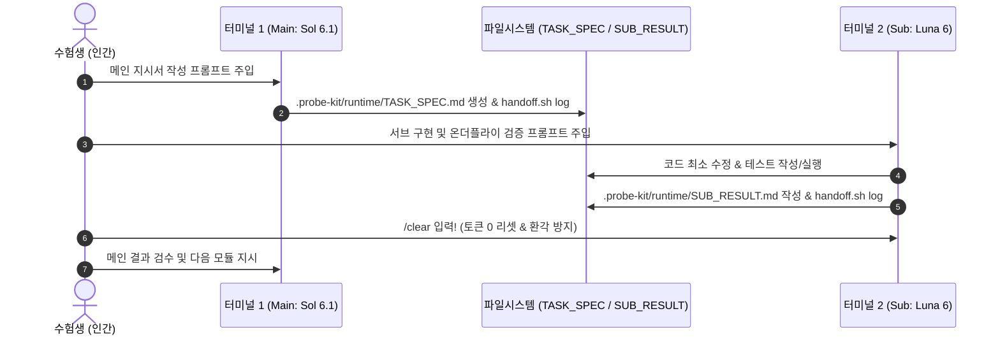

# 🧭 Cofa Probe 실전 당일 라이브 런북 (Chronological Exam-Day Runbook)

> **수험생 전용 안내:**  
> 이 문서는 시험 당일 10:00부터 13:30까지 분초 단위로 따라 하는 **원클릭 실전 라이브 런북**입니다.  
> 각 단계별로 **⏱ 권장 시각**, **👉 수행 행동**, **📋 복붙용 명령어/프롬프트**, 그리고 **✅ 완료 시그널**을 엄격히 갖추고 있습니다.  
> 화면 한쪽에 이 문서를 켜두고 순서대로 복사하여 터미널과 에이전트에 입력하세요.

---

## 📑 타임라인 요약 (Timeline Overview)

| 시각 | 단계 | 핵심 수행 내용 | 주요 도구 / 명령어 |
| :--- | :--- | :--- | :--- |
| **10:00** | **[1단계]** 원클릭 하네스 설치 | 외부 Git 차단 및 하네스 자동 장착 | `git clone ... && bash init.sh` |
| **10:02** | **[2단계]** 환경 검증 & 듀얼 터미널 | 무토큰 EDA 확인 및 Sol/Luna 분리 기동 | `git status` / `EDA_SUMMARY` / `codex` |
| **10:05** | **[3단계]** 문제 탐색 & Case 식별 | 과제 문제 README 분석 및 스킬 매핑 | 메인 프롬프트 (`NOTES_TEMP.md` 기록) |
| **10:10** | **[4단계]** DM 실무자 만능 질의 | 목표, 입출력, 결측/중복, 인터페이스 질의 | 우측 DM 창 (범용 템플릿) |
| **10:20** | **[5단계]** 케이스별 DM 질문 질의 | `dm_question.md` 기반 심층 질문 및 기록 | `.probe-kit/dm_question.md` |
| **10:25** | **[6단계]** 솔루션 브레인스토밍 | N단계 분할 ➔ 트레이드오프 ➔ 주도적 결정 | 3-Part 메인 프롬프트 & 결정 로깅 |
| **10:35** | **[6.5단계]** 구현 & 온더플라이 검증 | `TASK_SPEC` 발행 ➔ 서브 구현 ➔ `/clear` | 터미널 1 ↔ 터미널 2 핑퐁 반복 |
| **상시** | **[7단계]** 다음 단계 전환 시그널 | ALL PASS / FAIL / Drift 상황별 액션 | 전환 시그널 판정표 |
| **12:20** | **[8단계]** 마무리 검증 & 사전 감사 | 코드 동결 ➔ 사전 감사 ➔ 하네스 디스크 보존 | `pre_submit_audit.py` / `.sh` |
| **12:45** | **[9단계]** 실무자 DM 최종 완료 보고 | 검증 결과 보고 및 만족도 확인 요청 | 메인 초안 작성 ➔ 우측 DM 전송 |
| **12:47** | **[10단계]** 제출 보고서 3대 요소 점검 | [판단·근거]-[검증]-[남은 한계] 점검 | 메인 보고서 검토 프롬프트 |
| **12:50** | **[11단계]** 보안 취약점 전수 점검 | API 키, 0.0.0.0 바인딩, 로그 누출 점검 | 메인 보안 감사 프롬프트 |
| **12:52** | **[12단계]** 오버엔지니어링 점검 & 제출 | 불필요 라이브러리 배제 ➔ 12:55 칼제출 | 메인 점검 ➔ 13:00 서술형 직접 타이핑 |
| **상시** | **[13]** 비상 상황 트러블슈팅 | 막히면 3분 우회, 핑퐁·환경 장애 즉각 해결 | 13. 트러블슈팅 표 / 플레이북 |

---

## 1단계: ⏱ 10:00 (시험 시작 0초) | 👉 원클릭 하네스 클론 및 초기화

시험 시작 버튼을 누르고 안경/신분증 확인을 마친 즉시, 워크스페이스 터미널을 열고 아래 1줄 명령어를 복사하여 실행합니다.

```bash
git clone https://github.com/chichochoi/sk.git /tmp/probe-kit && bash /tmp/probe-kit/init.sh
```

> ⚠️ **웹 터미널 붙여넣기 주의:** 웹 터미널에서 붙여넣기는 반드시 `Ctrl+Shift+V`(또는 마우스 우클릭 > 붙여넣기)를 쓰고 `Ctrl+V`는 절대 쓰지 마세요. `Ctrl+V`를 누르면 `^[[200~`, `\026` 같은 제어 문자가 명령어 앞에 붙어 `command not found` 오류가 발생합니다.

### 🔍 스크립트 자동 실행 내역 (총 6단계 순서)
1. **[1/6] 외부 git push 원천 차단 (보안 안전장치):** 하네스를 클론한 직후(기본 `/tmp/probe-kit` 또는 `<workspace>/.probe-kit` 직접 클론 모두 지원), 원본의 **`.git` 디렉토리를 즉시 삭제**하여 시험 중 외부 GitHub으로의 `git push` 사고를 원천 차단합니다.
2. **[2/6] probe-kit 하네스 파일을 워크스페이스(.probe-kit)로 배포:** 하네스 파일들을 워크스페이스 내부(`.probe-kit`)로 안전하게 배치하고 실행 권한(`chmod +x`)을 부여합니다.
3. **[3/6] 워크스페이스 Git 오염 방지 (.git/info/exclude) 등록:** `.git/info/exclude`에 `/.probe-kit`, `/runtime/`, `/NOTES_TEMP.md`, `/TASK_SPEC.md`, `/SUB_RESULT.md`, `/EDA_SUMMARY.txt`, `/HANDOFF.md` 등을 등록하여, **과제 저장소의 Git 형상(`.gitignore` 포함)을 전혀 더럽히지 않고 100% 격리**합니다. (워크스페이스가 비-Git 디렉토리인 경우 경고와 함께 안전하게 건너뜁니다)
4. **[4/6] 런타임 버퍼 보장 및 실시간 메모장/인수인계서 준비:** `templates/NOTES.md`를 워크스페이스 루트의 `NOTES_TEMP.md`로, `templates/HANDOFF.md`를 `.probe-kit/runtime/HANDOFF.md`로 안전하게 복사합니다. (기존 파일이 있으면 덮어쓰지 않고 보존)
5. **[5/6] 워크스페이스 구조 및 데이터 무토큰 초기 스캔:** `eda_scan.py`를 무토큰(0 Token)으로 실행하여 데이터 및 테스트 파일 현황을 `.probe-kit/runtime/EDA_SUMMARY.txt`에 자동 생성합니다.
6. **[6/6] Codex 글로벌 하네스(~/.codex) 및 모델 프리셋 설정 (마지막 / 선택적 Non-fatal):** 글로벌 설정 디렉토리(`~/.codex`)에 `AGENTS.md`(메인 헌법), `SUB_AGENTS.md`(서브 헌법), `config.toml`을 설치합니다. 이 단계는 **선택적(Non-fatal)**으로 동작하여, 환경에 따라 권한 오류(`Permission denied`)가 발생해도 경고만 출력하고 정상 통과합니다. (이 경우 에이전트 프롬프트 첫 줄에서 `.probe-kit/AGENTS.md` / `SUB_AGENTS.md`를 명시적으로 읽도록 안내합니다)

✅ **완료 시그널:**
터미널에 다음 메시지가 출력되면 정상 완료입니다:
```text
=== [6/6] Codex 글로벌 하네스(~/.codex) 및 모델 프리셋 설정 ===
...
🎉 [probe-kit] 메인(Sol 6.1 xhigh) × 서브(Luna 6 xhigh) 하네스 설치 완료!
```

---

## 2단계: ⏱ 10:02 ~ 10:05 | 👉 환경 검증 및 듀얼 터미널 분리 기동

하네스 설치 직후 워크스페이스 격리 상태와 무토큰 EDA 요약을 확인하고, 메인과 서브 터미널을 분리합니다.

```bash
# 1. Git 격리 검증 (Untracked files에 .probe-kit, NOTES_TEMP.md 등이 나타나지 않아야 함)
git status

# 2. 무토큰 데이터/코드 구조 요약 확인
cat .probe-kit/runtime/EDA_SUMMARY.txt

# 3. Handoff 로깅 동작 검증 (에이전트가 실행되는 터미널과 같은 셸에서 확인)
bash .probe-kit/scripts/handoff.sh log "검증" "하네스 환경 검증" || python3 .probe-kit/scripts/handoff.py log "검증" "하네스 환경 검증"
```

> ⚠️ **웹 터미널 붙여넣기:** 터미널 명령어 입력 시 `Ctrl+V` 대신 반드시 `Ctrl+Shift+V`(또는 우클릭 > 붙여넣기)를 사용하세요.  
> 💡 **비-Git 워크스페이스 안내:** 워크스페이스가 Git 저장소가 아닌 일반 디렉토리(예: `/home/user`)인 경우, `init.sh`에서 `.git/info/exclude` 등록 단계가 경고와 함께 안전하게 건너뛰어집니다(정상 동작). 이 경우 `git status` 격리 확인은 생략하고 바로 `cat .probe-kit/runtime/EDA_SUMMARY.txt`부터 확인하세요.  
> 💡 **Handoff 실행 규칙:** handoff 로그는 에이전트가 실행되는 터미널과 같은 셸에서 실행. bash가 실패하면(WSL E_ACCESSDENIED 등) `python3 .probe-kit/scripts/handoff.py log "<step>" "<msg>"` 사용. 그래도 안 되면 runtime/HANDOFF.md 표에 직접 한 줄 추가.

### 🖥️ 듀얼 터미널 기동 및 모델 선택

단일 터미널에서 대화를 지속하면 컨텍스트 오염과 토큰 폭발로 후반부에 치명적인 환각이 발생합니다. 반드시 **터미널을 2개로 분리**하세요.

```bash
# [터미널 1 - 메인 아키텍트 전담]
codex
# Codex 진입 후 명령어 실행:
/status
/model
# 모델 목록에서 [Sol 6.1 (xhigh)] 선택 (sol-6.1, reasoning xhigh)
```
> **절대 원칙 (메인):** 메인에게는 비즈니스 소스 코드를 직접 짜게 하지 않습니다. 오직 아키텍처 진단, 요구사항 구조화, 작업 명세서(`.probe-kit/runtime/TASK_SPEC.md`) 작성, 서브 결과 검수만 시킵니다.

```bash
# [터미널 2 - 서브 워커 전담] (터미널 우측 상단 '+' 버튼으로 새 탭 열기)
codex
# Codex 진입 후 명령어 실행:
/status
/model
# 모델 목록에서 [Luna 6 (xhigh)] 선택 (luna-6, reasoning xhigh)
```
> **절대 원칙 (서브):** 서브는 `TASK_SPEC.md`에 지정된 파일만 최소 수정하고, 온더플라이 테스트를 실행하여 `SUB_RESULT.md`를 작성한 뒤 **반드시 `/clear`로 초기화**합니다.
> 
> ⚠️ **주의:** `Astra` 모델이나 자동 화면 조작(`Computer Use`)은 규정상 금지되어 있으며 사용 시 실격 처리됩니다.

✅ **완료 시그널:**
`git status` 출력 시 하네스 파일이 노출되지 않고, `EDA_SUMMARY.txt`에서 컬럼/테스트 파일 목록을 확인했으며, 터미널 1(`Sol 6.1 xhigh`)과 터미널 2(`Luna 6 xhigh`)가 대기 상태인 것. (진행 중 문제가 발생하면 [13. 비상 상황 트러블슈팅](#13-비상-상황-트러블슈팅-if-something-breaks) 참조)

---

## 3단계: ⏱ 10:05 ~ 10:10 | 👉 과제 지시서(README.md) 탐색 및 Case·스킬 식별

과제 루트의 문제 지시서(`README.md`)를 메인 에이전트가 읽고 어떤 Case에 해당하는지 판별하도록 지시합니다.  
*(⚠️ 주의: 키트의 README가 아니라 **시험장 과제 루트의 문제 README.md**를 읽게 해야 합니다.)*

터미널 1 (`Sol 6.1 xhigh`)에 아래 프롬프트를 복사하여 입력합니다:

```text
[MAIN] 먼저 .probe-kit/AGENTS.md를 읽고 그 규칙을 따라줘.
아직 비즈니스 코드는 절대 작성하거나 수정하지 마.
현재 워크스페이스 루트에 있는 과제 지시서(README.md)와 .probe-kit/runtime/EDA_SUMMARY.txt 를 분석해줘. (키트 내부 README가 아닌 과제 문제 지시서여야 함)
다음 항목을 핵심 위주로 명확하게 브리핑하고, 워크스페이스 루트의 NOTES_TEMP.md 에 기록해줘:
1. 이번 과제가 아래 Case 1~4 중 어느 유형에 해당하는지 판별하고, 연동할 .probe-kit/skills/ 스킬 파일 경로를 지정해줘:
   - Case 1: 데이터 정제·집계·이상치/반도체 수율 판정 -> .probe-kit/skills/case1_data_pipeline.md
   - Case 2: 실무형 웹 서비스 / 웹앱 / 대시보드 구축 -> .probe-kit/skills/case2_web_service.md
   - Case 3: 기존 레거시 코드베이스 디버깅 및 기능 확장 -> .probe-kit/skills/case3_legacy_debug.md
   - Case 4: 규정 색인·판정, 사내 업무 자동화, RAG -> .probe-kit/skills/case4_policy_rag_doc.md
   - 위 4개의 케이스에 없는거면 없다고 말해.(케이스 복합이면->.probe-kit/skills/case1_data_pipeline.md)
2. 과제 요구사항 요약 (필수 제출 파일명, 입출력 포맷, 대상 파일 범위)
3. 절대 변경하면 안 되는 기존 시스템의 불변 제약 (API 규격, 인증 방식, 함수 시그니처 등)
4. 불필요한 오버엔지니어링을 배제한 최소 핵심 기능(MVP) 목표
브리핑과 NOTES_TEMP.md 기록이 끝나면 터미널에서 다음 명령어를 실행해줘:
bash .probe-kit/scripts/handoff.sh log "탐색" "Case 식별 및 초기 분석 완료"
(실패 시 `python3 .probe-kit/scripts/handoff.py log "탐색" "Case 식별 및 초기 분석 완료"` 사용. 그래도 안 되면 runtime/HANDOFF.md 표에 직접 한 줄 추가)
```

✅ **완료 시그널:**
메인 에이전트가 과제 유형(Case 1~4)과 매핑된 스킬 파일명을 보고하고, `NOTES_TEMP.md`에 문제 개요가 기록되며, `HANDOFF.md`에 탐색 로그가 추가됨.

---

## 4단계: ⏱ 10:10 ~ 10:20 | 👉 우측 DM '업무 담당자(실무자)' 만능 질문 질의

과제 지시서에는 출제자가 숨겨둔 예외 조건(Edge Case)이 20~30% 존재합니다.  
화면 우측 메신저에서 **`업무 담당자(실무자 에이전트)`**를 선택하고, 아래 **어떤 Case/단계에서도 즉시 통용되는 만능 질문 템플릿**을 복사하여 순차적으로 질문합니다.

### 📋 DM 만능 질문 복붙 템플릿 (Universal Templates)

#### 1) [목표, 주 사용자 및 기존 업무 문제점]
```text
안녕하세요 담당자님, 본격적인 착수 전 핵심 맥락을 확인하고자 합니다. 이 결과물을 실제로 활용하는 주 타겟 사용자는 누구이며, 기존 업무 방식에서 가장 불편해하던 핵심 문제점(Pain Point)이나 실수가 자주 발생하는 지점은 어디인가요?
```

#### 2) [입력 데이터 스펙 및 결측/이상치 처리]
```text
입력 데이터의 정확한 스펙과 예외 처리 기준을 여쭙고자 합니다. 취소·반려된 데이터나 중복 유입된 데이터는 집계 및 연산에서 어떻게 처리해야 하나요? (예: 취소 건 분모 제외 여부, 중복 시 최신/최초 기준) 결측치(null, 빈 값, -999)나 비정상 입력값에 대한 기본 처리 기준이 정의되어 있나요?
```

#### 3) [산출물 스펙 및 완료 조건 (Definition of Done)]
```text
최종 결과물은 어떤 파일 및 포맷이어야 하며, 반드시 포함되어야 할 필수 컬럼/필드나 정렬 순서, 소수점 반올림, 단위 기준이 있나요? 이번 과제가 성공적으로 끝났다고 판단하는 '완료 조건(Definition of Done)'은 무엇인가요?
```

#### 4) [불변 규칙 및 절대 금지 사항 (Hard Constraints)]
```text
기존 시스템의 인터페이스(함수 시그니처, API 엔드포인트 URL, HTTP 메서드, 응답 JSON 스키마, 인증 방식)는 그대로 유지해야 하나요? 시스템 운영상 절대로 건드리거나 변경해서는 안 되는 금지 사항이 있다면 말씀해 주세요.
```

#### 5) [상충 시 우선순위 (Priority)]
```text
요구조건 간에 상충이 발생할 경우(예: 데이터 정합성 vs 처리 속도, 화려한 UI 기능 vs 핵심 유저 동선의 안정성), 실무에서는 어떤 가치를 최우선 순위로 두어야 하나요?
```

#### 6) [표본 검증 및 신뢰성 확인 기준]
```text
최종 제출 전 결과의 신뢰성을 확인하기 위해, 현업에서 교차 대조해볼 수 있는 기준 표본 데이터나 수동 검증 기준(기댓값)이 마련되어 있나요?
```

#### 7) [비상 힌트 유도 질문 (과제 파악이 막혔을 때)]
```text
과제 맥락을 정확히 파악하고 싶습니다. 현업 관점에서 제가 무엇을 먼저 물어봐야 할까요? 어떤 영역이나 숨은 예외 조건에 대해 확인하면 좋을지 힌트를 주실 수 있나요?
```

#### 8) [미인지 단서 조항 및 현업 특수 규칙 발굴]
```text
제가 아직 미처 파악하지 못했거나 여쭤보지 않은 내용 중에, 현업에서 이 업무를 처리할 때 반드시 알아야 할 특수 예외 규칙이나 단서 조항이 또 있을까요?
```


> [!WARNING]
> **❌ 절대 금지 질문 (감점 및 답변 거부):**
> - *"제가 지금 뭐부터 해야 하나요? 1, 2, 3단계로 정리해주세요."*
> - *"어떻게 코딩하면 되나요?"*  
> 구조화와 아키텍처 판단은 본인이 직접 내려야 하며, 실무자에게는 도메인 규칙, 데이터 스펙, 예외 조건만 캐내야 합니다.

✅ **완료 시그널:**
실무자 DM으로부터 목표, 입출력 포맷, 결측/중복 처리, 불변 인터페이스에 대한 구체적 답변을 수신함.

---

## 5단계: ⏱ 10:20 ~ 10:25 | 👉 케이스별 맞춤형 DM 질문 추출 및 답변 기록 (`dm_question.md`)

범용 질문 외에 각 Case별로 특화된 심층 질문은 `.probe-kit/dm_question.md`에서 확인하여 추가 질의합니다.

### 👉 수행 행동:
1. 에디터에서 `.probe-kit/dm_question.md` 파일을 엽니다.
2. 3단계에서 식별한 Case 섹션(Case 1, Case 2, Case 3, Case 4)으로 이동합니다.
3. 해당 Case에 특화된 심층 질문을 복사하여 우측 DM 창에 질문합니다.
4. 실무자 답변을 받는 즉시 워크스페이스 루트의 `NOTES_TEMP.md`를 열고 `## 1. 실무자 DM 확인 사항` 섹션에 아래 형식으로 기록합니다:

```markdown
## 1. 실무자 DM 확인 사항
- [산출물 포맷] - result.json 파일로 저장하며, 수치는 소수점 둘째 자리 반올림
- [취소/반려 건 처리] - status가 'cancelled'인 레코드는 총합 및 평균 계산의 분모에서 완전 제외
- [중복 레코드 처리] - 동일 ID 유입 시 timestamp가 가장 최신인 1건만 유지
- [인터페이스 불변] - 기존 run_pipeline() 함수의 파라미터 시그니처 및 반환 dict 구조 절대 유지
- [우선순위] - 화려한 UI나 복잡한 패턴보다 데이터 정합성을 최우선시
```

✅ **완료 시그널:**
`NOTES_TEMP.md`에 실무자 DM 확인 조건이 구체적 수치 및 예외 규칙과 함께 1줄씩 정리되어 저장됨.

---

## 6단계: ⏱ 10:25 ~ 10:35 | 👉 솔루션 브레인스토밍 3-Part 프롬프트 (인간 주도성 가점)

메인 에이전트와 트레이드오프를 논의하고 수험생이 직접 방향을 결정하는 과정을 남겨 **의도(Intent)·인지(Cognition) 축 만점**을 공략합니다.  
터미널 1 (`Sol 6.1 xhigh`)에 순서대로 주입합니다. (코드는 아직 작성하지 않습니다.)

### 📋 Part (a) & (b): [N단계 분할 및 대안별 장단점 분석 요구]
```text
[MAIN] 아직 비즈니스 코드는 절대 작성하거나 수정하지 마.
과제 README.md와 실무자 DM 확인 결과(NOTES_TEMP.md)를 바탕으로 다음 2가지를 분석해줘:
1. 전체 문제를 시험 시간 내에 안정적으로 해결할 수 있는 N개의 주요 개발 단계(Step 1, Step 2, Step 3 등)로 분할해줘.
2. 각 단계별로 채택 가능한 2~3가지 구현 대안(예: 표준 라이브러리 기반 경량 스트림 방식 vs 외부 프레임워크 일괄 적재 방식 등)을 제시하고, 각각의 장단점(구현 복잡도, 시간 내 완성 가능성, 실무자 예외 조건 충족 신뢰성, 오버엔지니어링 위험)을 명확한 트레이드오프 표로 정리해줘.
어떤 방식이 오버엔지니어링 없이 최소 구현(MVP)을 달성하는 데 최적인지 요약해줘.
3. 담당자나 나에게 물어볼게 있으면 언제든 나에게 말해.

```

### 📋 Part (c): [수험생의 주도적 결정 및 로깅 지시 템플릿]
*(수험생이 분석 결과를 확인한 후, 아래 템플릿의 대괄호 내용을 채워 터미널 1에 입력합니다)*

```text
[MAIN] 네 분석을 검토했어. [외부 의존성 배제 및 실무자 DM의 취소·중복 예외 처리 신뢰성 보장] 장점 때문에 나는 [파이썬 표준 라이브러리(csv, json) 기반의 단일 스트림 파이프라인] 단계별 해결법을 쓰고 싶어. 가능해?
가능하다면 내가 결정한 [채택한 방식]과 [배제한 대안 및 이유]를 NOTES_TEMP.md에 기록하고, 터미널에서 다음 명령어를 실행해줘:
bash .probe-kit/scripts/handoff.sh log "결정" "[선택한 해결법] 채택 확정 (이유: [장점 명시])"
(실패 시 `python3 .probe-kit/scripts/handoff.py log "결정" "[선택한 해결법] 채택 확정 (이유: [장점 명시])"` 사용. 그래도 안 되면 runtime/HANDOFF.md 표에 직접 한 줄 추가)
기록이 끝나면 코드는 짜지 말고 Step 1을 위한 준비 완료를 보고해줘.
```
#### 9) [가설 제시 및 최종 구현 동의 (의도 축 가산점)]
```text
'말씀해주신 내용을 바탕으로 요구사항을 [A, B, C]로 구조화하여, [X 기준]으로 예외를 처리하고 [Y 구조]로 우선 구현하려 합니다. 현업의 의도와 부합할까요?' 라는 형식으로 담당자에게 묻고 싶어. 프롬프트를 짜줘.

```

✅ **완료 시그널:**
메인이 수험생의 결정을 확인하고 `NOTES_TEMP.md`와 `HANDOFF.md`에 의사결정 근거가 기록됨.

---

## 6.5단계: ⏱ 10:35 ~ 12:20 | 👉 범용 `TASK_SPEC.md` 발행 및 서브 위임 사이클

이 단계가 시험의 70%를 차지하는 메인-서브 핑퐁 구간입니다.  
터미널 1(메인 지시) ➔ 터미널 2(서브 구현 & `/clear`) 사이클을 각 단계(Step 1, 2, 3)마다 반복합니다.



### 1) 범용 `TASK_SPEC.md` 작성 지시 프롬프트 (터미널 1 - 메인 `Sol 6.1 xhigh`)
```text
[MAIN] 비즈니스 코드는 절대 직접 작성하거나 수정하지 마.
우리가 확정한 의사결정과 실무자 DM 조건을 반영하여, 서브 에이전트(Luna 6 xhigh)가 수행할 [Step N: X 모듈] 작업 명세서를 .probe-kit/runtime/TASK_SPEC.md 파일에 작성해줘.
TASK_SPEC.md 에는 다음 6대 필수 요소를 반드시 누락 없이 포함해야 해:
1. 이번 단계의 명확한 단일 목표 (Single Goal)
2. 수정이 허용된 정확한 파일 경로 (지정 외 파일 수정 절대 금지)
3. 실무자 DM에서 확정한 필수 비즈니스 조건 및 예외 규칙 (취소 건 제외, 최신 중복 유지 등)
4. 절대 준수해야 할 금지 사항:
   - 불필요한 추상화/라이브러리 도입 등 오버엔지니어링 금지
   - API 키, 시크릿, 개인정보 하드코딩 금지
   - 웹 서버 호스트는 반드시 0.0.0.0 바인딩
   - 시험 규정에 따라 git add / commit / reset / clean 일체 금지
5. 서브 에이전트가 구현 직후 실행할 검증 요구사항:
   - 기존 베이스라인 테스트 실행으로 회귀(Regression) 없음 증명
   - 이번 태스크의 실무자 DM 요구사항에 맞춘 온더플라이 ad-hoc 테스트 코드(tests/test_*.py 등)를 즉석 작성하여 정상 경로(Happy Path) 및 예외 케이스(빈 값, 결측치, 중복 등)를 직접 실행 검증 (고정 템플릿 사용 금지, git commit 없이 untracked 유지)
6. 완료 조건(Definition of Done) 및 .probe-kit/runtime/SUB_RESULT.md 기록 요구
작성이 완료되면 터미널에서 다음 명령어를 실행해줘:
bash .probe-kit/scripts/handoff.sh log "TASK_SPEC" "Step N 명세서 발행 완료"
(실패 시 `python3 .probe-kit/scripts/handoff.py log "TASK_SPEC" "Step N 명세서 발행 완료"` 사용. 그래도 안 되면 runtime/HANDOFF.md 표에 직접 한 줄 추가)
7. 담당자나 나에게 물어볼게 있으면 언제든 나에게 말해.

```

### 2) 서브 에이전트 구현 및 온더플라이 검증 지시 (터미널 2 - 서브 `Luna 6 xhigh`)
터미널 2 창으로 전환하여 아래 프롬프트를 입력합니다:

```text
[SUB] 먼저 .probe-kit/SUB_AGENTS.md를 읽고 그 규칙을 따라줘.
.probe-kit/runtime/TASK_SPEC.md 와 지정된 스킬 파일을 읽고, 명시된 파일 범위와 제약 조건을 엄격히 준수하여 코드를 구현해줘.
구현 직후 다음 검증을 터미널에서 직접 실행해:
1. 기존 베이스라인 테스트를 실행하여 기존 기능이 깨지지 않았는지 확인해.
2. 이번 태스크의 실무자 DM 요구사항에 맞춘 전용 테스트 코드(tests/test_*.py 등)를 온더플라이로 즉석 작성하여 정상 경로와 예외 케이스를 모두 실행 검증해 (고정 템플릿 사용 금지, git add/commit/reset/clean 금지 및 untracked 유지).
3. 테스트 실패 시 무작정 덮어쓰지 말고 실패 원인과 수정 범위를 먼저 진단해.
모든 검증이 통과하면 변경 파일 목록, 테스트 실행 결과, 남은 한계점을 핵심 위주로 정리하여 .probe-kit/runtime/SUB_RESULT.md 에 기록하고, 다음 명령어를 터미널에서 실행해줘:
bash .probe-kit/scripts/handoff.sh log "sub done" "Step N 구현 및 검증 통과 완료"
(실패 시 `python3 .probe-kit/scripts/handoff.py log "sub done" "Step N 구현 및 검증 통과 완료"` 사용. 그래도 안 되면 runtime/HANDOFF.md 표에 직접 한 줄 추가)
```
*(💡 비대화형 환경인 경우 메인 터미널에서 `bash .probe-kit/scripts/subagent.sh`를 실행해도 동일하게 서브 호출 가능)*

> [!IMPORTANT]
> **서브 작업 완료 즉시 필수 조치:**
> 서브가 `SUB_RESULT.md` 작성을 마치면, **터미널 2에 반드시 `/clear`를 입력**하세요!  
> 서브 세션의 이전 코드 잔재와 에러 로그를 비워 토큰을 0으로 리셋하고, 다음 모듈 구현 시 이전 기억과 혼동하여 발생하는 환각(Hallucination)을 원천 차단합니다.

### 3) 메인 결과 검수 프롬프트 (터미널 1 - 메인 `Sol 6.1 xhigh`)
터미널 1 창으로 돌아와 아래 프롬프트를 입력합니다:

```text
[MAIN] .probe-kit/runtime/SUB_RESULT.md 와 git diff --stat 만 확인해서 Step N이 실무자 DM 조건에 맞게 검증되었는지 엣지 케이스 관점에서 비판적으로 검토해줘.
검토가 완료되면 다음 모듈인 [Step N+1]에 대한 .probe-kit/runtime/TASK_SPEC.md 를 작성해줘.
담당자나 나에게 물어볼게 있으면 언제든 나에게 말해.

```

---

### 🔍 케이스별 특화 추가 지침 (Case-Specific Extra Instructions)

| 케이스 구분 | 연동 스킬 | 서브 지시 시 반드시 포함해야 할 특화 지침 |
| :--- | :--- | :--- |
| **Case 1**<br>(데이터 파이프라인 / 반도체 판정) | `case1_data_pipeline.md` | - 대용량 데이터를 프롬프트에 덤프하지 말고 `EDA_SUMMARY.txt` 참조<br>- 전처리 단계별(중복 제거 건수, 취소 건수, 유효 행 수) 필터링 로그 출력<br>- 15건 표본 수동 대조(`sample_check_template.py`)로 기댓값과 100% 일치 증명 |
| **Case 2**<br>(실무형 웹 서비스) | `case2_web_service.md` | - 서버 기동 시 반드시 **`0.0.0.0` 호스트 바인딩** (`127.0.0.1` 금지)<br>- 서버 터미널 탭 유지, 플랫폼 내장 Browser에서 직접 클릭·입력 동작 수행 (클릭 로그가 채점됨)<br>- 회원가입 등 부가기능 제외, 핵심 유저 동선 1개(입력->처리->화면) 수직 완성 |
| **Case 3**<br>(레거시 코드 디버깅) | `case3_legacy_debug.md` | - 코드 수정 전 기존 테스트 스위트 1회 먼저 실행하여 **베이스라인 로그 보존**<br>- 기존 API URL 엔드포인트, 응답 JSON 스키마, 함수 시그니처 100% 불변 유지<br>- `git diff`로 합의된 최소 범위(1~3개 파일) 외 무단 변경 절대 차단 |
| **Case 4**<br>(규정 색인 / 자동화 / RAG) | `case4_policy_rag_doc.md` | - 문서를 통째 요약하지 말고 관련 조항/페이지 위치를 먼저 색인화<br>- 모호한 케이스는 임의 추측하지 않고 `'수동 검토 필요'` 또는 `'확인 불가'` 플래그 분리<br>- 단순 O/X가 아닌 판단 근거 조항(출처)을 결과물에 함께 출력 |

✅ **완료 시그널:**
`TASK_SPEC.md` 작성 ➔ 서브 구현 및 온더플라이 테스트 통과 ➔ `SUB_RESULT.md` 기록 ➔ 터미널 2 `/clear` 실행 완료.

---

## 7단계: ⏱ 상시 참조 | 👉 다음 단계 전환 시그널 및 상황별 액션 테이블

구현 중 발생하는 다양한 상황에 맞춰 아래 표의 대응 행동을 즉각 취하세요.

| 시그널 (Signal) | 현재 상황 | 즉시 실행할 조치 (Action) |
| :--- | :--- | :--- |
| **`SUB_RESULT.md` ALL PASS** | 서브 구현 및 온더플라이 테스트 정상 통과 | 1) 터미널 2에 `/clear` 입력 (토큰 리셋)<br>2) 터미널 1에 메인 검수 프롬프트 입력<br>3) `bash .probe-kit/scripts/handoff.sh log "검증 완료" "<모듈 요약>"` 실행 (실패 시: `python3 .probe-kit/scripts/handoff.py log "검증 완료" "<모듈 요약>"` 또는 runtime/HANDOFF.md 직접 추가) |
| **온더플라이 / 단위 테스트 FAIL** | 서브 구현 결함 또는 엣지 케이스 충돌 | 무작정 코드를 덮어쓰지 말고, 터미널 2에서 에러 트레이스백과 원인 후보 2가지를 먼저 진단한 뒤 대상 파일만 최소 범위로 수정 (2회 이상 실패 시 단순 로직으로 전환) |
| **기존 베이스라인 테스트 FAIL** | 회귀(Regression) 발생 (기존 기능 파손) | 즉시 `git diff`로 변경된 코드 확인. 기존 함수 시그니처나 반환 형식이 깨졌는지 확인 후 원래 규격에 맞게 롤백 (`git reset --hard` 절대 금지, 에디터에서 직접 수정) |
| **메인 에이전트 제약 망각 (Drift)** | 메인이 DM 조건 누락하거나 불필요한 라이브러리 임의 제안 | **Handoff 골든 타이밍 발동!**<br>구 세션에서 `bash .probe-kit/scripts/handoff.sh` 실행 ➔ 새 터미널 1 열고 클린 `Sol 6.1 xhigh`에서 `[메인 프롬프트 6]`(.probe-kit/prompts/02_codex_prompts.md 참조)으로 복창/승인 |
| **DM 실무자 요구사항 변경/추가** | 실무자가 새로운 조건이나 우선순위 변경 알림 | `NOTES_TEMP.md`에 즉시 반영하고, 메인 에이전트에게 변경 사항을 브리핑하여 다음 `TASK_SPEC.md`에 수정 반영 |
| **⏱ 12:20 데드라인 도달** | 시험 종료 70분 전 | **신규 기능 추가 전면 중단 (Code Freeze)!** 미완성 기능은 과감히 배제하고, 구현된 핵심 기능의 정합성 검증 및 보고서 작성(8단계)으로 즉시 전환 |

---

## 8단계: ⏱ 12:20 ~ 12:45 | 👉 마무리 검증 & 사전 감사 & 최종 제출 준비

> [!WARNING]
> **12:20 코드 동결 (Code Freeze):**
> 12:20 이후로는 단 한 줄의 새로운 기능도 추가하지 않습니다. 불완전한 5개 기능보다 **완벽하게 검증되고 한계가 명시된 2~3개 핵심 기능(MVP)**이 훨씬 높은 점수를 받습니다.

### 1) 표본 수동 대조 교차 검증 (데이터 과제 필수)
```bash
# 15건 표본 데이터 수동 계산값(기댓값) vs 실제 처리 함수 출력 대조 실행
python3 .probe-kit/scripts/sample_check_template.py

# 실제 과제 모듈 및 함수 지정 대조 실행 시 (예: src.pipeline 모듈의 process_orders 함수)
TARGET_MODULE="src.pipeline" TARGET_FUNC="process_orders" python3 .probe-kit/scripts/sample_check_template.py
```
*(웹 과제인 경우: `0.0.0.0`으로 서버 기동을 유지하고, 내장 Browser에서 정상 폼 제출 및 예외 입력 시 에러 표출을 직접 클릭 조작하여 확인합니다.)*

### 2) 무감점 사전 감사 스크립트 실행 (환경에 맞추어 선택)
```bash
# Linux / WSL / Git Bash 환경:
bash .probe-kit/scripts/pre_submit_audit.sh

# 범용 Python 3 버전 직접 실행 (WSL/Linux/Windows 공통):
python3 .probe-kit/scripts/pre_submit_audit.py
```
* **6대 PASS 확인 항목:**
  1. `git diff --stat`: 과제 범위 외 불필요한 파일이 수정되지 않았는가?
  2. 민감정보 노출: API 키, 패스워드, 개인정보가 하드코딩되지 않았는가?
  3. 네트워크 바인딩: 웹 서버가 `0.0.0.0`으로 바인딩되어 있는가?
  4. 시스템 리소스: 메모리(RAM) 및 CPU가 정상 상태인가?
  5. 하네스 격리: `.git/info/exclude`로 하네스 및 런타임 파일이 안전 격리되었는가?
  6. **하네스 디스크 영구 보존:** `.probe-kit` 및 `HANDOFF.md`가 디스크에 보존되어 있는가?

### 3) Git 상태 읽기 전용 최종 확인
```bash
git status
```
> [!CAUTION]
> **시험 중 Git 절대 규칙 (위반 시 감점):**
> - `git add`, `git commit`, `git reset`, `git clean` **일체 금지!** 시험 중에는 커밋하지 않습니다.
> - 태스크별 온더플라이 테스트 코드는 untracked 상태로 유지되는 것이 정상입니다.
> - `.probe-kit`과 `HANDOFF.md`, `NOTES_TEMP.md`는 `.git/info/exclude`로 격리되어 Git status에 노출되지 않으며, **평가관 및 평가 AI의 가점 자산이므로 디스크에서 절대 삭제(`rm -rf`)하지 마세요!**

### 4) 최종 제출 보고서 초안 생성 지시 (터미널 1 - 메인 `Sol 6.1 xhigh`)
```text
[MAIN] 이제 신규 코드 작성은 중단하고 제출 보고서를 작성하자.
과제 README.md에서 요구하는 제출 보고서 파일명(예: SUBMISSION_REPORT.md 또는 REPORT.md)으로, .probe-kit/templates/SUBMISSION_REPORT.md 양식에 맞춰 최종 보고서를 작성해줘.
우리가 실무자 DM으로 확인한 내용, NOTES_TEMP.md, 그리고 SUB_RESULT.md의 검증 기록을 바탕으로 [결정] - [근거] - [검증] - [한계] 구조를 명확히 포함해줘. 우리가 택한 구조와 왜 그 구조를 택했는지를 적어.
특히 어떤 방식으로 AI 오버엔지니어링을 통제했는지, 현재 구현의 실패 가능 조건(한계점)을 구체적으로 적어줘.
```

### 5) 최종 인수인계서 동기화 및 모든 에디터 탭 저장
```bash
# 최종 인수인계서 동기화
bash .probe-kit/scripts/handoff.sh
```
* **모든 열린 탭 `Ctrl+S` 저장:** 에디터 상단 탭에 하얀 동그라미(미저장 상태)가 단 하나도 없도록 모든 탭을 확인하며 `Ctrl+S`를 누릅니다.

✅ **완료 시그널:**
사전 감사 6대 PASS, `git status` 클린(테스트 코드 외 불필요 파일 없음), 제출 보고서 생성 완료, 모든 파일 저장 완료.

---

## 9단계: ⏱ 12:45 | 👉 실무자 DM 최종 완료 보고 및 확인 요청 프롬프트

실무자 DM에 최종 작업 완료를 알리고 확인을 구하는 정중하고 전문적인 메시지를 메인 에이전트에게 작성하도록 지시합니다.

터미널 1 (`Sol 6.1 xhigh`)에 아래 프롬프트를 입력합니다:

```text
[MAIN] 비즈니스 코드는 절대 수정하지 마.
우리가 지금까지 구현하고 검증한 전체 결과를 바탕으로, 우측 DM의 '업무 담당자'에게 보낼 최종 완료 보고 메시지를 작성해줘.
메시지에는 다음 내용이 공학적이고 정중하게 포함되어야 해:
1. 담당자님이 지시하신 핵심 요구사항 및 예외 조건(취소 건 제외, 중복 최신 유지, 기존 인터페이스 100% 보존 등)을 어떻게 정확히 반영했는지 요약
2. 수행한 검증 결과 (베이스라인 회귀 테스트 통과, 태스크별 온더플라이 테스트 통과, 15건 표본 수동 대조 일치 등)
3. "지시해주신 방향에 맞추어 구현과 검증을 완결하였는데, 혹시 추가로 확인이 필요하시거나 보완할 부분이 있으신지 검토 부탁드립니다."라는 확인 요청 문구
답변이 나오면 내가 우측 DM에 그대로 복사해서 보낼 수 있도록 메시지 본문만 깔끔하게 출력해줘.
```

👉 **행동:** 메인이 출력한 메시지를 복사하여 우측 DM 창에 전송합니다.

✅ **완료 시그널:**
실무자 DM에 완료 보고 메시지가 전달되고 확인 응답을 수신함.

---

## 10단계: ⏱ 12:47 | 👉 제출 보고서 3대 필수 요소 (판단/검증/한계) 점검 프롬프트

제출 문서가 평가관의 채점 기준을 100% 충족하는지 메인 에이전트와 교차 점검합니다.

터미널 1 (`Sol 6.1 xhigh`)에 아래 프롬프트를 입력합니다:

```text
[MAIN] 현재 작성된 제출 보고서(SUBMISSION_REPORT.md 또는 지정된 보고서 파일)를 읽고, 아래 3대 필수 요소가 빠짐없이 구체적으로 작성되었는지 검토해줘:
① 선택한 판단과 근거: [결정] 왜 이 아키텍처/자료구조/로직을 선택했는지, 그리고 초기 제안된 복잡한 대안(오버엔지니어링)을 왜 거절하고 단순한 구조를 채택했는지 명시되었는가?
② 검증 결과: 베이스라인 테스트, 실무자 조건 맞춤 온더플라이 테스트, 그리고 표본 수동 대조(또는 브라우저 직접 조작) 결과가 구체적 수치/로그와 함께 명시되었는가?
③ 남은 한계: 이 시스템이 실패할 수 있는 구체적인 한계 조건(예: 초대용량 데이터 유입 시 메모리 한계, 미정의 비정형 포맷 등)과 향후 프로덕션 보완 방안이 솔직하게 명시되었는가?
부족한 부분이 있다면 해당 섹션만 즉시 보강하여 보고서를 업데이트해줘.
```

✅ **완료 시그널:**
제출 보고서에 ① 선택한 판단과 근거, ② 검증 결과, ③ 남은 한계 3대 축이 모두 완비됨.

---

## 11단계: ⏱ 12:50 | 👉 보안 취약점 및 민감정보 전수 점검 프롬프트

제출 전 코드와 설정 파일에 보안 취약점이 없는지 최종 점검합니다.

터미널 1 (`Sol 6.1 xhigh`)에 아래 프롬프트를 입력합니다:

```text
[MAIN] 워크스페이스 내 수정된 모든 소스 코드와 설정 파일, 테스트 코드에 대해 보안 감사를 수행해줘. 다음 4대 보안 취약점 여부를 확인하고 결과를 보고해줘:
1. 민감정보 하드코딩: API 키, 패스워드, 시크릿 토큰, 사내 개인정보(주민등록번호 등)가 평문으로 남아있는가?
2. 네트워크 바인딩: 웹 서버 호스트가 localhost/127.0.0.1 로 닫혀있지 않고 반드시 0.0.0.0 으로 바인딩되어 있는가?
3. 로그 민감정보 유출: 콘솔 로그나 파일 로그에 비밀번호, 개인정보, 불필요한 대용량 원본 데이터가 출력되고 있는가?
4. 취약한 호출: eval(), 미검증 셸 실행, 임의 파일 경로 조작(Directory Traversal) 위험이 있는가?
문제 발견 시 수정할 파일과 수정 코드를 제시하고 즉시 조치해줘.
```

✅ **완료 시그널:**
보안 취약점 0건(PASS) 및 민감정보 평문 노출 없음 확인.

---

## 12단계: ⏱ 12:52 ~ 12:55 | 👉 오버엔지니어링 배제 & 최종 점검 및 제출 안내

오버엔지니어링 배제와 형상 위생을 점검하고 과제를 최종 제출합니다.

### 📋 오버엔지니어링 & 최종 형상 점검 프롬프트 (터미널 1 - 메인 `Sol 6.1 xhigh`)
```text
[MAIN] 최종 제출 전 마지막 아키텍처 및 위생 점검을 수행해줘:
1. 오버엔지니어링 점검: 실무자가 요구하지 않은 불필요한 외부 라이브러리 추가, 과도한 디자인 패턴/추상화 계층, 불필요한 캐싱이나 회원 관리 기능이 포함되어 있지 않은가?
2. 인터페이스 불변: 기존 함수의 시그니처, API URL 엔드포인트, JSON 응답 키 이름이 원래 스펙과 100% 일치하는가?
3. 형상 위생: __pycache__, *.pyc, 임시 백업(*.bak) 파일이 저장소 변경 파일에 포함되지 않았는가?
4. 디버그 잔재: 개발 중 삽입했던 불필요한 print/console.log 나 주석 처리된 대규모 코드 블록이 남아있는가?
5. 재현 가능성: 심사관이 README에 기재된 단 1줄의 실행 명령어로 시스템 기동 및 검증 테스트를 즉시 재현할 수 있는가?
점검 결과를 한 줄씩 확인해줘.
```

### 🚀 과제 최종 제출 및 후속 서술형 안내 (What to do after)

#### 1) 12:55 플랫폼 과제 최종 제출
1. 시험 플랫폼 우측 상단의 **`제출하고 문제풀기`** 버튼 클릭.
2. 팝업창에서 **`제출물 확정하고 문제풀기`** 클릭.
3. **"맞춤형 확인 문제를 생성 중입니다 (약 5~10분 소요)"** 안내 화면 확인.

#### 2) 12:55 ~ 13:00 문제 생성 대기 (마인드셋 정돈)
* 시스템이 내 제출 코드, 터미널 로그, git status, 제출 보고서를 교차 분석하여 개인화된 서술형 질문 6개를 출제합니다.
* 대기 시간 동안 `NOTES_TEMP.md`와 `SUBMISSION_REPORT.md`의 **`[결정] - [근거] - [검증] - [한계]`** 내용을 머릿속으로 정리합니다.

#### 3) 13:00 ~ 13:30 후속 서술형 6문항 직접 타이핑
* **규칙:** 문항당 5분(300초), 이전 문항 되돌아가기 불가, **복사/붙여넣기(`Ctrl+C/V`) 불가**, AI 불가 ➔ **100% 손수 직접 타이핑!**
* **4문장 작성 공식 준수:**
  - 1문장 **[결정]**: *"저는 현업 요구조건인 `[핵심 규칙]`을 충족하고 불필요한 오버엔지니어링을 방지하기 위해 `[채택 구조]`를 선택하여 구현했습니다."*
  - 2문장 **[근거]**: *"구체적으로 `[파일/함수명]`에서 원본 입력을 받아 `[처리 로직]`으로 처리한 뒤 `[출력 형태]`로 반환하도록 구성했습니다."*
  - 3문장 **[검증]**: *"정합성을 보장하기 위해 터미널 단위 테스트와 `[15건 표본 수동 대조 / 브라우저 직접 클릭 조작]`을 실행하여 정상/예외 케이스가 의도대로 동작함을 확인했습니다."*
  - 4문장 **[한계]**: *"다만 현재 구현은 `[초대용량 유입 / 동시성 충돌]` 조건에서는 메모리 한계가 발생할 수 있어, 향후 `[배치 처리 도입]`으로 보완할 수 있습니다."*

> [!TIP]
> **🔑 전제 불일치 방어 치트키 (질문과 실제 구현이 다를 때):**
> 평가 시스템이 내 코드를 오인하여 사실과 다른 전제로 질문할 때는 당황하지 말고 첫 줄을 아래와 같이 시작하세요:
> ```text
> 질문에서는 [A 방식/외부 라이브러리 사용]을 전제로 하였으나, 실제 구현에서는 [B 제약/실무자 요구사항]을 충족하고 불필요한 복잡도를 방지하기 위해 [C 방식/표준 라이브러리 기반 단일 파이프라인]으로 구현했습니다.
> ```

---

## 13. 비상 상황 트러블슈팅 (If Something Breaks)

> 🚨 **원칙:** 막히면 3분 안에 우회하고, 하네스가 없어도 과제 자체는 계속 진행

### 🩺 시작 직후 한 줄 확인 (Quick Health Check)

```bash
ls .probe-kit/runtime/ ; head -5 .probe-kit/runtime/EDA_SUMMARY.txt ; which python3 ; git status --short | head
```
— `EDA_SUMMARY.txt`와 `HANDOFF.md`가 보이면 init 정상, 없으면 아래 표 첫 줄 대처.

---

### 🛡️ A. AGENTS.md가 안 깔릴 때

- **현상:** `init.sh` 실행 시 `~/.codex 설치 실패(권한): 건너뜀` 출력. (스크립트는 더 이상 중단(abort)되지 않고 정상 통과함)
- **대처:** 키트는 `~/.codex` 없이도 `.probe-kit/` 안 파일로 정상 동작합니다.
  - **메인 첫 줄 프롬프트:** `먼저 .probe-kit/AGENTS.md를 읽고 그 규칙을 따라줘.`
  - **서브 첫 줄 프롬프트:** `먼저 .probe-kit/SUB_AGENTS.md를 읽고 그 규칙을 따라줘.`  
  *(이미 3단계 및 6.5단계 프롬프트에 기본 반영되어 있음)*

---

### 🏓 B. 핑퐁이 안 될 때 (메인 ↔ 서브 통신 장애)

- **서브가 `TASK_SPEC.md`를 못 찾음:** 메인에게 `.probe-kit/runtime/TASK_SPEC.md` 저장 경로를 `cat`으로 확인시키기
- **`[SUB] TASK_SPEC 실행해`를 못 알아들음:** `TASK_SPEC.md` 내용을 서브 창에 직접 붙여넣고 `SUB_AGENTS.md` 규칙대로 실행
- **`SUB_RESULT.md`가 안 생김:** 서브에게 `.probe-kit/runtime/SUB_RESULT.md`에 쓰도록 재지시, 안 되면 서브 요약 출력을 메인 창에 붙여넣어 검수
- **서브 자체가 안 뜸:** 메인이 직접 구현하는 것은 최후수단 (역할 분리 규칙 위반으로 평가 영향 가능, 불가피한 경우 그 이유를 `NOTES_TEMP.md`에 기록)

---

### 📋 C. 증상별 즉시 해결 조치표 (Symptoms → Action)

| 문제 증상 | 원인 | 즉시 해결 방법 |
| :--- | :--- | :--- |
| **`EDA_SUMMARY.txt` 없음 / `init.sh` 중간 종료** | 초기화 중 실행 중단 또는 권한/환경 문제 | `bash .probe-kit/init.sh` 재실행 또는 `python3 .probe-kit/scripts/eda_scan.py . > .probe-kit/runtime/EDA_SUMMARY.txt` |
| **명령 앞에 `\E[200~` / `\026` 붙음 (`command not found` 등)** | 웹 터미널에서 `Ctrl+V`로 붙여넣어 제어 문자 유입 | 해당 줄을 전체 삭제(`Ctrl+U` 또는 백스페이스)한 뒤 `Ctrl+Shift+V`(또는 우클릭 붙여넣기), **`Ctrl+V` 금지** |
| **`python: command not found`** | 환경 내 기본 `python` 심볼릭 링크 부재 | 모든 명령은 `python3`으로 실행 (`python3 .probe-kit/...`) |
| **`handoff.sh` 실패** | WSL 권한 오류 또는 셸 환경 제약 | `python3 .probe-kit/scripts/handoff.py log "<단계>" "<메시지>"`, 그래도 안 되면 `runtime/HANDOFF.md` 표에 직접 한 줄 추가 |
| **`pre_submit_audit`가 `.probe-kit/`·`HANDOFF.md` untracked 경고** | `.git/info/exclude` 등록 누락 또는 비-Git 디렉토리 | `init.sh` 재실행(exclude 재등록), git 저장소가 아니면 'git 저장소 아님' SKIP은 정상 |
| **`git clone` 자체가 멈춤** | 외부 GitHub 네트워크 지연/제한 | 에러 메시지 확인, 네트워크 문제면 시험 운영진에 문의 (재현된 적 없음). 워크스페이스에 이미 다운로드된 `probe-kit`이 있다면 `bash probe-kit/init.sh` (또는 `bash .probe-kit/init.sh`) 로컬 실행 |
| **스크립트 실행 오류 / 환경 제약** | 줄바꿈(CRLF) 또는 셸 권한 문제 | 셸 스크립트 대신 `python3 .probe-kit/scripts/pre_submit_audit.py`를 직접 실행하거나, Bash 터미널 탭을 열어서 실행 |
| **웹 서버 기동 시 포트 충돌 (`Address already in use`)** | 이전 프로세스가 해당 포트 점유 중 | 터미널에서 `lsof -i :<port>` (또는 `netstat -ano \| findstr <port>`)로 PID 확인 후 `kill -9 <PID>` 종료, 종료가 불가능하면 실무자 DM에 다른 포트 사용 가능 여부 확인 |
| **Codex 세션 응답 지연 또는 토큰 한계** | 컨텍스트 누적 또는 일시적 API 지연 | 서브 터미널은 즉시 `/clear` 실행. 메인 터미널은 `bash .probe-kit/scripts/handoff.sh` 실행 후 새 탭에서 새 터미널을 열어 `[메인 프롬프트 6]`(Handoff 인수, .probe-kit/prompts/02_codex_prompts.md 참조)으로 무손실 세션 전환 |
| **시험 중 실수로 `git add`나 `git commit`을 실행함** | 무의식적 습관으로 인한 명령어 입력 | 절대 당황하여 `git reset --hard`나 `git clean -fd`를 치지 마세요 (작업 코드 영구 소실 위험!). 침착하게 작업 코드가 완성되었는지 확인하고, 추가 커밋 없이 그대로 다음 단계를 진행 |

---

## 14. 부록: probe-kit 저장소 파일 맵 요약 (Appendix: Compact File Map)

```text
.probe-kit/
├── foruser.md                       # 👑 [수험생 전용] 지금 읽고 있는 실전 라이브 런북
├── dm_question.md                   # 💬 [수험생 전용] Case 1~4 실무자 DM 맞춤형 질문 뱅크 & 비상 가이드
├── init.sh                          # [원클릭 장착] 하네스 설치 + Git 보호 + 무토큰 EDA 스캔
├── AGENTS.md                        # [메인 헌법] Sol 6.1에게 코드 작성 금지 & 설계·지시 강제
├── SUB_AGENTS.md                    # [서브 헌법] Luna 6에게 지시서 엄수 & 온더플라이 테스트·구현 전담 강제
│
├── runtime/                         # [작업 버퍼] 메인 ↔ 서브 통신 무토큰 핸드셰이크 버퍼
│   ├── TASK_SPEC.md                 # 메인(Sol)이 작성하는 단일 모듈 작업 지시서
│   ├── SUB_RESULT.md                # 서브(Luna)가 실행 후 기록하는 요약 결과 보고서
│   ├── HANDOFF.md                   # 세션 간 무손실 인수인계서 (init.sh가 초기 복사 후 실시간 누적)
│   └── EDA_SUMMARY.txt              # init.sh 실행 시 무토큰 자동 생성되는 데이터/코드 요약문
│
├── prompts/                         # [복붙 치트시트] 에디터 우측에 띄워두고 쓰는 프롬프트 팩
│   ├── 02_codex_prompts.md          # 메인/서브 단계별 통제 프롬프트 6종
│   └── 03_post_qna_formula.md       # 후속 서술형 4문장 타이핑 공식 & 방어문
│
├── skills/                          # [도메인 지침] 문제 유형별 전문 규칙
│   ├── case1_data_pipeline.md       # Case 1: 데이터 정제·집계·반도체 품질 판정 지침
│   ├── case2_web_service.md         # Case 2: 0.0.0.0 바인딩·핵심 동선 수직 완성 지침
│   ├── case3_legacy_debug.md        # Case 3: 베이스라인 테스트·인터페이스 불변 디버깅 지침
│   ├── case4_policy_rag_doc.md      # Case 4: 규정 색인·수동 검토 플래그·환각 통제 지침
│   └── handoff.md                   # Handoff 4대 골든 타이밍 및 표준 프로토콜 지침
│
├── templates/                       # [문서 템플릿]
│   ├── HANDOFF.md                   # 세션 인수인계서 원본 템플릿
│   ├── NOTES.md                     # 실시간 의사결정 메모장 (루트의 NOTES_TEMP.md 원본)
│   └── SUBMISSION_REPORT.md         # 최종 제출용 계획 및 검증 보고서 템플릿
│
└── scripts/                         # [자동화 & 검증 도구]
    ├── handoff.sh                   # 세션 전환 기계 정보 수집 및 단계별 로그(log 서브커맨드) 갱신기
    ├── handoff.py                   # OS 독립형 Python 3 버전 단계별 로그(log 서브커맨드) 갱신기
    ├── subagent.sh                  # 서브 에이전트 자동 호출 래퍼 스크립트
    ├── eda_scan.py                  # 토큰 0원으로 CSV/JSON/테스트 파일 구조 분석 스캐너
    ├── sample_check_template.py     # 15건 표본 수동 기댓값 vs 스크립트 출력 교차 검증 도구
    ├── pre_submit_audit.sh          # Linux/WSL/Git Bash용 종합 무감점 사전 감사 도구
    └── pre_submit_audit.py          # 범용 Python 3 버전 사전 감사 도구
```
