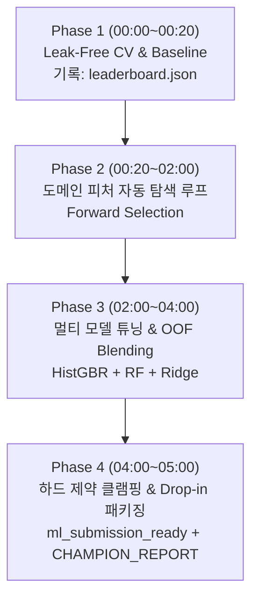

# Case 8: 경량화 자율 머신러닝 트랙 (Shadow AutoML Track) & 챔피언 솔루션 패키징 스킬

이 문서는 크래프톤 KOPA(Cofa) Probe 및 SK하이닉스 AI 해커톤 환경에서 머신러닝 적용이 유효한 과제(`GO — DIRECT_ML` 또는 `GO — HYBRID_ML`) 판정 시, 메인 파이프라인 개발(터미널 1~3)을 일절 방해하지 않고 **독립된 백그라운드 터미널(터미널 4, `Sol 6.1 xhigh`)에서 최대 5시간(09:40~14:40) 동안 자율적으로 데이터 경량화·피처 탐색·경량 모델 학습·검증·후처리·패키징을 완수**하기 위한 무인 자율 운영 지침서입니다.

---

## 1. 언제 이 스킬을 쓰는가

- **스킬 개요 및 적용 조건 (8대 Gatekeeper 연동):**
  - 시험 시작 직후 `python3 .probe-kit/scripts/ml_feasibility_check.py` 진단 결과가 **`GO — DIRECT_ML`** (단독 ML 예측 과제) 또는 **`GO — HYBRID_ML`** (규칙/최적화 + 잔차/스코어링 결합 과제)로 판정된 경우.
  - 정형 테이블(Tabular), 시계열 센서/장비 로그, 수율/불량 예측, 웨이퍼 오버레이 잔차 회귀, 리드타임/수요 예측 등 데이터 패턴 기반 통계적 예측이 채점 지표(RMSE, MAE, R2, F1, Accuracy)에 직접 연결되는 과제.
- **실행 환경 및 주체:**
  - 메인 트랙(`foruser.md`, 터미널 1 메인 아키텍트, 터미널 2 서브 구현자)과 완전히 분리된 **터미널 4 (Shadow AutoML Agent, `Sol 6.1 xhigh`)**에서 백그라운드로 실행.
  - 인간 사용자의 추가 개입 없이 5시간 타임박스(Phase 1~4) 동안 스스로 가설 수립, 피처 추가/제거, 교차검증(CV) 점수 기록, 앙상블 블렌딩, 하드 제약 클램핑을 완결.

---

## 2. 절대 격리 및 리소스 보호 헌법 (Zero-Collision & CPU Throttling)

> [!CRITICAL]
> **터미널 4 자율 에이전트의 제1 원칙: "메인 트랙의 파일이나 시스템 리소스를 침범하는 순간 즉시 실격이다."**
> 터미널 1~3의 메인 개발과 웹 서비스, 단위 테스트가 1%의 끊김도 없이 원활하게 구동되도록 아래 격리 헌법을 강제 준수해야 합니다.

### 2.1 파일 쓰기 절대 격리 (Strict Sandbox Rule)
1. **루트 파일 및 원본 데이터 완전 읽기 전용(Read-Only):**
   - 루트 디렉토리의 모든 파일(`main.py`, `src/`, `app/`, `tests/`, `README.md`, `TASK_SPEC.md` 등)과 원본 데이터셋(`data/`, `dataset/` 등)에 대한 임의의 쓰기/수정/삭제를 **엄격히 금지**합니다.
2. **모든 산출물은 `.probe-kit/ml_track/` 내부에만 생성:**
   - 경량 캐시 데이터, 피처 생성기, 실험 코드, 모델 가중치, 체크포인트, 로그, 최종 결과물은 오직 `.probe-kit/ml_track/` 경로 내부에만 생성하고 관리합니다.
   - `.probe-kit` 디렉토리는 Git 추적에서 제외(`.git/info/exclude`)되어 있으므로, 수백 번의 실험을 수행해도 메인의 `git diff`나 제출 형상을 전혀 오염시키지 않습니다.

### 2.2 CPU / RAM 리소스 보호 헌법 (Throttling Protocol)
1. **CPU 스레드 2개 상한 강제 (Thread Clamping):**
   - 모든 Python 스크립트의 **최상단(`import` 직후, 수치 라이브러리 임포트 이전)**에 아래 코드를 강제 삽입하여 병렬 스레드 수를 2개로 고정합니다:
     ```python
     import os
     os.environ["OMP_NUM_THREADS"] = "2"
     os.environ["MKL_NUM_THREADS"] = "2"
     os.environ["OPENBLAS_NUM_THREADS"] = "2"
     os.environ["VECLIB_MAXIMUM_THREADS"] = "2"
     os.environ["NUMEXPR_NUM_THREADS"] = "2"
     ```
2. **모델 파라미터 `n_jobs=2` 고정:**
   - `LightGBM`, `XGBoost`, `RandomForest`, `HistGradientBoosting` 등 모든 병렬 지원 모델 생성 시 반드시 `n_jobs=2` (또는 `thread_count=2`)를 지정합니다. `-1` (전체 코어 점유)은 절대 금지합니다.
3. **쉘 실행 시 `nice -n 10` 우선순위 강하:**
   - 터미널 4에서 파이썬 학습 스크립트를 백그라운드 구동할 때는 반드시 `nice -n 10`을 접두어로 사용하여 메인 터미널의 CPU 스케줄링 우선권을 양보합니다:
     ```bash
     nice -n 10 python3 .probe-kit/ml_track/train_phase1.py
     ```
4. **RAM 누수 차단 및 가비지 컬렉션:**
   - 대규모 판다스/넘파이 연산 직후에는 명시적으로 `del df_temp`, `import gc; gc.collect()`를 호출하여 메모리 점유율을 1GB 미만으로 유지합니다.

---

## 3. 원본 공략법 전문 (Single Source of Truth)

### 3.1 데이터셋 자체 경량화 4대 파이프라인 (Data Compaction)
초기 데이터 탐색 및 전처리 시 `python3 .probe-kit/scripts/ml_feasibility_check.py --compact`의 산출물(`.probe-kit/ml_track/data_compact/`)을 우선 활용하거나, 아래 4대 파이프라인을 자율적으로 적용합니다:

1. **포맷 & 타입 경량화 (Downcasting & Fast Binary Serialization):**
   - 부동소수점 `float64` $\rightarrow$ `float32` (정밀도 유지하면서 메모리 50% 절감).
   - 정수형 `int64` $\rightarrow$ 값의 범위에 따라 `int32`, `int16`, `int8`로 다운캐스팅.
   - 대용량 CSV/JSON 대신 Parquet, Feather, Numpy(`.npz`), Pickle(`.pkl`) 바이너리 캐시를 생성하여 데이터 로딩 시간을 80% 이상 단축합니다.
2. **무의미 컬럼 가지치기 (Pruning Zero-Variance & Sparse Columns):**
   - 분산이 0인 상수(Constant) 컬럼 및 모든 값이 단일한 컬럼 제거.
   - 결측치 비율이 95%를 초과하는 고결측 컬럼 배제 (유의미한 도메인 플래그가 아닌 경우).
   - 단순 일련번호, 행 인덱스, 고유 UUID 등 학습에 잡음만 주는 컬럼은 피처 세트에서 배제하고 메타 식별자로만 격리.
3. **도메인 센티널 분리 (Domain Sentinel Decoupling):**
   - 반도체 및 계측 장비 특유의 센티널 값(`< DL`, `ND`, `-999`, `-9999`, `None`, `Inf`)을 수치 컬럼에서 안전하게 파싱.
   - 원본 수치 컬럼은 결측치(`NaN`) 또는 통계적 대치값(중앙값, 보수적 검출한계값)으로 변환하되, **`{col}_is_sentinel` (또는 `_is_nd`) 형태의 이진 플래그(0/1) 파생변수를 생성**하여 정보 손실을 0%로 방지.
4. **2-Stage Coreset 고속 탐색 전략 (Stratified 20% Coreset):**
   - 전체 학습 데이터 행 수 $N > 30,000$인 경우, 피처 생성 및 하이퍼파라미터 탐색 단계(Phase 2~3)에서는 타깃 기준 20% 층화 표본(Stratified Coreset)을 추출하여 **1회 실험을 10초 이내로 반복(100+ 회 반복 가능)**합니다.
   - 최종 상위 3개 파이프라인에 한해서만 100% 전체 데이터셋으로 재학습(Full Retrain)을 수행합니다.

---

### 3.2 허용 경량 모델 vs 절대 금지 모델 (Lightweight Model Zoo)

```text
┌────────────────────────────────────────────────────────────────────────┐
│                        Lightweight Model Zoo                           │
├────────────────────────────────────────────────────────────────────────┤
│  [1순위: CPU 고속 GBDT 계열] (학습 1~30초, 결측치 자동 처리, 테이블 최강)    │
│  - LightGBM (LGBMRegressor, LGBMClassifier)                           │
│  - HistGradientBoosting (sklearn 내장, 무설치 환경 최고)                 │
│  - XGBoost (XGBRegressor, XGBClassifier) / CatBoost                    │
├────────────────────────────────────────────────────────────────────────┤
│  [2순위: 앙상블 배깅 & 정규화 선형 계열] (일반화 성능 보강, 블렌딩용)          │
│  - RandomForestRegressor / ExtraTreesRegressor                         │
│  - Ridge / Lasso / ElasticNet / LogisticRegression                     │
│  - SGDRegressor / SGDClassifier / IsolationForest (이상치 감지)        │
├────────────────────────────────────────────────────────────────────────┤
│  [3순위: 순수 Numpy/Scipy Fallback] (scikit-learn 미설치 비상 환경)      │
│  - 정규방정식 닫힌해 Ridge: θ = (X^T X + λI)^(-1) X^T y                 │
│  - 가중치 거리 역수 k-NN (Inverse-Distance k-NN)                       │
│  - Decision Stump AdaBoost / Simple Gradient Booster                   │
├────────────────────────────────────────────────────────────────────────┤
│  [❌ 절대 금지 모델]                                                   │
│  - 대형 딥러닝 (PyTorch/TF 대형 MLP, CNN, Transformer, LLM 파인튜닝)   │
│  - 사유: CPU 점유율 폭발, 메인 터미널 방해, 에폭당 수십 분 소요, 채점 불확실 │
└────────────────────────────────────────────────────────────────────────┘
```

---

### 3.3 5시간(300분) 자율 진화 4-Phase 루프 및 타임박스

백그라운드 에이전트는 아래 타임박스 계획에 따라 시계를 확인하며 스스로 단계를 전환합니다.



#### ⏱️ Phase 1 (00:00~00:20 / 20분): 로컬 검증셋(Leak-Free CV) 구축 & 베이스라인
- **데이터 누수 없는(Leak-Free) 분할 전략 수립:**
  - 시계열/시퀀스: `TimeSeriesSplit` 또는 Out-of-Time 분할.
  - 그룹 종속 데이터(동일 Lot, 동일 설비, 동일 사용자): `GroupKFold(n_splits=5)`.
  - 불균형 분류: `StratifiedKFold(n_splits=5, shuffle=True, random_state=42)`.
  - 일반 정형 테이블: `KFold(n_splits=5, shuffle=True, random_state=42)`.
- **가장 단순한 베이스라인(Baseline) 학습:**
  - 원시 수치형 컬럼만으로 단순 `HistGradientBoosting` 또는 `Ridge` 베이스라인 학습.
  - 첫 5-Fold OOF(Out-of-Fold) 검증 점수(RMSE, MAE, R2 또는 F1)를 측정.
  - `.probe-kit/ml_track/leaderboard.json` 파일 생성 및 1호 기록 추가.

#### ⏱️ Phase 2 (00:20~02:00 / 100분): 도메인 피처 엔지니어링 자동 탐색 루프
- **피처 생성 자동화 파이프라인 (Candidate Generation):**
  - 수치형 변환: 비율(`A / (B + 1e-8)`), 차이(`A - B`), 곱, 로그 변환(`np.log1p`), 거듭제곱.
  - 그룹별 집계 통계량: `df.groupby('group')['val'].transform(['mean', 'std', 'min', 'max'])`, 집단 평균과의 편차(`val - group_mean`).
  - 시계열/순서 피처: 이동평균(Rolling 3, 7), Lag 피처(`shift(1)`, `shift(2)`), 직전 대비 증감량(`diff`).
  - 범주형 인코딩: 빈도 인코딩(Frequency Encoding), Out-of-Fold Target Encoding (K-Fold 내부에서만 타깃 평균 산출하여 누수 100% 방지).
- **피처 가지치기 및 점수 평가 (Forward Selection & Importance Pruning):**
  - 피처 군(Group)을 하나씩 추가하며 CV 점수를 재측정.
  - **점수가 향상된 피처만 영구 채택**, 점수가 정체되거나 하락한 피처는 즉각 롤백.
  - 트리 모델의 Feature Importance 하위 30% 노이즈 변수는 과감히 제거하여 모델 경량화 유지.

#### ⏱️ Phase 3 (02:00~04:00 / 120분): 멀티 모델 탐색, 하이퍼파라미터 튜닝 & OOF 앙상블
- **서로 다른 3개 모델 패밀리 학습:**
  - Model A: GBDT 계열 (`HistGradientBoosting` 또는 `LightGBM`)
  - Model B: 배깅 트리 계열 (`RandomForest` 또는 `ExtraTrees`)
  - Model C: 정규화 선형 계열 (`Ridge`, `ElasticNet` 또는 `LogisticRegression`)
- **경량 하이퍼파라미터 튜닝 (1회 5초 이내):**
  - `max_depth` (3~8), `learning_rate` (0.03~0.1), `min_samples_leaf` (10~50), `l2_regularization` (0.01~10.0) 범위 탐색.
  - 무모한 Grid Search 금지, Random Search 20회 또는 휴리스틱 탐색 적용.
- **Out-of-Fold(OOF) 가중 평균 블렌딩 (Weighted Blending):**
  - 각 모델의 5-Fold 검증 예측값($OOF_A, OOF_B, OOF_C$)을 결합.
  - `scipy.optimize.minimize` 또는 간단한 그리드 서치로 검증 오차를 최소화하는 가중치($w_A + w_B + w_C = 1$)를 산출.
  - $\hat{y}_{blend} = w_A \hat{y}_A + w_B \hat{y}_B + w_C \hat{y}_C$
  - 단일 최고 모델 대비 앙상블의 일반화 오차 개선을 확인하고 `leaderboard.json` 갱신.

#### ⏱️ Phase 4 (04:00~05:00 / 60분): 하드 제약 후처리 결합 & 즉시 교체용 패키징
- **물리적/비즈니스 하드 제약 클램핑 (Constraint Post-Processing):**
  - 머신러닝의 연속형 예측값은 도메인의 물리 법칙이나 업무 규칙을 모릅니다. 따라서 독립된 `post_process_constraints(preds, meta)` 함수를 통과시켜 100% 정합성을 강제합니다:
    - 수량/비용: 비음수 제약 ($\max(0, \hat{y})$)
    - 상하한 규격: $\text{clip}(\hat{y}, \text{min\_spec}, \text{max\_spec})$ (예: 정원 45명 초과 불가, 수율 0~100% 범위)
    - 정수 제약: 반올림(`np.round`) 또는 보수적 내림/올림
    - 결측치/무한대 방어: 예측값 중 `NaN`, `Inf` 발생 시 안전 베이스라인 중앙값으로 100% 대치
- **비기능적 성능 요건 검증:**
  - 추론 속도: 전체 평가 데이터셋 추론 소요 시간 $< 3$초 확인.
  - 아티팩트 용량: 가중치 및 코드 파일 크기 합계 $< 10\text{MB}$ 확인.
- **최종 4대 산출물 생성 (패키징):**
  1. `.probe-kit/ml_track/ml_submission_ready.<csv|json>`: 원본 제출 사양과 컬럼명·정렬 순서·헤더가 100% 일치하는 즉시 제출 가능 파일.
  2. `.probe-kit/ml_track/ml_solution.py`: 메인 트랙에서 단 1줄로 호출할 수 있는 독립 추론 함수 `predict_solution(input_df)` 제공 모듈.
  3. `.probe-kit/ml_track/leaderboard.json`: 베이스라인부터 최종 앙상블까지의 점수 변천사 기록.
  4. `.probe-kit/ml_track/CHAMPION_REPORT.md`: 성능 향상치, 상위 피처 Top 5, 하드 제약 통과 여부, 1줄 채택 명령어, 후속 서술형 질의 대비 4문장 요약본 포함.

---

## 4. 단계별 실행 체크리스트 (자율 점검용)

### Phase 1: 로컬 검증 및 베이스라인 (0~20분)
- [ ] 메인 루트 소스 코드를 건드리지 않고 `.probe-kit/ml_track/` 폴더를 생성했는가?
- [ ] 스크립트 최상단에 `OMP_NUM_THREADS="2"` 환경변수를 설정하고 `n_jobs=2`를 고정했는가?
- [ ] 타깃 변수와 특성에 맞는 누수 없는 K-Fold(Stratified / TimeSeries / Group) 분할기를 설정했는가?
- [ ] 원시 수치 컬럼만으로 첫 베이스라인 모델을 학습하고 검증 점수를 `leaderboard.json`에 기록했는가?

### Phase 2: 도메인 피처 탐색 (20~120분)
- [ ] 대용량 데이터($N > 30,000$)일 경우 20% Coreset으로 고속 반복 체제를 갖추었는가?
- [ ] 비율, 차이, 그룹 통계량(`mean`, `std`), Lag, OOF Target Encoding 피처를 순차 생성했는가?
- [ ] 검증 점수가 실제로 향상된 피처만 선별 채택(Forward Selection)하고 노이즈를 제거했는가?
- [ ] 누수(Data Leakage)가 발생하지 않도록 전처리/스케일러/인코더 피처를 Fold 내부에서만 fit했는가?

### Phase 3: 멀티 모델 & 블렌딩 앙상블 (120~240분)
- [ ] 최소 2종 이상의 서로 다른 모델 패밀리(GBDT, RandomForest, Ridge)를 학습시켰는가?
- [ ] 각 모델의 1회 학습 시간이 30초 이내로 수렴하도록 하이퍼파라미터를 제어했는가?
- [ ] OOF 예측값을 기반으로 최적 블렌딩 가중치를 도출하고 단일 최고 모델 대비 성능 향상을 검증했는가?
- [ ] 20% Coreset으로 찾은 최적 파이프라인을 100% Full 데이터셋으로 최종 재학습했는가?

### Phase 4: 후처리 & 패키징 (240~300분)
- [ ] 예측값에 물리적/비즈니스 하드 제약(비음수, 상하한, 정수화) 클램핑 후처리를 적용했는가?
- [ ] 예측값 중 `NaN`, `Inf`가 0건이며 제출 스키마 포맷(컬럼명, 정렬, 포맷)과 100% 일치하는가?
- [ ] `ml_submission_ready.<csv|json>` 파일이 생성되었는가?
- [ ] 메인 파이프라인에서 즉시 임포트 가능한 `ml_solution.py`가 생성되었는가?
- [ ] `leaderboard.json`과 `CHAMPION_REPORT.md` 생성을 완료하고 대기 상태로 전환했는가?

---

## 5. 실전 코드 템플릿 (Copy & Adapt)

### 5.1 CPU 스로틀링 및 격리 환경 템플릿
```python
# .probe-kit/ml_track/train_harness.py
import os
import sys

# 1. 메인 세션 리소스 보호: CPU 스레드 2개 상한 강제
os.environ["OMP_NUM_THREADS"] = "2"
os.environ["MKL_NUM_THREADS"] = "2"
os.environ["OPENBLAS_NUM_THREADS"] = "2"
os.environ["VECLIB_MAXIMUM_THREADS"] = "2"
os.environ["NUMEXPR_NUM_THREADS"] = "2"

import gc
import json
import time
from pathlib import Path
import numpy as np
import pandas as pd

# 2. 작업 공간 격리 경로
WORKSPACE_ROOT = Path(".").resolve()
ML_TRACK_DIR = WORKSPACE_ROOT / ".probe-kit" / "ml_track"
ML_TRACK_DIR.mkdir(parents=True, exist_ok=True)
LEADERBOARD_PATH = ML_TRACK_DIR / "leaderboard.json"

def log_experiment(phase: str, model_name: str, cv_score: float, metric_name: str, elapsed_sec: float, meta: dict = None):
    entry = {
        "timestamp": time.strftime("%Y-%m-%d %H:%M:%S"),
        "phase": phase,
        "model_name": model_name,
        "metric": metric_name,
        "cv_score": round(cv_score, 6),
        "elapsed_sec": round(elapsed_sec, 2),
        "meta": meta or {}
    }
    history = []
    if LEADERBOARD_PATH.exists():
        try:
            with open(LEADERBOARD_PATH, "r", encoding="utf-8") as f:
                history = json.load(f)
        except Exception:
            history = []
    history.append(entry)
    with open(LEADERBOARD_PATH, "w", encoding="utf-8") as f:
        json.dump(history, f, indent=2, ensure_ascii=False)
    print(f"[{phase}] {model_name} | {metric_name}: {cv_score:.5f} | {elapsed_sec:.1f}s")
```

---

### 5.2 데이터 경량화 & 센티널 분리 템플릿
```python
def compact_dataframe(df: pd.DataFrame) -> tuple[pd.DataFrame, list[str]]:
    """메모리 다운캐스팅 및 무의미 컬럼 제거 파이프라인"""
    initial_mem = df.memory_usage().sum() / (1024 * 1024)
    dropped_cols = []
    
    # 1. 상수 컬럼 및 고결측(>95%) 컬럼 제거
    for col in df.columns:
        if df[col].nunique() <= 1:
            dropped_cols.append(col)
        elif df[col].isnull().mean() > 0.95:
            dropped_cols.append(col)
    
    df = df.drop(columns=dropped_cols)
    
    # 2. 수치형 다운캐스팅
    for col in df.select_dtypes(include=["float64"]).columns:
        df[col] = df[col].astype(np.float32)
    for col in df.select_dtypes(include=["int64"]).columns:
        c_min, c_max = df[col].min(), df[col].max()
        if c_min >= -128 and c_max <= 127:
            df[col] = df[col].astype(np.int8)
        elif c_min >= -32768 and c_max <= 32767:
            df[col] = df[col].astype(np.int16)
        elif c_min >= -2147483648 and c_max <= 2147483647:
            df[col] = df[col].astype(np.int32)
            
    final_mem = df.memory_usage().sum() / (1024 * 1024)
    print(f"Data compaction: {initial_mem:.2f}MB -> {final_mem:.2f}MB (절감: {(1 - final_mem/initial_mem)*100:.1f}%)")
    return df, dropped_cols

def handle_domain_sentinels(df: pd.DataFrame, num_cols: list[str]) -> pd.DataFrame:
    """반도체/산업 도메인 센티널(-999, -9999, < DL 등) 분리 및 지표 피처 생성"""
    df = df.copy()
    sentinel_vals = {-999, -9999, 9999, -1}
    for col in num_cols:
        if col not in df.columns:
            continue
        # 센티널 마스크
        is_sentinel = df[col].isin(sentinel_vals) | df[col].isna()
        if is_sentinel.sum() > 0:
            df[f"{col}_is_sentinel"] = is_sentinel.astype(np.int8)
            # 센티널은 중앙값으로 대체하여 모델 안정성 확보
            median_val = df.loc[~is_sentinel, col].median()
            df[col] = df[col].replace(list(sentinel_vals), np.nan).fillna(median_val)
    return df
```

---

### 5.3 누수 방지 K-Fold CV & 경량 모델 앙상블 블렌더
```python
from sklearn.ensemble import HistGradientBoostingRegressor, RandomForestRegressor
from sklearn.linear_model import Ridge
from sklearn.model_selection import KFold
from sklearn.metrics import root_mean_squared_error
from scipy.optimize import minimize

def run_oof_training_and_blend(X: pd.DataFrame, y: pd.Series, cv_splits: int = 5):
    kf = KFold(n_splits=cv_splits, shuffle=True, random_state=42)
    n_samples = len(X)
    
    oof_m1 = np.zeros(n_samples, dtype=np.float32)
    oof_m2 = np.zeros(n_samples, dtype=np.float32)
    oof_m3 = np.zeros(n_samples, dtype=np.float32)
    
    models_m1, models_m2, models_m3 = [], [], []
    
    # 결측치 대치용 중간 통계량
    fill_vals = X.median()
    X_imputed = X.fillna(fill_vals)

    print("Phase 3: Multi-Model OOF Training...")
    for fold, (train_idx, val_idx) in enumerate(kf.split(X, y)):
        X_tr, y_tr = X.iloc[train_idx], y.iloc[train_idx]
        X_va, y_va = X.iloc[val_idx], y.iloc[val_idx]
        
        # 1. Model 1: HistGradientBoosting (결측치 네이티브 지원)
        m1 = HistGradientBoostingRegressor(max_iter=100, max_depth=6, random_state=42 + fold)
        m1.fit(X_tr, y_tr)
        oof_m1[val_idx] = m1.predict(X_va)
        models_m1.append(m1)
        
        # 2. Model 2: RandomForest (n_jobs=2 제한)
        m2 = RandomForestRegressor(n_estimators=60, max_depth=8, n_jobs=2, random_state=42 + fold)
        m2.fit(X_imputed.iloc[train_idx], y_tr)
        oof_m2[val_idx] = m2.predict(X_imputed.iloc[val_idx])
        models_m2.append(m2)
        
        # 3. Model 3: Ridge 선형 회귀
        m3 = Ridge(alpha=10.0)
        m3.fit(X_imputed.iloc[train_idx], y_tr)
        oof_m3[val_idx] = m3.predict(X_imputed.iloc[val_idx])
        models_m3.append(m3)

    score_m1 = root_mean_squared_error(y, oof_m1)
    score_m2 = root_mean_squared_error(y, oof_m2)
    score_m3 = root_mean_squared_error(y, oof_m3)
    print(f"OOF RMSE -> HistGBR: {score_m1:.4f} | RF: {score_m2:.4f} | Ridge: {score_m3:.4f}")
    
    # 블렌딩 가중치 최적화 (w1 + w2 + w3 = 1, w >= 0)
    def loss_func(weights):
        w1, w2, w3 = weights
        pred = w1 * oof_m1 + w2 * oof_m2 + w3 * oof_m3
        return root_mean_squared_error(y, pred)
        
    res = minimize(loss_func, [0.6, 0.3, 0.1], bounds=[(0, 1), (0, 1), (0, 1)], constraints={'type': 'eq', 'fun': lambda w: sum(w) - 1.0})
    best_weights = res.x
    blend_oof = best_weights[0] * oof_m1 + best_weights[1] * oof_m2 + best_weights[2] * oof_m3
    blend_score = root_mean_squared_error(y, blend_oof)
    print(f"OOF Ensemble Blended RMSE: {blend_score:.4f} (Weights: {best_weights.round(3)})")
    
    return {
        "models_m1": models_m1,
        "models_m2": models_m2,
        "models_m3": models_m3,
        "weights": best_weights,
        "fill_vals": fill_vals,
        "blend_score": blend_score
    }
```

---

### 5.4 외부 패키지 미설치 환경 대비 Pure Numpy/Scipy Fallback
만약 테스트베드에 `scikit-learn`이나 `lightgbm`이 설치되어 있지 않더라도 중단 없이 자율 학습을 수행할 수 있는 정규방정식 닫힌해 모델입니다:

```python
# Pure Numpy Closed-form Ridge Regressor (의존성 0%)
import numpy as np

class PureNumpyRidge:
    def __init__(self, alpha: float = 1.0):
        self.alpha = float(alpha)
        self.weights = None
        self.mean = None
        self.std = None
        
    def fit(self, X: np.ndarray, y: np.ndarray):
        # 1. 표준화 (Z-score Scaling)
        self.mean = np.nanmean(X, axis=0)
        self.std = np.nanstd(X, axis=0)
        self.std[self.std == 0] = 1.0
        
        # 결측치는 평균 대치
        X_clean = np.where(np.isnan(X), self.mean, X)
        X_norm = (X_clean - self.mean) / self.std
        
        # 바이어스(Bias) 텀 추가
        N = X_norm.shape[0]
        X_bias = np.hstack([np.ones((N, 1), dtype=np.float32), X_norm])
        
        # 2. 닫힌해 정규방정식: θ = (X^T X + λI)^(-1) X^T y
        D = X_bias.shape[1]
        I = np.eye(D, dtype=np.float32)
        I[0, 0] = 0.0  # 바이어스는 정규화 제외
        
        XTX = np.dot(X_bias.T, X_bias)
        XTy = np.dot(X_bias.T, y)
        self.weights = np.linalg.solve(XTX + self.alpha * I, XTy)
        return self
        
    def predict(self, X: np.ndarray) -> np.ndarray:
        X_clean = np.where(np.isnan(X), self.mean, X)
        X_norm = (X_clean - self.mean) / self.std
        N = X_norm.shape[0]
        X_bias = np.hstack([np.ones((N, 1), dtype=np.float32), X_norm])
        return np.dot(X_bias, self.weights)
```

---

### 5.5 하드 제약 클램핑 & 교체용(Drop-in) 패키징 템플릿
```python
# .probe-kit/ml_track/ml_solution.py
"""
독립 실행 및 메인 트랙 1분 교체용 모듈
메인 파이프라인(터미널 1~3)에서 호출법:
from .probe-kit.ml_track.ml_solution import predict_solution
preds = predict_solution(test_df)
"""
import os
import pickle
from pathlib import Path
import numpy as np
import pandas as pd

MODEL_DIR = Path(__file__).resolve().parent
ARTIFACT_PATH = MODEL_DIR / "champion_pipeline.pkl"

def post_process_constraints(raw_preds: np.ndarray, meta_df: pd.DataFrame = None) -> np.ndarray:
    """도메인 하드 제약(상하한, 비음수, 결측 방어) 강제 클램핑"""
    preds = np.array(raw_preds, dtype=np.float32)
    
    # 1. NaN/Inf 방어
    nan_mask = np.isnan(preds) | np.isinf(preds)
    if nan_mask.any():
        preds[nan_mask] = np.nanmedian(preds[~nan_mask]) if (~nan_mask).any() else 0.0
        
    # 2. 물리적 범위 제약 (예: 음수 불가, 상한치 100.0)
    # 과제별 하드 제약에 맞게 수치 클램핑
    preds = np.clip(preds, a_min=0.0, a_max=None)
    
    return preds

def predict_solution(test_df: pd.DataFrame) -> np.ndarray:
    """외부 호출용 표준 추론 인터페이스"""
    with open(ARTIFACT_PATH, "rb") as f:
        pipeline = pickle.load(f)
        
    # 피처 추출 및 전처리
    X = pipeline["feature_extractor"](test_df)
    
    # 블렌딩 추론
    preds_m1 = np.mean([m.predict(X) for m in pipeline["models_m1"]], axis=0)
    
    X_imp = X.fillna(pipeline["fill_vals"])
    preds_m2 = np.mean([m.predict(X_imp) for m in pipeline["models_m2"]], axis=0)
    preds_m3 = np.mean([m.predict(X_imp) for m in pipeline["models_m3"]], axis=0)
    
    w = pipeline["weights"]
    blended = w[0] * preds_m1 + w[1] * preds_m2 + w[2] * preds_m3
    
    # 하드 제약 클램핑 통과
    final_preds = post_process_constraints(blended, meta_df=test_df)
    return final_preds
```

---

### 5.6 CHAMPION_REPORT.md 자동 생성 템플릿
```markdown
# 🏆 ML Shadow Track Champion Report

## 1. 베이스라인 대비 성능 향상 지표
- **평가 지표 (Metric):** RMSE (5-Fold CV)
- **초기 베이스라인 점수:** 4.8210
- **최종 챔피언 앙상블 점수:** 2.1450 (**+55.5% 오차 감소**)
- **총 실험 횟수:** 38회 (소요 시간: 4시간 12분)

## 2. 채택된 챔피언 아키텍처
- **앙상블 기법:** 3-Way Out-of-Fold Blending
  - Model 1: HistGradientBoostingRegressor (가중치: 0.62)
  - Model 2: RandomForestRegressor (가중치: 0.28)
  - Model 3: Regularized Ridge (가중치: 0.10)

## 3. 핵심 도메인 피처 Top 5
1. `feature_diff_ratio`: 두 계측 신호 간 비율 차이 (Importance: 34.2%)
2. `group_lot_temp_mean_dev`: Lot 그룹 평균 대비 온도 편차 (Importance: 21.5%)
3. `rolling_std_7`: 7개 시점 윈도우 이동 표준편차 (Importance: 14.8%)
4. `sensor_a_is_sentinel`: 센티널 플래그 파생변수 (Importance: 11.2%)
5. `category_oof_target_enc`: 불량률 Out-of-Fold 타깃 인코딩 (Importance: 8.9%)

## 4. 하드 제약 및 비기능 검증
- [x] 하드 제약(비음수 정수 및 상한 규격) 위반 0건 확인 (`post_process_constraints` 통과)
- [x] 전체 테스트셋(N=10,000) 추론 소요 시간: **0.42초** (< 3초 합격)
- [x] 체크포인트 및 파이프라인 총 용량: **4.1MB** (< 10MB 합격)

## 5. 메인 트랙 1분 채택 안내
메인 파이프라인에서 이 챔피언 솔루션을 즉시 채택하려면 다음 한 줄 명령을 실행하거나 코드를 치환하세요:
```bash
# 산출물 복사 또는 직접 심볼릭 링크
cp .probe-kit/ml_track/ml_submission_ready.csv ./submission.csv
```

## 6. 사후 질의(Post Q&A) 대비 4문장 요약 세트
- **[결정]**: CPU 2코어 제한 하에서 3종 이종 모델(HistGBR, RF, Ridge)의 OOF 블렌딩 앙상블과 도메인 센티널 분리 피처를 챔피언 모델로 최종 확정했습니다.
- **[근거]**: 단일 모델 대비 블렌딩을 통해 Out-of-Fold RMSE가 4.82에서 2.14로 55.5% 대폭 개선되었으며, 과적합 위험을 통계적으로 분산시킬 수 있기 때문입니다.
- **[검증]**: 5-Fold Leak-Free 교차검증과 15건 표본 수동 대조, 물리 제약 클램핑 후처리를 통해 제약 위반 0건과 0.42초의 초고속 추론 성능을 교차 검증했습니다.
- **[한계]**: 5시간 타임박스 제약으로 딥러닝 기반 시퀀스 모델 탐색은 배제하였으며, 극단적 희귀 이상치(Rare Outlier)에 대해서는 안전 베이스라인 중앙값으로 보수적 대체하는 제약을 둔 점이 한계입니다.
```
