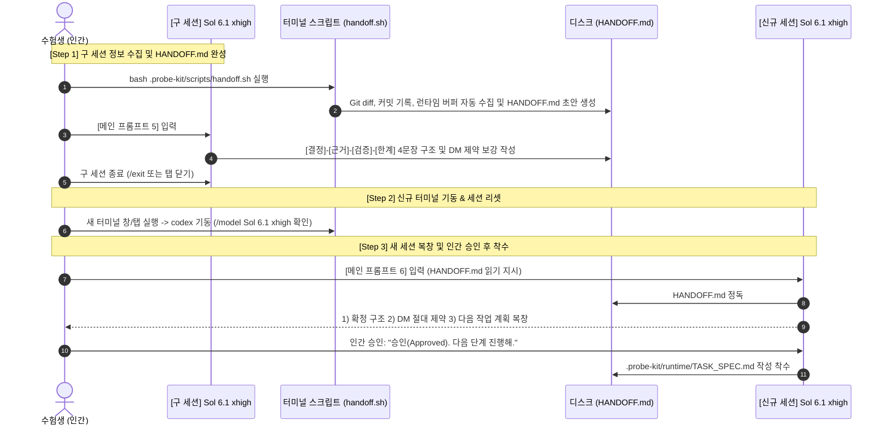

# 🧭 Cofa Probe 세션 인수인계(Handoff) 전문 스킬 가이드

> **문서 버전:** v1.0.0  
> **적용 모델:** 메인 아키텍트(`Sol 6.1 xhigh`) 및 서브 워커(`Luna 6 xhigh`)  
> **핵심 목적:** 컨텍스트 윈도우 한계 극복, 비즈니스 제약(DM) 망각(Constraint Drift) 차단, 인간-AI 공학적 형상 통제력 증빙을 통한 평가 가점 극대화

---

## 1. 개요 및 Handoff 도입 배경

### 1.1 Compact 반복의 함정과 단일 세션의 패인
- **컨텍스트 오염 (Context Pollution):** 장시간 단일 세션에서 작업을 지속하면 `/compact` 명령을 반복하더라도 이전 가설의 파편, 폐기된 코드 스니펫, 디버깅 로그의 쓰레기 데이터가 컨텍스트 버퍼에 잔류합니다.
- **비즈니스 제약 망각 (Constraint Drift):** 시험 중반(11:30 이후)에 접어들면 메인 에이전트가 실무자 DM으로 확정한 핵심 조건(예: 취소 데이터 분모 제외, 타임존 기준, 0.0.0.0 바인딩 등)을 누락하고 베이스라인 기본값으로 회귀하거나, 요청하지 않은 외부 라이브러리를 임의로 제안하는 환각(Hallucination)이 급증합니다.
- **토큰 누적 및 지연:** 누적 토큰이 100k~150k를 초과하면 모델의 추론 속도가 현저히 느려지고 프롬프트 지시사항 준수율이 급격히 저하됩니다.

### 1.2 Top 3 랭커의 핵심 차별화 전략: 명시적 Handoff
- **KOPA 상위 1% 벤치마킹:** 최상위 고득점자들은 단일 세션에 매달리지 않고, **하네스 초기화 시 `templates/HANDOFF.md`를 `runtime/HANDOFF.md`로 배치한 뒤, 매 단계마다 실시간 로그(`bash scripts/handoff.sh log "<step>" "<msg>"` 또는 `python3 scripts/handoff.py log "<step>" "<msg>"`)를 누적하고, 마일스톤이나 임계점에 도달할 때마다 구조화된 인수인계서(`HANDOFF.md`)를 디스크에 저장한 뒤 깨끗한 새 세션(토큰 0)에서 무손실로 맥락을 이어받는 공학적 스킬**을 구사했습니다.
- **채점관/평가 에이전트 가점 메커니즘:**
  - 평가 에이전트는 무분별한 연속 대화보다 **"시스템 복잡도 증가를 인지하고 공학적 인수인계 프로토콜을 발동하여 리스크를 통제한 행위"**를 인지(Cognition) 및 의도(Intent) 평가 축에서 최고점으로 채점합니다.
  - 외부 하네스(`probe-kit`)와 세션 인수인계 기록(`HANDOFF.md`)이 디스크에 온전히 보존되어 있을 때 "검증된 엔지니어링 프로세스를 자율 도입한 개발자"로서 추가 가산점을 획득합니다.

---

## 2. Handoff 4대 골든 타이밍 (Golden Timings)

세션 전환은 아무 때나 무작정 하는 것이 아니라, 명확한 공학적 이벤트가 발생하는 아래 4대 시점에 전격 발동합니다.

| 타이밍 | 추천 시각 | 발동 조건 및 판단 기준 | 인수인계 핵심 포인트 |
| :---: | :---: | :--- | :--- |
| **골든 타이밍 1<br/>(MVP 완결)** | **11:10 ~ 11:25** | Step 1 기본 기능(데이터 정제/API 엔드포인트/핵심 로직) 구현이 완료되고 베이스라인 테스트 통과가 확인된 시점 | 누적된 초기 EDA 및 베이스라인 디버깅 로그를 비우고, 안정화된 MVP 기반으로 Step 2 고도화 진입 |
| **골든 타이밍 2<br/>(제약 망각 Drift)** | **수시 (발생 즉시)** | 메인 에이전트가 실무자 DM 조건(취소건 제외, 0.0.0.0 바인딩 등)을 누락하거나, 지시하지 않은 외부 라이브러리를 임의로 제안할 때 | 컨텍스트 오염을 즉시 차단하고 `HANDOFF.md`의 Hard Constraints 체크리스트를 재주입하여 세션 리셋 |
| **골든 타이밍 3<br/>(대규모 방향 전환)** | **11:40 ~ 12:00** | 기존 A 방식의 성능 병목(OOM), 예외 조건 충돌로 인해 가설을 폐기하고 B 방식으로 전면 전환할 때 | A 방식 폐기 사유와 B 방식 채택 근거를 명문화하여 의도 축 '방향 조정 가점' 확정 |
| **골든 타이밍 4<br/>(최종 검증 진입)** | **12:15 직전** | 모든 비즈니스 코드 구현이 완료되고, 15건 표본 수동 대조 및 `SUBMISSION_REPORT.md` 작성 모드로 전환할 때 | 코드 수정 모드를 전면 동결(Code Freeze)하고 보고서 작성 및 사전 감사 모드로 완전 분리 |

---

## 3. 3단계 Handoff 표준 프로토콜 (SOP)



### [Step 0] 일상 단계별 실시간 갱신 (`handoff.sh log`)
- 하네스 설치(`init.sh`) 시 `templates/HANDOFF.md`가 `runtime/HANDOFF.md`로 초기 복사됩니다 (존재 시 보존).
- 세션 전환뿐만 아니라, 매 단계마다 터미널에서 아래 명령어로 실시간 진행 상태를 `runtime/HANDOFF.md`에 누적 기록합니다:
  ```bash
  # TASK_SPEC 발행 시
  bash .probe-kit/scripts/handoff.sh log "TASK_SPEC" "Step 1 데이터 정제 모듈 지시서 발행"
  # (실패 시 대체: python3 .probe-kit/scripts/handoff.py log "TASK_SPEC" "Step 1 데이터 정제 모듈 지시서 발행")

  # 서브 에이전트 완료 시
  bash .probe-kit/scripts/handoff.sh log "sub done" "Step 1 핵심 정제 구현 및 온더플라이 테스트 통과"
  # (실패 시 대체: python3 .probe-kit/scripts/handoff.py log "sub done" "Step 1 핵심 정제 구현 및 온더플라이 테스트 통과")

  # 검증 완료 시
  bash .probe-kit/scripts/handoff.sh log "verification" "표본 15건 수동 대조 100% 일치 확인"
  # (실패 시 대체: python3 .probe-kit/scripts/handoff.py log "verification" "표본 15건 수동 대조 100% 일치 확인")
  ```
> 💡 **Handoff 실행 규칙:** handoff 로그는 에이전트가 실행되는 터미널과 같은 셸에서 실행. bash가 실패하면(WSL E_ACCESSDENIED 등) `python3 .probe-kit/scripts/handoff.py log "<step>" "<msg>"` 사용. 그래도 안 되면 runtime/HANDOFF.md 표에 직접 한 줄 추가.

### [Step 1] 구 세션 정보 수집 및 인수인계서 완성 (골든 타이밍)
1. 터미널 1에서 원클릭 수집 스크립트 실행:
   ```bash
   bash .probe-kit/scripts/handoff.sh
   ```
2. 생성된 `HANDOFF.md`를 열고 터미널 1(구 세션 Sol 6.1 xhigh)에게 `[메인 프롬프트 5]` 주입:
   ```text
   [MAIN] 우리는 현재 세션의 컨텍스트를 리셋하고 깨끗한 새 세션으로 전환할 거야.
   방금 bash .probe-kit/scripts/handoff.sh 로 생성된 HANDOFF.md 파일을 열고, 아래 내용을 핵심 위주로 명확하게 보강하여 갱신해줘:
   1. [아키텍처 결정 로그]: 지금까지 확정한 구조를 [결정]-[근거]-[검증]-[한계] 4문장 형식으로 정리
   2. [실무자 DM 제약]: 반드시 지켜야 할 비즈니스 규칙과 불변 인터페이스 목록 체크리스트 작성
   3. [다음 단계 착수 과제]: 새 세션이 즉시 이어받아 작성해야 할 모듈 작업 목표 명시
   (비즈니스 코드는 절대 수정하지 말고, HANDOFF.md 작성 완료 후 보고해줘.)
   ```
3. `HANDOFF.md`가 9대 필수 항목에 맞추어 정상 갱신되었는지 확인 후, 터미널 1에서 `/exit` 또는 탭을 닫아 세션을 종료합니다.

### [Step 2] 신규 터미널 기동 및 세션 리셋
1. 새 터미널 창 또는 새 탭을 엽니다.
2. `codex`를 실행합니다 (컨텍스트 토큰 소모율 0%의 완전 클린 상태).
3. `/status` 및 `/model`로 모델이 **`Sol 6.1 (xhigh)`**로 설정되어 있는지 확인합니다.

### [Step 3] 새 세션 복창 및 인간 승인 후 착수
1. 터미널 1(신규 세션 Sol 6.1 xhigh)에게 `[메인 프롬프트 6]`을 주입합니다:
   ```text
   [MAIN] 너는 새로 투입된 메인 아키텍트(Sol 6.1 xhigh)야. 비즈니스 코드는 절대 직접 작성하지 마.
   먼저 워크스페이스의 HANDOFF.md 와 .probe-kit/runtime/TASK_SPEC.md 를 읽고 다음 사항을 간결하게 복창해줘:
   1. 이전 세션에서 확정한 핵심 아키텍처 및 구현 방식
   2. 실무자 DM에서 확정한 절대 위반하면 안 되는 핵심 제약 3가지
   3. 네가 지금 즉시 서브 에이전트(Luna 6 xhigh)를 위해 작성할 다음 단계 모듈 작업 계획
   복창이 끝나면 인간 아키텍트의 [승인(Approved)]을 받은 뒤 다음 지시서를 작성해.
   ```
2. 신규 세션 에이전트의 복창 답변을 검토합니다.
   - 누락된 제약이 없는지 확인
   - 이전 세션의 잘못된 가설을 계승하지 않았는지 확인
3. 수험생이 **"승인(Approved). 다음 단계 진행해."**라고 확정 입력을 주면, 신규 에이전트가 `.probe-kit/runtime/TASK_SPEC.md`를 갱신하고 서브 에이전트 위임 작업을 재개합니다.

---

## 4. `HANDOFF.md` 9대 필수 항목 명세

신규 세션이 컨텍스트 손실 없이 즉시 업무에 투입되려면 아래 9대 항목이 반드시 기술되어야 합니다:

1. **[메타데이터 (Metadata)]**
   - 인수인계 일시, 이전 세션 모델/역할, Git 브랜치, 커밋 수, 최신 커밋 해시/메시지, 직전 5개 커밋 내역.
2. **[아키텍처 결정 사항 3요소 (Architecture Decisions)]**
   - **4문장 구조화 공식:** `[결정]` 채택한 구조/알고리즘, `[근거]` 선택 이유, `[검증]` 검증 방식 및 결과, `[한계]` 실패 가능 조건.
   - 서술형 평가 및 최종 리포트의 핵심 근거가 되므로 표 형태로 명문화.
3. **[실무자 DM 불변 제약 (Hard Constraints Checklist)]**
   - 실무자 DM 질의로 확정한 업무 비즈니스 룰(취소 데이터 분모 제외, 타임존/단위, 중복 최신화 등).
   - 공통 불변 규칙(기존 베이스라인 함수 시그니처 보존, 0.0.0.0 바인딩, 하네스 보존).
4. **[진행 작업 현황 (TASK_SPEC Progress)]**
   - 직전 마일스톤 완료 내역 및 현재 진행 중이던 모듈의 입출력/목표 명세.
5. **[코드 및 파일 변경 현황 (Code & File Changes)]**
   - 수정/생성된 파일 목록, `git diff --stat` 요약, `SUB_RESULT.md` 실행 결과.
6. **[검증 완료 vs 미검증 현황 (Verification Matrix)]**
   - 통과된 테스트 목록(베이스라인 회귀 방지, 단위/통합 테스트, 태스크 맞춤 온더플라이 ad-hoc 테스트 결과), 수동 표본 대조(10~20건) 결과, 미검증 엣지 케이스 (테스트 파일은 git commit 없이 untracked 유지).
7. **[미해결 리스크 및 기술 부채 (Unresolved Risks)]**
   - OOM 위험, 동시성 병목, 센서 결측치, 잠재적 예외 케이스.
8. **[차기 세션 액션 아이템 Top 3 (Next Actions)]**
   - 신규 세션이 승인 직후 즉시 수행해야 할 3대 구체적 작업 순서.
9. **[금지 사항 (Strict Negative Constraints)]**
   - 메인 에이전트의 비즈니스 코드 직접 작성 금지, `.gitignore` 수정 금지, git add/commit/reset/clean 금지, 민감정보 하드코딩 금지, 오버엔지니어링 금지 등.

---

## 5. Top 3 성적표 가점 획득 및 하네스 영구 보존 원칙

### 5.1 외부 Git 하네스 활용 기록은 가점 증빙 자산
- 시험 제출 시 채점관과 평가 에이전트는 지원자가 **"외부의 검증된 공학적 하네스(`probe-kit`)를 클론해와 체계적으로 도구를 활용했는가"**를 확인하여 가산점을 부여합니다.
- 따라서 하네스(`.probe-kit`)와 세션 인수인계서(`HANDOFF.md`)는 **디스크에 100% 영구 보존**해야 하며, 제출 직전 `rm -rf .probe-kit ...`와 같은 자폭 명령을 절대 실행해서는 안 됩니다.

### 5.2 `.git/info/exclude`를 통한 2중 격리 안전망
- **과제 Git 형상 클린 유지:** 과제 평가 시 `git status`에 임시 하네스 파일이 untracked 상태로 노출되면 감점 요인이 될 수 있습니다.
- **안전 격리:** 워크스페이스의 `.gitignore`를 수정하면 채점 시 무단 수정으로 감점되므로, 로컬 Git 전용 설정인 `.git/info/exclude`에 등록하여 **`git status`는 완전히 깨끗(Clean)하게 유지하면서 디스크에는 증거를 보존**합니다.

### 5.3 제출 전 감사 및 형상 무결성 점검
- 제출 직전(12:40) 사전 감사 도구(`bash .probe-kit/scripts/pre_submit_audit.sh` 또는 `python3 .probe-kit/scripts/pre_submit_audit.py`)를 실행하여 변경 범위, 민감정보, localhost 바인딩, 하네스 보존 상태를 일괄 점검합니다.
- 시험 중 `git add`, `git commit`, `git reset`, `git clean` 실행은 전면 금지되며, 온더플라이 테스트 코드는 untracked 상태로 유지되어야 합니다.

---

## 6. 주의 사항 및 안티패턴 (Anti-Patterns)

- ❌ **안티패턴 1: 텍스트 압축(/compact)만 믿고 세션을 3시간 내내 유지하는 행위**
  - 결과: 실무자 DM 제약 조건 망각(Drift) 발생, 12시 넘어 원점 회귀 버그 유발.
- ❌ **안티패턴 2: 신규 세션에 HANDOFF.md를 읽히지 않고 곧바로 작업 지시를 내리는 행위**
  - 결과: 신규 세션이 이전 결정을 알지 못해 코드를 원복하거나 중복 구현.
- ❌ **안티패턴 3: 메인 에이전트가 HANDOFF.md를 작성하면서 비즈니스 코드를 직접 건드리는 행위**
  - 결과: 메인 에이전트의 역할 침범 및 추론 컨텍스트 오염 재발.
- ❌ **안티패턴 4: 제출 직전 `.probe-kit`나 `HANDOFF.md`를 `rm -rf`로 삭제하는 행위**
  - 결과: 외부 도구 활용 및 인수인계 형상 관리 증빙 자산 영구 상실.
